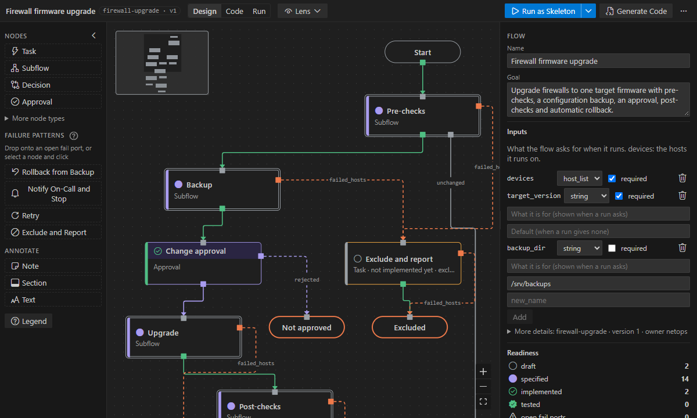
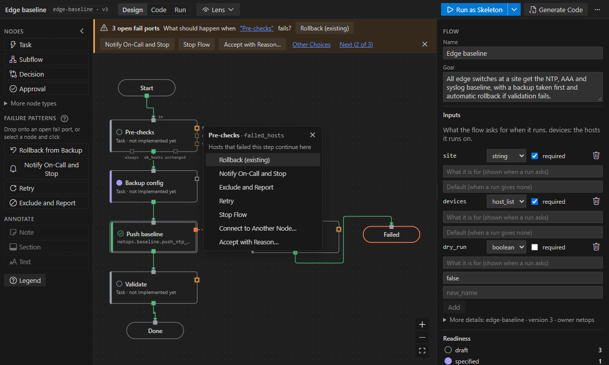
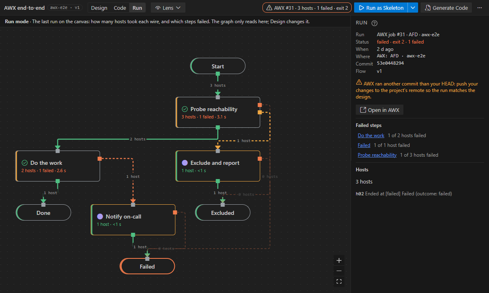
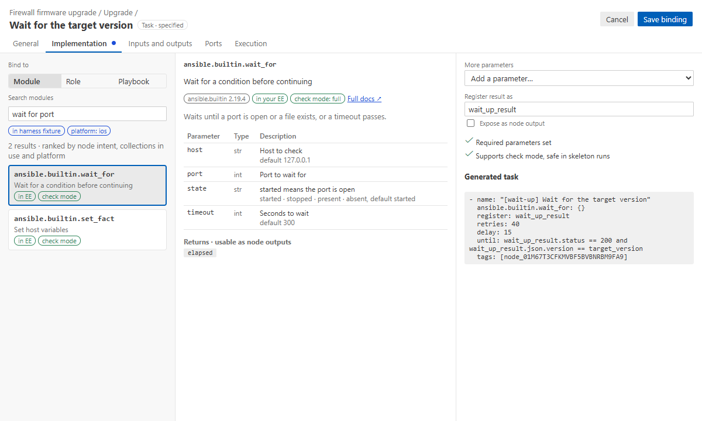

<h1 align="center">Ansible Flow Designer</h1>

Design Ansible automation as a diagram in VS Code. Draw the steps and decide what
happens when each one fails; the extension writes the playbook and runs it.

## Why

- **The diagram is the source.** A flow is a YAML file (`*.flow.yaml`) in your repository. The
  playbook is generated from it on every save, and edits to the code are shown as drift, not lost.
- **Failure paths are designed, not forgotten.** Every step has a `failed_hosts` port, and the
  flow is not done until each one is handled or kept open with a reason.
- **It runs before the code exists.** A new flow runs as a skeleton in check mode. You then bind
  each step to a module, a role or a playbook, one at a time.

## Main features

- **Top-down canvas:** steps, decisions, approvals, parallel branches and subflows, with notes
  and sections that explain the flow.
- **Failures in one click:** rollback from backup, notify on-call and stop, exclude and report,
  retry.
- **Bind steps** to modules, roles and playbooks from your execution environment's catalog, with
  their docs. Pass data between steps with `@`, and let whoever runs the flow set a step's
  retries, delay or timeout.
- **Design versus code:** Code mode compares the flow with the code it runs and fixes drift in
  either direction.
- **Run** locally (check mode, or for real and audited) or in AWX with approvals. Run mode shows
  where every host went.
- **Lenses** over the whole flow: inventory, data, code, access, timing, and changes since a
  commit.
- **Bring what you have:** import playbooks and AWX workflows. AI assistants (Copilot, Claude Code
  and others) build and fix flows through flow tools. Export to draw.io, and run scenario tests in
  CI.

| Handle a failure                                                            | See where every host went                                                  |
| --------------------------------------------------------------------------- | -------------------------------------------------------------------------- |
|                  |             |
| **Bind a step to a module**                                                 | **Design versus code**                                                     |
|  |  |

## Get started

1. Install the extension. Designing needs nothing else; runs need ansible-core 2.19 or later in
   an execution environment image, WSL or a local venv (**Set Up Ansible Environment…** helps).
2. Click the **Ansible Flows** icon in the Activity Bar, then **New Flow** (or **Open Sample
   Flow…** for a flow that already runs).
3. Add steps with **Add a Step** and **N**, answer the banner about failures, then **Run as
   Skeleton** on `localhost`.

The **[first tutorial](docs/guide/tutorials/01-first-flow.md)** takes 10 minutes. Then:

- **[The user guide](docs/guide/README.md)**, which also opens in VS Code (**Ansible Flow: Open
  User Guide**);
- **[every feature](docs/guide/reference/features.md)**;
- **[details](docs/details.md):** requirements, settings, repository layout and building from
  source.

Requires VS Code 1.140 or later. MIT licensed.
