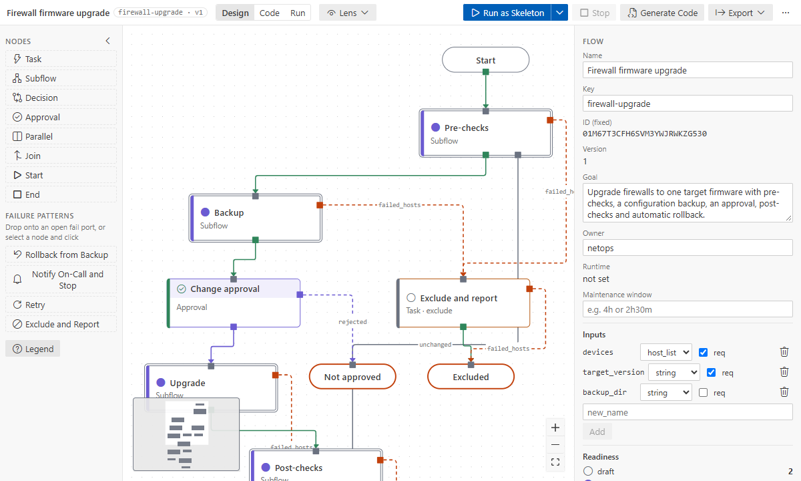

# Ansible Flow Designer — user guide

Ansible Flow Designer lets you design Ansible automation top-down, as a diagram. You draw the steps
and wire them port to port: `ok_hosts` to the next step, `failed_hosts` to a rollback. Then you run
the diagram as a walking skeleton before any code exists. Later you bind each step to a module, a
role or a playbook. The diagram is a YAML file (`*.flow.yaml`) in your repository, and the
playbooks are generated from it.

## Start here

- New to the designer? Follow **[Tutorial 1: your first flow](tutorials/01-first-flow.md)** (15
  minutes, no Ansible needed until the last step).
- Prefer to click through? **Ansible Flow: Get Started** in the Command Palette opens the
  walkthrough on VS Code's Welcome page.
- Want something to look at first? **Ansible Flow: Open Sample Flow…** copies a sample into your
  folder.

## Tutorials

| Tutorial                                                             | You will                                                                                  | Time   |
| -------------------------------------------------------------------- | ----------------------------------------------------------------------------------------- | ------ |
| [1. Your first flow](tutorials/01-first-flow.md)                     | create a flow, add steps, handle failures, use a subflow, run a skeleton                  | 15 min |
| [2. From design to production](tutorials/02-design-to-production.md) | bind modules, pass data between steps, poll a device, compare with the code, run for real | 30 min |
| [3. AWX end to end](tutorials/03-awx-end-to-end.md)                  | set up a template, run approvals as an AWX workflow, follow the run, import a workflow    | 30 min |
| [4. With an AI assistant](tutorials/04-ai-assistant.md)              | let Copilot or Claude Code build and fix a flow                                           | 20 min |

## How-to pages

**Designing**
- [Canvas basics: levels, menus, keyboard shortcuts](how-to/canvas-basics.md)
- [Ports and failure patterns](how-to/ports-and-failure-patterns.md)
- [Subflows](how-to/subflows.md)
- [Decisions, parallel branches, approvals and ends](how-to/control-flow.md)
- [Copy and paste nodes](how-to/copy-paste.md)
- [Hand-written YAML and Complete IDs](how-to/hand-written-yaml.md)
- [Export as draw.io or an image](how-to/export.md)

**Implementing**
- [Bind a step to a module, role or playbook](how-to/binding-and-catalog.md)
- [Data between steps](how-to/data-between-steps.md)
- [Retries and polling](how-to/polling-and-retries.md)
- [Generated code](how-to/code-generation.md)
- [Implementation mode: design vs code](how-to/implementation-mode.md)
- [Lenses](how-to/lenses.md)

**Running**
- [Runs and environments](how-to/runs-and-environments.md)
- [Approvals](how-to/approvals.md)
- [AWX](how-to/awx.md)
- [Import playbooks and AWX templates](how-to/import.md)

**AI and setup**
- [AI assistants](how-to/ai-assistants.md)
- [Settings](how-to/settings.md)

## Reference

- [Commands](reference/commands.md)
- [Settings](reference/settings.md)
- [Problem codes](reference/problems.md)
- [Flow file format](reference/flow-format.md)
- [Troubleshooting](troubleshooting.md)

## Words used in this guide

| Word                | Meaning                                                                                                                  |
| ------------------- | ------------------------------------------------------------------------------------------------------------------------ |
| **flow**            | One `*.flow.yaml` file: the diagram, its inputs and its decisions                                                        |
| **node** / **step** | A box on the canvas: task, subflow, decision, approval, parallel, join, start or end                                     |
| **port**            | Where hosts leave a node (`ok_hosts`, `failed_hosts`, `unreachable`, `true`, `approved`, …) or enter it (`in`)           |
| **wire**            | Hosts that leave one port go to the next node                                                                            |
| **fail port**       | A port for hosts that failed: `failed_hosts`, `unreachable`, `timeout`, `rejected`. Each one needs a handler or a reason |
| **level**           | The top of the flow, or the inside of a subflow                                                                          |
| **binding**         | The module, role or playbook a step runs                                                                                 |
| **skeleton run**    | `ansible-playbook --check` of the generated code; unbound steps print TODO                                               |
| **status**          | draft → specified (has inputs or outputs) → implemented (bound) → tested (a real run passed)                             |
