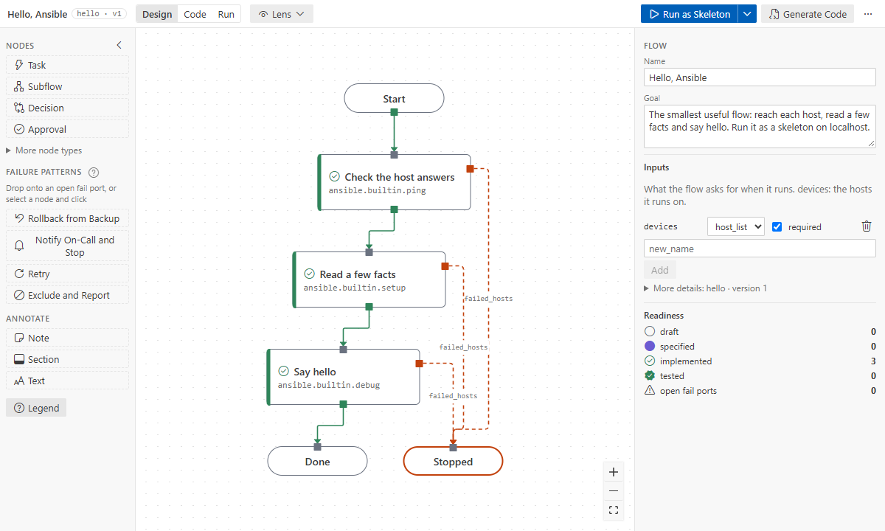

# How flows work

A flow is a diagram of steps that the extension turns into an Ansible playbook. This page explains
what happens to your hosts on the way, with the **Hello, Ansible** sample (**Open Sample Flow…** →
**Hello, Ansible**). Back to the [guide](../README.md).



## Hosts travel along wires

A run starts with the hosts of the flow's `devices` input at **Start**. Every step sends each host
out through one **port**, by what happened to it:

- `ok_hosts`: the step succeeded on the host;
- `failed_hosts`: it failed;
- optional ports a step can have: `unreachable`, `unchanged`, `always`, `timeout`.

A **wire** takes the hosts of one port to the next step. Hosts that leave **Check the host
answers** by `ok_hosts` arrive at **Read a few facts**. Those that fail go to **Stopped**, an end
node whose outcome is failed. So every step decides, per host, where that host goes next. A
**decision** routes hosts on a condition, and an **approval** waits for a person.

A port with no wire is **open**. An open fail port means hosts that fail there have nowhere to go,
so they fail the run. The banner asks what should happen. Wire it to a handler with a failure
pattern, or keep it open with **Accept with Reason…**.

## A step is a play

In the file, a step is a few lines of YAML. Here is the first step of Hello (IDs left out):

```yaml
- key: ping
  type: task
  title: Check the host answers
  intent: "Ping each host: Ansible can reach it and run Python there."
  impl:
    kind: module
    ref: ansible.builtin.ping
```

Saving writes `generated/hello.yml` next to the flow, with **one play per step**. The play runs the
step's module and then sorts each host into a group named after the port it leaves by. The next
step's play runs on that group:

```yaml
- name: "[ping] Check the host answers"
  hosts: "{{ devices if devices is string else devices | join(',') }}"
  tasks:
    - block:
        - ansible.builtin.ping: {}
          register: ping_result
        - ansible.builtin.group_by:
            key: flow_ping_ok_hosts
      rescue:
        - ansible.builtin.group_by:
            key: flow_ping_failed_hosts

- name: "[facts] Read a few facts"
  hosts: flow_ping_ok_hosts
```

A wire is a group: the hosts in `flow_ping_ok_hosts` are the ones that took the wire from
`ok_hosts`. A step that fails on a host does not stop the play: the `rescue` sorts the host into
`failed_hosts`, and the flow decides where it goes.

## Failures end in the outcome

After every step ran, a last play, the **outcome**, fails each host that ended on an open port or
at an end node whose outcome is failed, with a message naming where it stopped. The run succeeds
only for hosts that reached a success end such as **Done**. Failures are handled where you drew
them, and nothing fails silently.

## Levels are playbooks

A **subflow** is a step with its own inner steps: a level of its own. Each level is one playbook
in `generated/`, and the level above imports it. The canvas shows one level at a time; open a
subflow by double-clicking it. See [subflows](../how-to/subflows.md).

## A skeleton run works before there is code

A step with no binding yet (no module, role or playbook) becomes a play that prints
`TODO: <intent>` and succeeds. So a new flow runs from the first minute.

**Run as Skeleton** runs the generated playbook with `ansible-playbook --check` in your Ansible
environment. Steps without code print their TODO, and bound modules run in check mode, so nothing
changes on the hosts. **Run mode** then shows how many hosts took each wire. Hello's steps are
already bound to builtin modules, so its skeleton run on `localhost` says hello for real.

## Design and code stay apart

You change the flow; the extension rewrites `generated/` on every save, so never edit those files.
The flow is the source of truth in Git. Every generated play is tagged with its step's ID, so
runs, problems and Code mode map back to the steps. To do more in a step, bind it to a module, a
role or a playbook of your own ([binding](../how-to/binding-and-catalog.md)).

**Next:** [Tutorial 2](../tutorials/02-design-to-production.md), or the
[glossary](../reference/glossary.md) for the words used here.
