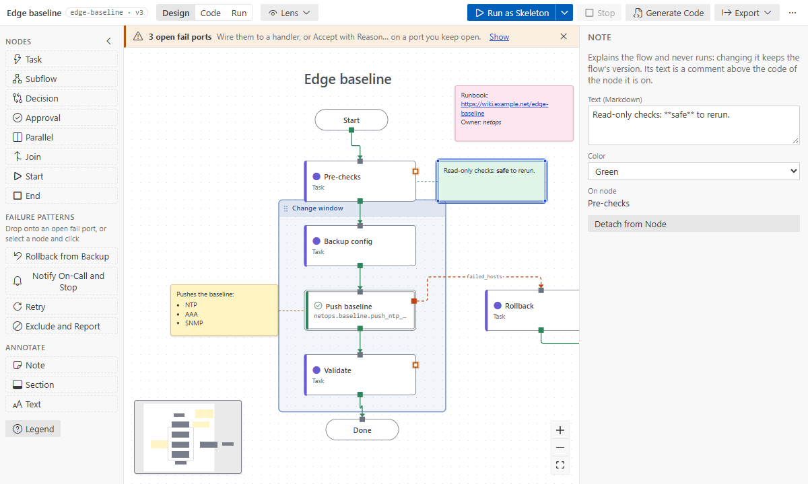

# Notes, sections and text

Explain a flow on the canvas: why a step is safe to rerun, which steps make up the change window,
where the runbook is. Annotations never run, and changing them never changes the flow's version or
makes a tested step untested. They need flow format 2 (**Upgrade Flow Format** moves a format 1
flow there).

## The three kinds

- **Note**: a sticky card. A note **on a node** is tied to it by a dashed line: it moves with the
  node (Tidy Up included), is copied, extracted and deleted with it, and its text becomes a comment
  above that step's code.
- **Section**: a titled region behind the steps, such as "Pre-checks" or "Change window". Drag it
  by its **title bar** (the strip across its top, with a grip): the steps and annotations wholly
  inside move with it, in one undo step. Nothing records what is inside; it is read from where
  things are when you drag. The rest of a section lets clicks through, so you can still pan and
  select the steps on it; the arrow keys move a selected section alone.
- **Text**: a heading or caption with no background, small, medium or large.

## Add one

- The palette's **Annotate** group: click Note, Section or Text, or drag one onto the canvas.
  A click puts it in free space near the middle of the view; with steps selected, **Section**
  is drawn around them. Drop a Note on a node to tie it to that node.
- Select several steps and right-click one: **Add Section Around**.
- Right-click the canvas: **Add Note Here**, **Add Section Here**, **Add Text Here**.
- Right-click a node: **Add Note to This Node**.
- Shift+N: a note on the selected node, else where the pointer is.

The new annotation opens for typing.

## Write and change it

Double-click it, press Enter or F2 with it selected, or use **Edit Text** in its menu. Type
Markdown:

| Write                                                           | Shows                             |
| --------------------------------------------------------------- | --------------------------------- |
| `**safe**`                                                      | **safe**                          |
| `*then*`                                                        | _then_                            |
| `` `show ntp` ``                                                | `show ntp`                        |
| `- NTP` on its own line                                         | a bullet list                     |
| `[runbook](https://wiki.example.net/ntp)` or a bare `https://…` | a link that opens in your browser |

Ctrl+Enter, or clicking elsewhere, saves (one undo step); Esc leaves it as it was. Only web links
(`http`, `https`) become links.

With one annotation selected, the side panel shows its text, color, size (Text) and the node a
note is on, with **Attach to Node…** or **Detach from Node**. Its menu adds **Color ▸**, Cut, Copy,
Duplicate and Delete. Drag a corner to resize a note or a section.

## Hide them for a while

**…** › **Hide Annotations** takes them off the canvas for you only; the file keeps them, and
**Show Annotations** brings them back. Under a lens and in Run mode they fade so the flow speaks.
In Code and Run modes, and on a shared subflow's level, they are read-only.

## In reviews, pictures and code

- The [Changes lens](lenses.md#compare-with-head-changes) outlines the annotations added or
  changed since the version you compare with and lists those removed.
- [Exports](export.md) to draw.io and images include them.
- A note on a step becomes `# Note:` comments above that step's play in the
  [generated code](code-generation.md).

## In the file

They live per level: `annotations:` next to `nodes:` (and `subflow.annotations` inside a
subflow). See [Hand-written YAML](hand-written-yaml.md#notes-sections-and-text) for an example, and
the [flow file format](../reference/flow-format.md) for every field. AI assistants add and change
them with `annotate` and `update_annotation`.
