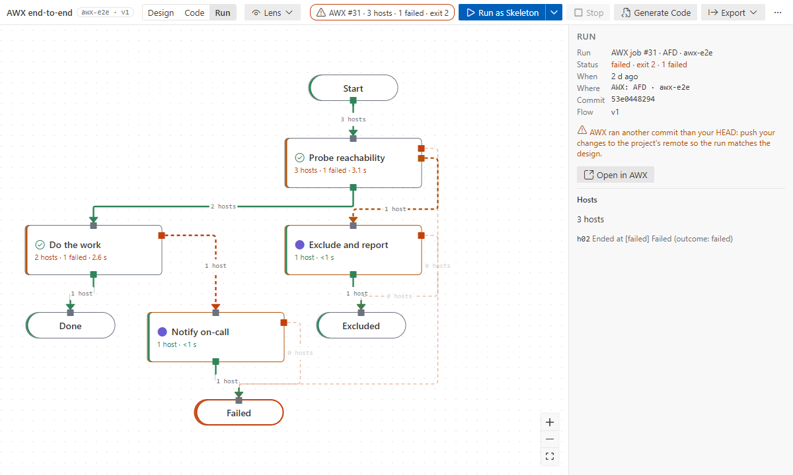

# AWX

Run flows in AWX (or the automation controller of Ansible Automation Platform) and follow them on
the canvas. Step by step: [Tutorial 3](../tutorials/03-awx-end-to-end.md).

## Connect

- `afd.awx.url`: your AWX, e.g. `https://awx.example.net`. `afd.awx.verifyTls` (default on): turn
  it off only for a lab with a self-signed certificate.
- **Ansible Flow: Set AWX Token**: a personal access token (Users → Tokens in AWX). It is checked
  against AWX and kept in VS Code's SecretStorage only. **Clear AWX Token** removes it.

## Set up the template

**Ansible Flow: Set Up AWX Template**, once per flow:
1. Pick the AWX project that holds this repository, an inventory, an execution environment
   (ansible-core 2.19+) and credentials. In a format 2 flow that already names its credentials and
   execution environment (`flow.runtime`), those are used and only the rest is asked.
2. The extension creates or updates the job template `AFD · <flow key>` for the generated
   playbook. A flow with top-level approvals gets a workflow of segment templates instead
   ([approvals](approvals.md)).
3. It writes the name to `flow.runtime`; a format 2 flow also keeps the credentials and the
   execution environment there, by name. One set per template: a format 2 flow has no credential
   or environment on a node (the upgrade moves them to the flow).

AWX runs what its project checks out: commit and push the flow and `generated/` first. If AWX does
not find the playbooks, the setup stops and names them.

## Launch

**Launch in AWX** (under the arrow of **Run as Skeleton** in the top bar, or the Command Palette):
- asks for the flow inputs, then confirms the targets and the commit;
- warns when AWX would run another commit than your HEAD (unpushed or uncommitted changes);
- launches with the inputs as extra vars and follows the job's events until it ends.

**Stop** in the top bar (or **Ansible Flow: Stop Run**) cancels the job or workflow in AWX; the
run panel follows it until AWX reports it canceled.

While it follows the job, a notification shows **Following AWX job …** with a **Cancel** button.
Cancelling, or 12 hours without the job ending, stops following only: the job keeps running in
AWX, and a message offers **Cancel It in AWX** or **Open in AWX**. AWX keeps a job's extra vars in
its record, so avoid secret flow inputs for AWX launches until surveys keep them masked.

## Follow the run

**Run** mode shows the last run, AWX or local, read-only:
- nodes: "3 hosts · 1 failed · 2.1 s", coloured ok, warn (some hosts took a fail port), failed (a
  failure was not routed), or dimmed when not reached;
- wires: how many hosts took them;
- select a node for each host and the port it left by; select a wire for its hosts;
- with nothing selected, the run panel shows the job, status, commit, flow version, failed hosts
  and **Open in AWX**.

## Mark tested

After a passing real run of the current flow version (exit 0, every failure routed, no failed end),
the run panel offers **Mark N nodes tested**. In a format 2 flow each of them keeps the run (its
id, the flow version and, from AWX, the commit). A tested node whose design changes later goes
back to `implemented`. Without such a run, a node can be marked tested by hand with a reason
([canvas basics](canvas-basics.md#nodes)).

In a format 2 flow the runtime is worked out from the flow: AWX when it names a template (Set Up
AWX Template writes it), a workflow when approvals split it, else a job.

## Lenses for AWX

The **Access** lens shows the credentials each node runs with (in a format 2 flow, the flow's) and
flags credentials that only AWX can use.
The **Timing** lens uses real-run durations ([lenses](lenses.md)).
