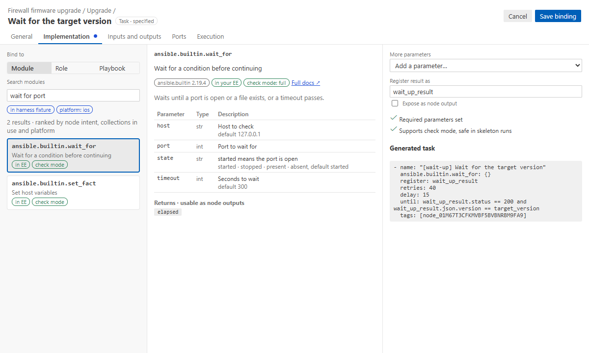

# Bind a step to a module, role or playbook

A step without a binding runs as a TODO message, which is fine while you design. Binding it says
what it really runs. Select the node and click the gear in the inspector, or right-click → **Bind
implementation…**. The properties page opens over the canvas, on **Implementation**.

## Find

Choose **Module**, **Role** or **Playbook**.
- **Modules** come from your environment's catalog. The search starts from the node's intent and
  ranks results by your words, `ansible.builtin`, the collections the repository already uses and
  the inventory's platform (`ansible_network_os`).
- Badges: _in EE_, _check mode_, _diff_, _read-only_, _other platform_ (dimmed), _deprecated_.
- **Roles** come from your `roles_path`, with their `meta/argument_specs.yml`; **playbooks** from
  the repository.

The first search in a folder reads every collection's docs from the environment
(`ansible-doc --metadata-dump`, about 30 seconds for a full execution environment). After that,
searches take milliseconds. **Ansible Flow: Rebuild Module Catalog** reads them again after you
install collections.

## Understand

The middle column shows what you picked:
- **a module:** its docs, the parameter table, the returns (click one to make it a node output)
  and an example;
- **a role:** its entry points and argument spec;
- **a playbook:** its plays and the hosts they target.

## Configure

The right column is a form from the argument spec: choices, booleans, one line per list item, YAML
for dicts. Required and already-set parameters come first.

- **Values are Jinja.** A value that is only `{{ name }}` shows as a purple **input chip**. Type `@`
  (or use the @ button) to insert one. Choosing a flow input, an upstream output, the subflow's
  input or a step inside an earlier subflow that is not an input yet adds it, with its `from:`
  ([data between steps](data-between-steps.md)).
- **Register result as** names the variable the module result is registered in (default
  `<key>_result`). **Expose as node output** makes the whole result an output.
- **The checklist** shows required parameters, where each variable comes from, check mode support
  and deprecation.
- **Generated task** shows the task exactly as the playbook will run it.

**Save binding** writes the binding, the inputs and outputs it added, and the status `implemented`
in one undo step. Renaming an input later rewrites the parameters that read it.

## Playbook bindings

A step bound to a playbook imports it with `afd_hosts` set to the hosts that arrive. Its plays
should target `"{{ afd_hosts }}"`; the checklist says whether they do. Only `ok_hosts` can be routed
for a playbook: hosts that fail inside it stop there.

## Role limits

Ansible gives no per-host "changed" or "unreachable" for a role, so `unchanged` and `unreachable`
on a role step never fire, and the validator says so. Put such a check in its own module step.

See also: [Implementation mode](implementation-mode.md) for design vs code drift,
[generated code](code-generation.md).
