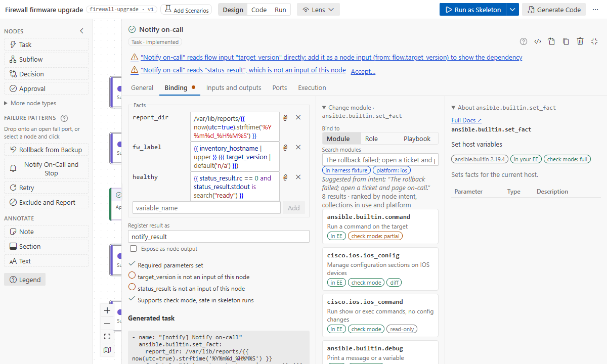
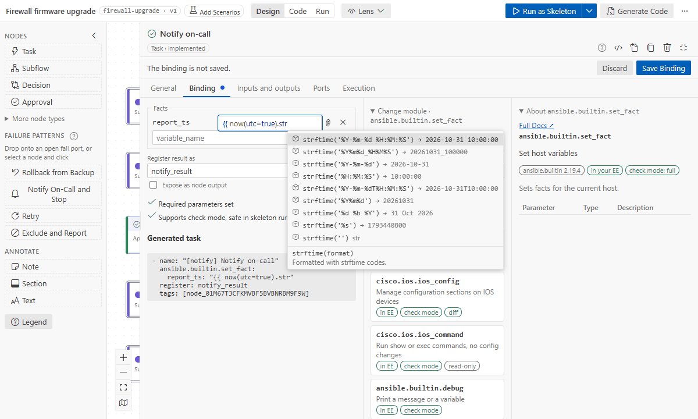

# Bind a step to a module, role or playbook

A step without a binding runs as a TODO message, which is fine while you design. Binding it says
what it really runs. Select the node and open the **Binding** tab of its Details (right panel), or
right-click → **Binding…**.

- **A step without a binding** shows **Find** first.
- **Once something is chosen**, **Configure** comes first, so its parameters are the first thing
  in the panel. Two folds follow:
  - **Change module** holds Find. It opens by itself while you choose another module, and when the
    bound one is a problem (not in the environment, removed, moved or deprecated).
  - **About** holds its docs.
- **Expand** (top right of the Details) widens the panel so the three sit side by side, with both
  folds open.
- **The panel's left edge** has a grip; drag it to widen the panel.


## Find

Choose **Module**, **Role** or **Playbook**.
- **Modules** come from your environment's catalog. The search starts from the node's intent and
  ranks results by your words, `ansible.builtin`, the collections the repository already uses and
  the inventory's platform (`ansible_network_os`).
- Badges: _in EE_, _check mode_, _diff_, _read-only_, _other platform_ (dimmed), _deprecated_.
- **Roles** come from your `roles_path`, with their `meta/argument_specs.yml`; **playbooks** from
  the repository.

The first search in a folder reads every collection's docs from the environment
(`ansible-doc --metadata-dump`, about 30 seconds for a full execution environment). After that,
searches take milliseconds. **Ansible Flow: Rebuild Module Catalog** reads them again after you
install collections.

## About

The **About** fold shows the docs of what you picked, with **Full Docs** at its top for a module:
- **a module:** its docs, the parameter table (**+** on a row adds that parameter to Configure),
  the returns (click one to make it a node output) and an example;
- **a role:** its entry points and argument spec;
- **a playbook:** its plays and the hosts they target.

## Configure

A form from the argument spec: choices, booleans, one line per list item, YAML for dicts.

- **Required** lists the parameters the module needs.
- **Optional** lists those with a value, and those you added.
- **Add a parameter** finds the others by name, alias or what they do (type `line`, or
  `permissions`), each with its description. Arrows move, Enter adds it, Escape closes. **+** in
  the docs table adds one too.

- **Values are Jinja.** A value that is only `{{ name }}`, or a field of it such as
  `{{ read_version_result.stdout }}`, shows as a purple **input chip**. Type `@` (or use the @
  button) to insert one where the cursor is; selected text is replaced. Choosing a flow input, an upstream output, the subflow's
  input or a step inside an earlier subflow that is not an input yet adds it, with its `from:`
  ([data between steps](data-between-steps.md)). After a step's result, the list offers the fields
  its module documents; `.` typed right after a result's chip offers them too.
- **Jinja is coloured and completed** as the editor colours and completes it, in every field that
  takes Jinja (see below).
- **set_fact** shows the facts it sets under **Facts**, one row each (a list or a dict as YAML);
  its doc's `key_value` stands for them, so it is neither asked for nor a problem.
- **Register result as** names the variable the module result is registered in (default
  `<key>_result`). **Expose as node output** makes the whole result an output.
- **The checklist** shows required parameters, where each variable comes from, check mode support
  and deprecation.
- **Generated task** shows the task exactly as the playbook will run it.

The binding is staged: while it differs from the file, a bar at the top of the Details says so,
with **Discard** and **Save Binding**. Saving writes the binding, the inputs and outputs it added,
and the status `implemented` in one undo step. Renaming an input later rewrites the parameters that
read it. Leaving an unsaved binding asks whether to keep editing, discard it or save it. Leaving
means Esc, another node, another level or mode, hiding the side panel, or the lens tab. Turning a
lens on keeps the Details open while a binding is unsaved. Esc in a field only reverts that field. Every other field of the
Details saves as you leave it.

While the flow file has YAML errors or missing IDs, the Details are read-only; fix the text first (**Open in Text Editor**).

## Jinja in fields

Parameter values, list items, variables and facts, the Timing fields, the Task keywords box, a
decision's Condition and Until show their Jinja in VS Code's default colours: delimiters,
variables, functions and filters, strings, numbers and keywords, and the `%` codes of a date
format.



The same step in the [dark](../images/jinja-colours-dark.png) and
[high contrast](../images/jinja-colours-hc.png) themes.

Inside `{{ }}`, ``, or a field that is a test without braces, a list opens as you type:

| After               | The list offers                                                                                                                |
| ------------------- | ------------------------------------------------------------------------------------------------------------------------------ |
| the start of a name | the step's variables (as `@` does), Ansible's (`inventory_hostname`, `hostvars`…), `now()`, `lookup()` and the other functions |
| `\|`                | filters: Jinja's, ansible.builtin's and those of the collections in the catalog                                                |
| `is`, `is not`      | tests                                                                                                                          |
| `.`                 | a value's members: a result's fields, a string's methods, a date's `strftime`                                                  |
| `strftime('`        | date formats and `%` codes, each with what it gives now                                                                        |
| `lookup('`          | lookup plugins                                                                                                                 |



- **Keys:** the arrows move, Enter or Tab puts the choice in, Esc closes the list (the field keeps
  your typing). Ctrl+Space opens the list anywhere in the Jinja. Ctrl+Z takes a choice back.
- **Help:** under the list, the chosen entry's signature and what it does. With the cursor inside
  a call (`now(`, `lookup('env', `), a line under the field shows its arguments, the one you are
  typing in bold, and for a date format what it gives now. Rest the pointer on a function, filter,
  test or `%` code to see its help.
- **Braces:** choosing a name inside `{{` that is not closed yet adds ` }}`. A variable that is not
  an input of the step yet becomes one, as with `@`.
- **Inside quotes in the YAML box,** a quote is put in as YAML writes it there (`''` in `'…'`).

## Task keywords

The **Execution** tab has a fold of its own, **Task keywords**: a YAML map written on the generated
task as is, for what a playbook task would say. Examples: `when`, `loop` (or `with_items`),
`ignore_errors`, `changed_when`, `failed_when`, `delegate_to`, `run_once`, `no_log`,
`become_user`, `environment`. Imported playbooks keep their tasks' keywords here.

- **One click for the common ones:** `+ no_log`, `+ ignore_errors` and `+ run_once` add their line
  and save it; `+ when`, `+ loop`, `+ delegate_to` and `+ changed_when` add theirs and put the
  cursor where the value goes. A keyword already set has its button greyed out.
- **The box helps as an editor does:** keys, strings, values and comments are coloured, and the
  Jinja in values too (`when`, `changed_when` and `failed_when` as tests), with the completion list
  of [Jinja in fields](#jinja-in-fields); the line a YAML error names is underlined while you type
  (nothing is saved until you leave the box); Enter keeps the indent, indents after `loop:`,
  continues a list after `- item`, and ends the list on an empty item.

```yaml
when: version_check.stdout is version('17.9', '<')
loop: "{{ uplinks }}"
```

- **Hosts a condition skips**, and hosts whose failure `ignore_errors` lets pass, leave through
  `ok_hosts`.
- **Variables are checked like parameters:** a keyword that reads a variable no input gives is a
  problem. `when`, `changed_when` and `failed_when` are tests without braces. Loop variables and
  the keywords' own `vars` count as known.
- **What the flow models itself** is refused, with where it goes instead:
  - `register` is _Register result as_;
  - `tags`, `become`, `timeout`, `retries`, `delay` and `until` are the settings above;
  - `notify` becomes a handler step with `when: <register> is changed`;
  - `block` and `rescue` become subflows and failure paths.
- **A role step** keeps `when` and `loop` on the role and applies the rest to every task in it;
  role variables belong in its parameters.
- **A playbook step** takes no keywords.

## Playbook bindings

A step bound to a playbook imports it with `afd_hosts` set to the hosts that arrive. Its plays
should target `"{{ afd_hosts }}"`; the checklist says whether they do. Only `ok_hosts` can be routed
for a playbook: hosts that fail inside it stop there.

## Role limits

Ansible gives no per-host "changed" or "unreachable" for a role, so `unchanged` and `unreachable`
on a role step never fire, and the validator says so. Put such a check in its own module step.

See also: [Code mode](code-mode.md) for design vs code drift,
[generated code](code-generation.md).
