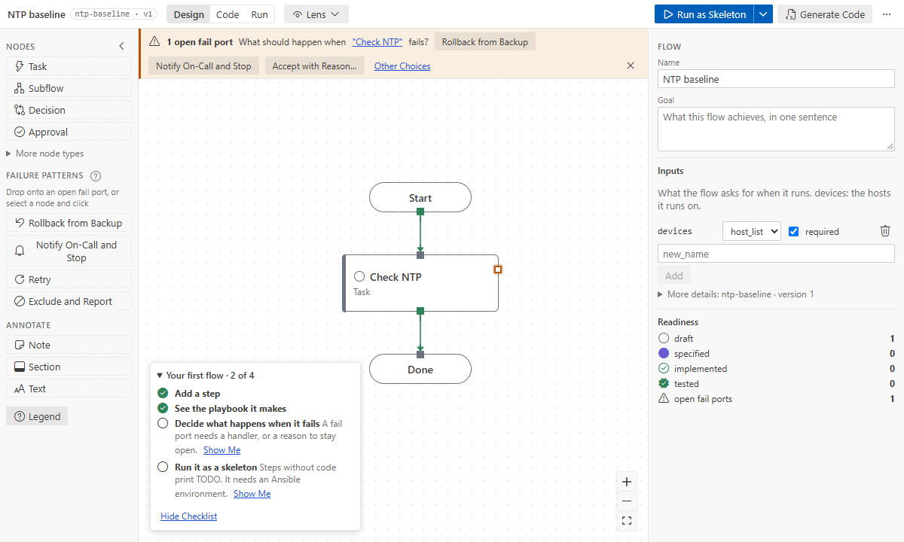

# Canvas basics

A `*.flow.yaml` file opens in the **Ansible Flow Designer** editor. The canvas shows one level at a
time: the top of the flow, or the inside of one subflow.

## The screen

- **Top bar:**
  - the breadcrumb;
  - the mode toggle: **Design**, **Code** (design vs code) and **Run** (the last run); each says in
    its tooltip what it is for;
  - the **Lens** dropdown, once the flow has a step;
  - the same actions in every mode: **Run as Skeleton** (with **Run for Real…**, **Run Scenarios**
    and **Launch in AWX** under its arrow; while a run goes the button is **Stop**), **Generate
    Code**, and a "…" menu with _Tidy Up_, _Open in Text Editor_, _Check Flow_, _Find Node…_,
    _Export as draw.io Diagram…_, _Export as Image…_, the panel switches, _Keyboard Shortcuts_ and
    _User Guide_. What cannot run now is greyed out; its tooltip says why.
- **Palette** (left, Design mode): the node types a first flow needs (Task, Subflow, Decision,
  Approval; Parallel, Join, Start and End under **More node types**), the failure patterns once
  the level has a step that can fail, and annotations. **? Legend** shows what the port and wire
  styles mean and what each port is for. The arrow at its top folds it to icons for a wider canvas.
  Code and Run modes read the graph, so the palette folds away there.
- **Folds:** rarer fields sit behind a line that says what is inside (**More details**, **More node
  types**, Quick Add's **Extra ports**, each Execution group). A fold opens by itself when
  something in it is set or has a problem, and otherwise stays as you left it.
- **Canvas** (middle): nodes, ports and wires.
- **Messages** (bottom of the canvas): what **Generate Code**, **Check Flow**, **Tidy Up**, copy and
  paste came to. They close by themselves (errors stay longer); × closes one now. **Saving…** shows
  there while an edit waits for VS Code longer than a moment.
- **Right panel:** the flow (name, goal and inputs; key, ID, version, owner, runtime and
  maintenance window under **More details**; readiness once there is a step) when nothing is
  selected; the **Details** of the selected node (tabs General, Binding, Inputs and outputs, Ports,
  Execution; Code and Run modes add theirs); a selected wire (which hosts take it, and Insert,
  Rewire or Disconnect); or the selection panel for several nodes. Drag
  its left edge to resize it (or focus the edge and use the arrow keys); **Expand** in the Details
  widens it for the catalog docs. Double-click the edge (or press Enter on it), or "…" › _Hide Side
  Panel_, to fold it to a strip; its button brings it back.
- A level with only Start and End shows a card to begin: **Add a Step** (between Start and End), or
  a flow from playbooks, an AWX workflow or a sample; **Get Started** opens the walkthrough.
- **Your first flow** (bottom left, on a flow with one to five steps): four things that make a first
  flow, ticked as you do them: add a step, see the playbook it makes, decide what happens when it
  fails, run it as a skeleton. **Show Me** does each, or opens where it is done. **Hide Checklist**
  hides it for good; "…" › _Show First-Flow Checklist_ brings it back.
- **"?"** beside the Details tabs and some panel titles opens the guide page about them.

The **Ansible Flows** icon in the Activity Bar lists the flows in the workspace; with no folder or
no flow yet it offers Open Folder, New Flow, Open Sample Flow, Import Ansible Playbooks and Get
Started.

## Keep a warning as it is

Some warnings are known and fine: a binding reads a variable that `group_vars` sets, for example.
In a format 2 flow, **Accept…** next to the warning in the node's Details, or **Accept with
Reason…** on it in the Problems panel, asks why and records it in the flow (with your Git user
name); the warning stops showing for that node and that variable. Remove the decision from
`decisions:` to see it again. A format 1 flow offers Upgrade Flow Format first.

## Find a node

**Ctrl+F** (or "…" › _Find Node…_, or right-click the canvas) opens a box at the top right of the
canvas. It searches every level by title, key or binding (a module, role or playbook); each result
says which subflows it is in. The arrow keys move through the results and **Enter** shows one,
opening its subflow; the box stays open for the next one. **Esc** closes it and leaves the node
selected.

**Filters** narrow the search, alone or with words. They list matching steps on every level at
once:

| Filter                           | Finds                                                                                                                             |
| -------------------------------- | --------------------------------------------------------------------------------------------------------------------------------- |
| `status:draft`, `status:tested`… | steps with that status (a draft is not implemented yet)                                                                           |
| `type:approval`, `type:decision` | steps of that type (`task`, `subflow`, `decision`, `approval`, …)                                                                 |
| `open:fail`                      | steps with a fail port nobody handles                                                                                             |
| `has:no-binding`                 | tasks not implemented yet (no module, role or playbook); with one filter, Find says what it lists ("4 steps not implemented yet") |
| `has:binding`, `has:errors`      | steps bound to a module, role or playbook; steps with an error                                                                    |
| `tag:backup`, `target:core`      | steps with that tag; steps whose inventory target matches                                                                         |

Two values of one filter mean either (`type:task type:approval`). The box offers the filters while
it is empty and completes the one you type. In the flow panel, each **Readiness** count opens Find
with its filter (`status:draft`, `open:fail`).

## Nodes

| Type           | Use it for                                                      |
| -------------- | --------------------------------------------------------------- |
| task           | one unit of work: a module, a role or a playbook                |
| subflow        | a phase with its own inner steps (a level)                      |
| decision       | split hosts by a condition: `true` / `false`                    |
| approval       | a person decides: `approved` / `rejected`                       |
| parallel, join | branches that run side by side, and where they meet             |
| start, end     | where hosts enter and where they finish (`success` or `failed`) |

A node's **status** is shown by its stripe and icon: draft, specified (has inputs or outputs),
implemented (bound to code; a decision once it has its condition, an approval, parallel or join as
it is), tested (a passing real run, or set by hand with a reason). In a format 2 flow the status
follows what the node has: binding a step makes it implemented, removing its inputs and outputs
makes it draft again, and a subflow is as far as its least finished step. The one thing set by
hand is **Mark Tested…** (the Lifecycle in its Details, or its menu): say why, and the reason is
kept on the node with your Git user name and the day, until its design changes; **Clear Tested**
takes it back. In a format 1 flow the Lifecycle and Status ▸ in the menu set any status by hand.

## Add, wire, move, delete

- **Add:**
  - click or drag a type from the palette; a click with one step selected adds the new one after
    it, wired, and on a flow with no steps yet it goes between Start and Done;
  - drag from a port and release on empty canvas (Quick add);
  - right-click the canvas → **Add Node Here…**;
  - or a port's **Insert Node on This Wire**, or drop a palette type onto a wire (it lights while
    you drag over it).

  
- **Wire:** drag from an output port to another node. One wire per output port; a node takes any
  number of wires in.
- **Move:** drag; arrow keys nudge the focused node. Positions go to the flow's `layout:` block.
  **Tidy Up** lays out the whole level. Nodes without a position (a new flow, or steps an AI agent
  added) are placed next to their neighbours until you move them.
  - While you drag a step, a dashed guide line shows when it shares an edge or a centre with
    another step; release near the line and it snaps there. "even gaps" shows when it sits halfway
    between its neighbours.
  - **Line up several:** select them, then **Align Centers** (Shift+Alt+A) or **Distribute
    Vertically** (Shift+Alt+D, three or more) in the side panel, or **Arrange ▸** in their
    right-click menu for the other edges and for spacing across. One Ctrl+Z puts them back.
  - **Reset Position** hands a step you placed back to automatic placement.
- **Delete:** Delete or Backspace. A whole selection is one undo step.
- **Select several:** Ctrl+click, or Shift+drag a box.

Every action is one small text edit: Ctrl+Z undoes it, and comments and formatting elsewhere in the
file never change.

## The right-click menu

Right-click a node, a selection, a wire, a port or the empty canvas.

- **Node:** Open Subflow, Details…, Binding…, Rename, Status ▸, one submenu per open
  fail port, Add Next Node…, Reset Position (a step you placed), Cut, Copy, Duplicate, Open in Text Editor, Peek Code, Delete.
- **Selection:** Cut, Copy, Duplicate, Extract into Subflow…, Arrange ▸ (align, distribute, Reset
  Position), Delete.
- **Note, section or text:** Edit Text, Color ▸, Attach to Node… or Detach from Node, Cut, Copy,
  Duplicate, Delete ([Notes, sections and text](annotations.md)).
- **Wire:** Insert Node on This Wire, Rewire to Another Node…, Disconnect.
- **Empty canvas:** Paste Here, Add Node Here…, Insert Shared Subflow…, Add Note Here, Add Section
  Here, Add Text Here, Select All, Tidy Up, Fit View, Up to Parent.

Shift+F10 or the Menu key opens it for the selection. Run mode only reads.

## Keyboard shortcuts

Press `?` for the sheet. Ctrl means ⌘ on macOS.

| Keys                     | Action                                                                                         |
| ------------------------ | ---------------------------------------------------------------------------------------------- |
| Ctrl+C / Ctrl+X / Ctrl+V | Copy, cut, paste nodes                                                                         |
| Ctrl+D                   | Duplicate the selection                                                                        |
| Delete / Backspace       | Delete the selection                                                                           |
| F2                       | Rename (the Title in the Details), or edit a note                                              |
| N                        | Add a node: after the selected one, else at the pointer (on its wire when it already leads on) |
| Shift+N                  | Add a note: on the selected node, else at the pointer                                          |
| Ctrl+Z / Ctrl+Y          | Undo / Redo                                                                                    |
| Enter                    | Open the selected subflow, or go to the node's Details                                         |
| Alt+↑                    | Back to the parent level                                                                       |
| Alt+1 / Alt+2 / Alt+3    | Design / Code / Run mode                                                                       |
| Ctrl+A                   | Select every node of the level                                                                 |
| Shift+Alt+A              | Line the selected steps up on the flow line (Align Centers)                                    |
| Shift+Alt+D              | Space three or more selected steps evenly, top to bottom                                       |
| Ctrl+F                   | Find a node on any level                                                                       |
| Shift+1                  | Fit the whole level in view                                                                    |
| Arrow keys               | Nudge the focused node                                                                         |
| Esc                      | Close the menu or dialog; else clear the selection                                             |
| Shift+F10                | Context menu for the selection                                                                 |
| Ctrl+F5 / Shift+F5       | Run as Skeleton / Stop Run                                                                     |
| Ctrl+Shift+B             | Generate Code                                                                                  |
| Shift+Alt+F              | Tidy Up                                                                                        |
| F7                       | Check Flow                                                                                     |

While the designer has the focus, Alt+1 to Alt+3 switch its modes instead of VS Code's editor tabs.

### With the keyboard only

- **Tab** walks the nodes of the level; the focused node is selected with Enter or Space.
- On the selected node, **Tab** goes on to its ports. **Enter** opens a port's menu, as a click
  does; the arrow keys and Enter choose in it.
- **Connect to Another Node…** and the other "pick a node" actions: **Tab** or the arrow keys show
  a node (dashed outline; the bar above the canvas names it), **Enter** wires it, **Esc** cancels.
- **Enter** on a selected node moves into its Details; the arrow keys switch the Details tabs and
  Tab goes on to the fields.
- Dialogs take the focus, keep Tab inside, and give the focus back where it was when they close.

The last four are VS Code keybindings, active while the designer has focus: change them in VS
Code's Keyboard Shortcuts ([commands](../reference/commands.md#keyboard)).

## Nodes and wires

- **Status:** a stripe on the node's left and an icon before its title: an empty circle for draft, a
  filled one for specified, a check for implemented, a seal for tested.
- **Under the title:** the module or role the node runs, or its kind while nothing is bound; a
  decision shows its condition.
- **Shapes:** subflows have a double border; decisions and approvals a coloured header; parallel
  and join are bars the branches leave from and meet at.
- **Wire labels:** a wire that leaves by a failure, a branch, a decision's answer, a timeout,
  `always` or `unchanged` is labelled with its port; the normal path is not. Hover or select a wire
  to see its port.
- **Wires round nodes:** a wire runs in steps from port to port. Where that would cross a node (a
  wire that skips a step, or one back up the flow), it goes round the nodes in its way instead,
  also while you drag one, and in exports. Wires into one port share their last stretch.

## Zoom

A level opens readable. When it fits at a zoom where titles are at least 11 px, you see all of it
(at 100% at most); otherwise it fits its width, starting at the top, and the minimap at the bottom
left shows where you are. **Fit View** (right-click the canvas, or the zoom controls) shows the
whole level. Zoomed far out, nodes show titles only; from 1.4×, summary rows. Select a node for its
Details on the right. Pause on a subflow or a bound node for a preview of what is inside.

New nodes without a position, and **Tidy Up**, follow the setting `afd.canvas.direction`: top to
bottom (`TB`, the default) or left to right (`LR`). It is yours, not the flow's.

## Text and the designer

**Open in Text Editor** opens the YAML next to the canvas. Both edit the same document, so save, dirty
state, undo, Git diff and hot exit are VS Code's own. `flow.version` goes up once per commit when
the design changes (not for layout moves).

While the text has YAML errors, the designer shows the last valid version **read-only**, with a
banner naming the error and **Open in Text Editor**. Fix the text and the designer edits again.

See also: [ports and failure patterns](ports-and-failure-patterns.md), [subflows](subflows.md),
[copy and paste](copy-paste.md).
