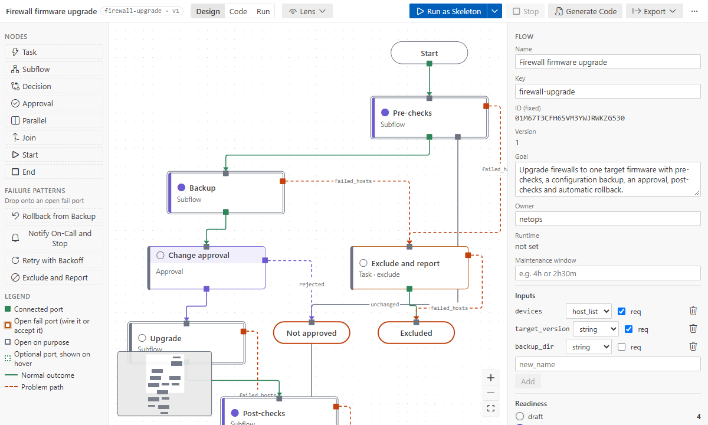
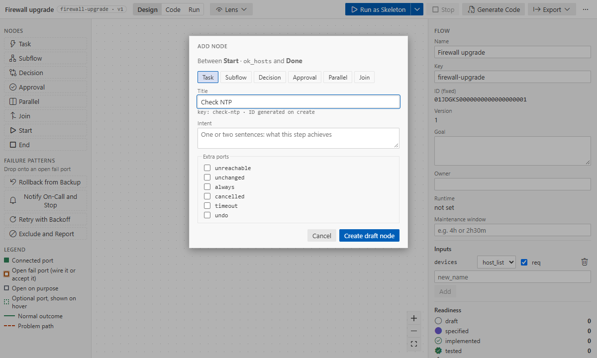
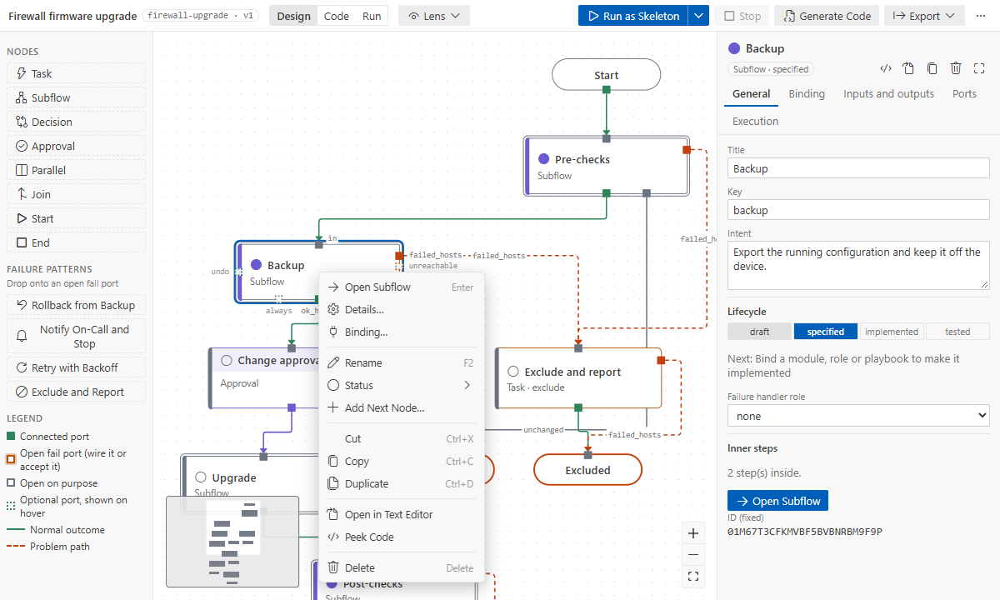
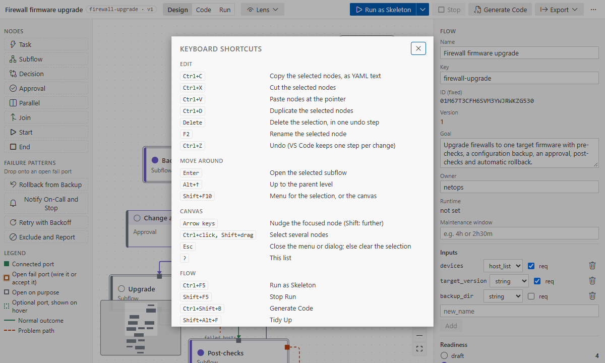

# Canvas basics

A `*.flow.yaml` file opens in the **Ansible Flow Designer** editor. The canvas shows one level at a
time: the top of the flow, or the inside of one subflow.

## The screen

- **Top bar:**
  - the breadcrumb;
  - the mode toggle: **Design**, **Code** (design vs code) and **Run** (the last run);
  - the **Lens** dropdown;
  - the same actions in every mode: **Run as Skeleton** (with **Run for Real…** and **Launch in
    AWX** under its arrow), **Stop**, **Generate Code**, **Export** ▾, and a "…" menu with _Tidy
    Up_, _Open in Text Editor_, _Check Flow_, _Keyboard Shortcuts_ and _User Guide_. What cannot
    run now is greyed out; its tooltip says why.
- **Palette** (left, Design mode): node types and failure patterns, and a legend of port and wire
  styles. Code and Run modes read the graph, so the palette folds away there.
- **Canvas** (middle): nodes, ports and wires.
- **Right panel:** the flow (name, goal, owner, maintenance window, inputs, readiness) when nothing
  is selected; the **Details** of the selected node (tabs General, Binding, Inputs and outputs,
  Ports, Execution; Code and Run modes add theirs); or the selection panel for several nodes. Drag
  its left edge to resize it (or focus the edge and use the arrow keys); **Expand** in the Details
  widens it for the catalog docs.

## Nodes

| Type           | Use it for                                                      |
| -------------- | --------------------------------------------------------------- |
| task           | one unit of work: a module, a role or a playbook                |
| subflow        | a phase with its own inner steps (a level)                      |
| decision       | split hosts by a condition: `true` / `false`                    |
| approval       | a person decides: `approved` / `rejected`                       |
| parallel, join | branches that run side by side, and where they meet             |
| start, end     | where hosts enter and where they finish (`success` or `failed`) |

A node's **status** is shown by its stripe and icon: draft, specified (has inputs or outputs),
implemented (bound to code), tested (a passing real run, or set by hand with a reason: choose
**tested** in the Lifecycle of its Details, or Status ▸ tested in its menu, and say why; the reason is
kept in the flow with your Git user name until the node's design changes).

## Add, wire, move, delete

- **Add:**
  - click or drag a type from the palette;
  - drag from a port and release on empty canvas (Quick add);
  - right-click the canvas → **Add Node Here…**;
  - or a port's **Insert Node on This Wire**.

  
- **Wire:** drag from an output port to another node. One wire per output port; a node takes any
  number of wires in.
- **Move:** drag; arrow keys nudge the focused node. Positions go to the flow's `layout:` block.
  **Tidy Up** lays out the whole level. Nodes without a position (a new flow, or steps an AI agent
  added) are placed next to their neighbours until you move them.
- **Delete:** Delete or Backspace. A whole selection is one undo step.
- **Select several:** Ctrl+click, or Shift+drag a box.

Every action is one small text edit: Ctrl+Z undoes it, and comments and formatting elsewhere in the
file never change.

## The right-click menu

Right-click a node, a selection, a wire, a port or the empty canvas.

- **Node:** Open Subflow, Details…, Binding…, Rename, Status ▸, one submenu per open
  fail port, Add Next Node…, Cut, Copy, Duplicate, Open in Text Editor, Peek Code, Delete.
- **Selection:** Cut, Copy, Duplicate, Extract into Subflow…, Delete.
- **Wire:** Insert Node on This Wire, Rewire to Another Node…, Disconnect.
- **Empty canvas:** Paste Here, Add Node Here…, Select All, Tidy Up, Fit View, Up to Parent.

Shift+F10 or the Menu key opens it for the selection. Run mode only reads.

## Keyboard shortcuts

Press `?` for the sheet. Ctrl means ⌘ on macOS.

| Keys                     | Action                                               |
| ------------------------ | ---------------------------------------------------- |
| Ctrl+C / Ctrl+X / Ctrl+V | Copy, cut, paste nodes                               |
| Ctrl+D                   | Duplicate the selection                              |
| Delete / Backspace       | Delete the selection                                 |
| F2                       | Rename (the Title in the Details)                    |
| Enter / Alt+↑            | Open the selected subflow / back to the parent level |
| Arrow keys               | Nudge the focused node                               |
| Esc                      | Close the menu or dialog; else clear the selection   |
| Shift+F10                | Context menu for the selection                       |
| Ctrl+F5 / Shift+F5       | Run as Skeleton / Stop Run                           |
| Ctrl+Shift+B             | Generate Code                                        |
| Shift+Alt+F              | Tidy Up                                              |
| F7                       | Check Flow                                           |

The last four are VS Code keybindings, active while the designer has focus: change them in VS
Code's Keyboard Shortcuts ([commands](../reference/commands.md#keyboard)).

## Nodes and wires

- **Status:** a stripe on the node's left and an icon before its title: an empty circle for draft, a
  filled one for specified, a check for implemented, a seal for tested.
- **Under the title:** the module or role the node runs, or its kind while nothing is bound; a
  decision shows its condition.
- **Shapes:** subflows have a double border; decisions and approvals a coloured header; parallel
  and join are bars the branches leave from and meet at.
- **Wire labels:** a wire that leaves by a failure, a branch, a decision's answer, a timeout,
  `always` or `unchanged` is labelled with its port; the normal path is not. Hover or select a wire
  to see its port.

## Zoom

A level opens readable. When it fits at a zoom where titles are at least 11 px, you see all of it
(at 100% at most); otherwise it fits its width, starting at the top, and the minimap at the bottom
left shows where you are. **Fit View** (right-click the canvas, or the zoom controls) shows the
whole level. Zoomed far out, nodes show titles only; from 1.4×, summary rows. Select a node for its
Details on the right. Pause on a subflow or a bound node for a preview of what is inside.

New nodes without a position, and **Tidy Up**, follow the setting `afd.canvas.direction`: top to
bottom (`TB`, the default) or left to right (`LR`). It is yours, not the flow's.

## Text and the designer

**Open in Text Editor** opens the YAML next to the canvas. Both edit the same document, so save, dirty
state, undo, Git diff and hot exit are VS Code's own. `flow.version` goes up once per commit when
the design changes (not for layout moves).

See also: [ports and failure patterns](ports-and-failure-patterns.md), [subflows](subflows.md),
[copy and paste](copy-paste.md).
