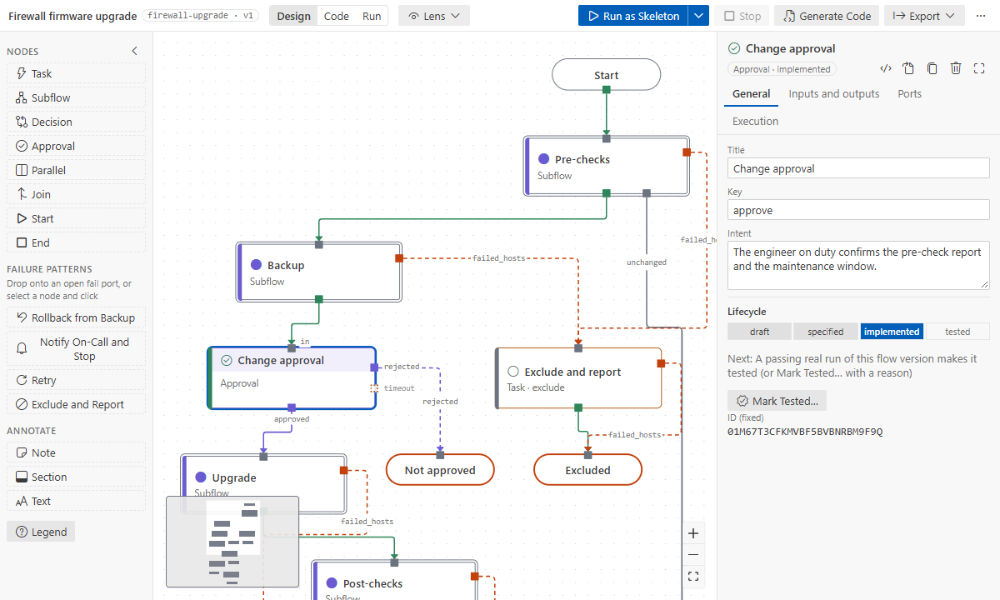

# Generated code

The flow is the source of truth; the playbooks are generated from it.

## When and where

- Saving a flow without errors writes `generated/<flow key>.yml` next to it, and
  `generated/<flow key>.<subflow key>.yml` for each subflow level (setting `afd.codegen.onSave`).
- Flows with top-level approvals also get AWX segment playbooks:
  `generated/<flow key>.seg_<segment>.yml`.
- **Ansible Flow: Generate Code** writes them on demand. Files are written only when their
  content changed.
- **Ansible Flow: Check Flow** runs `ansible-playbook --syntax-check` in your
  environment; errors land on the generated files in the Problems panel.

## What the playbook looks like

- One play per step, in graph order, named `[key] Title` and tagged `node_<ID>`. Runs, AWX events
  and drift map back to the nodes through these tags.
- Hosts move between plays with `group_by`. Every step **rescues** its failures, so failed hosts
  take their port instead of stopping the run.
- A final **outcome play** fails the hosts left on open ports or failed end nodes, with the reason.
  The job ends red, but every branch runs first.
- Unbound steps run a `TODO: <intent>` debug message. Bound modules and roles run for real.
- Inputs become play variables from the upstream outputs (see
  [data between steps](data-between-steps.md)).
- The header says how the file was made, and how to choose an approval outcome in a local run.
- A [note on a step](annotations.md) becomes `# Note:` comment lines right above that step's play.
  Changing a note rewrites the generated file but not the flow's version.

Generated code shows in two places: the Details' **Binding** tab shows the task as the playbook
will run it, and **Peek Code** (the node menu, or `</>` in the Details) opens the node's play in
the generated file.

## Do not edit generated files

They are rewritten from the flow. If you edit one anyway, the extension notices and asks before
overwriting it. To change behaviour, change the flow, or bind the step to a role you own.

## Version

`flow.version` goes up once per commit when the design changes (compared with Git HEAD), never for
layout moves. The generated header names the version, and the run panel shows which version ran.
