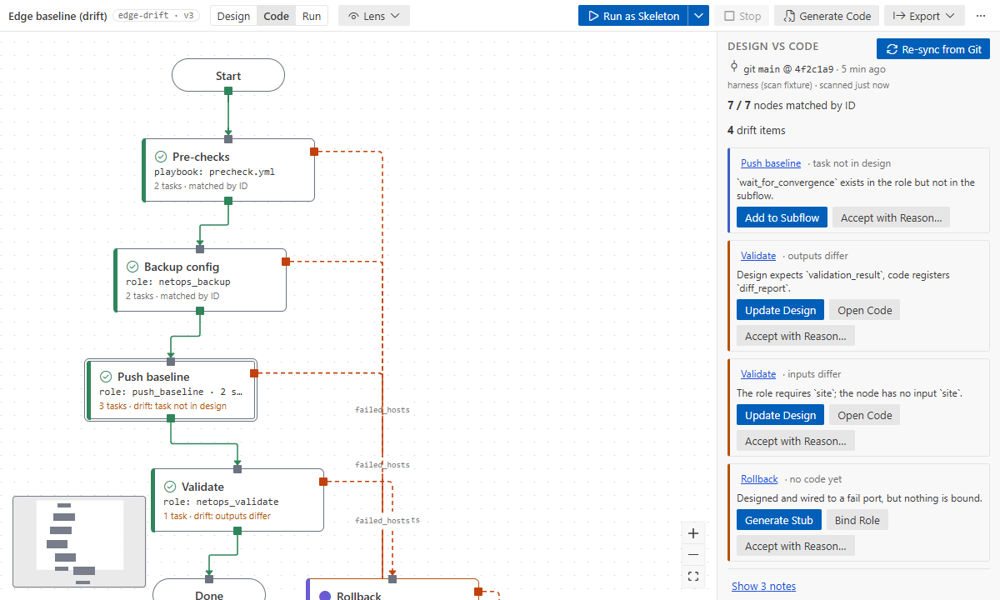

# Code mode: design vs code

Switch the top bar to **Code** to see the same graph against the code it runs. Nothing
is changed for you; every difference comes with actions for both sides. The graph is read-only here
(no moving, wiring or deleting); bindings stay editable in a node's Details and through the drift
actions.

## Re-sync from Git

**Re-sync from Git** (at the top of the Design vs code panel) compiles, in your Ansible
environment:
- the flow's generated playbook;
- every bound role entry point;
- every bound playbook.

It uses Ansible's own loader, not text search. It labels the result with the branch, the HEAD
commit and its time, and counts uncommitted files. It runs on the first visit and again after each
save.

## Reading the nodes

Nodes show what they run (`role: netops_validate`, `module: …`, `playbook: …`) and a summary such
as "3 tasks · drift: outputs differ". Select one to see its tasks with file and line; click one to
open it.

## Drift items

The **Design vs code** panel lists the nodes matched by ID and the drift items:

| Kind                | Example                                                            | Actions                                                                                                                                |
| ------------------- | ------------------------------------------------------------------ | -------------------------------------------------------------------------------------------------------------------------------------- |
| contract mismatch   | "Design expects `validation_result`, code registers `diff_report`" | _Update Design_ (renames the output and its readers), _Open Code_                                                                      |
| code without design | a role task the subflow does not show                              | _Add to Subflow_, _Accept with Reason…_                                                                                                |
| design without code | an unbound node                                                    | _Generate Stub_ (a role with a TODO task, output facts and argument specs from the node's inputs; bound in the same edit), _Bind Role_ |
| notes               | roles without argument specs, dynamic includes                     | _Write argument_specs_                                                                                                                 |

**Accept with Reason…** asks for a reason and records it in the flow with your Git user (`drift_ignored`).
Ignored items stay listed, with _Reopen_.

Select a node for its Details: the **Code** tab shows what it runs and its drift, the **Binding**
tab changes the binding.
