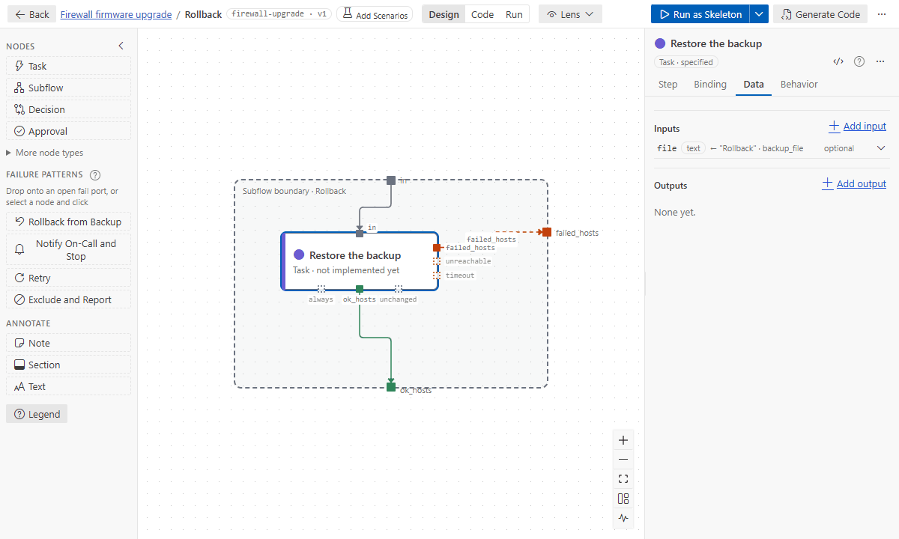
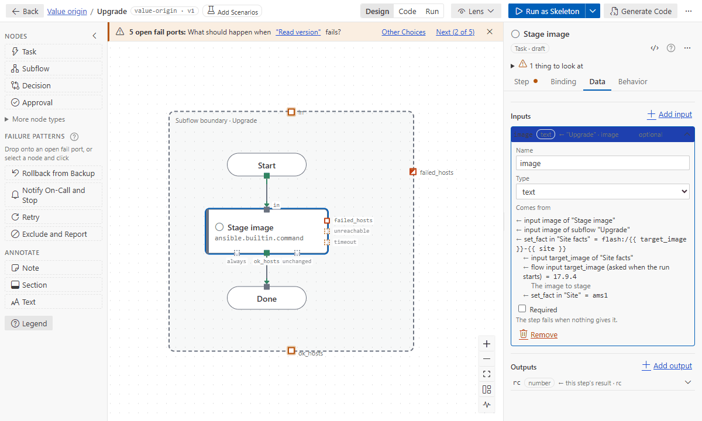
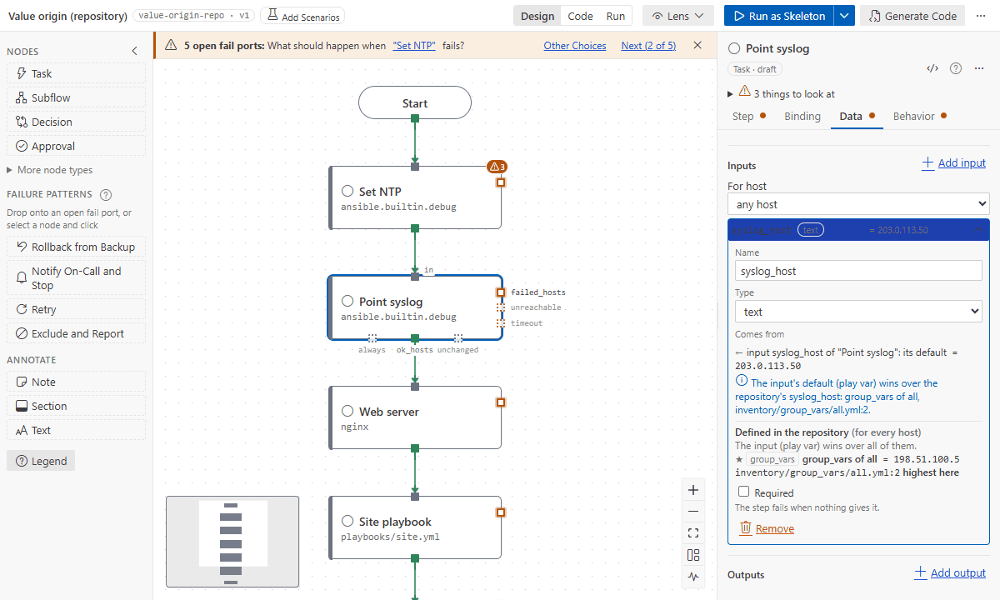
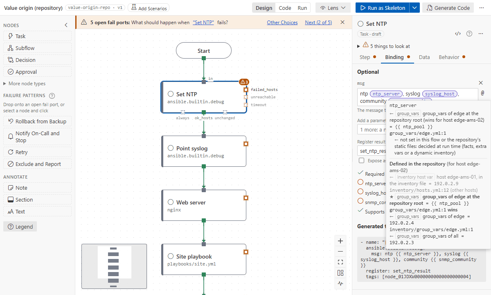
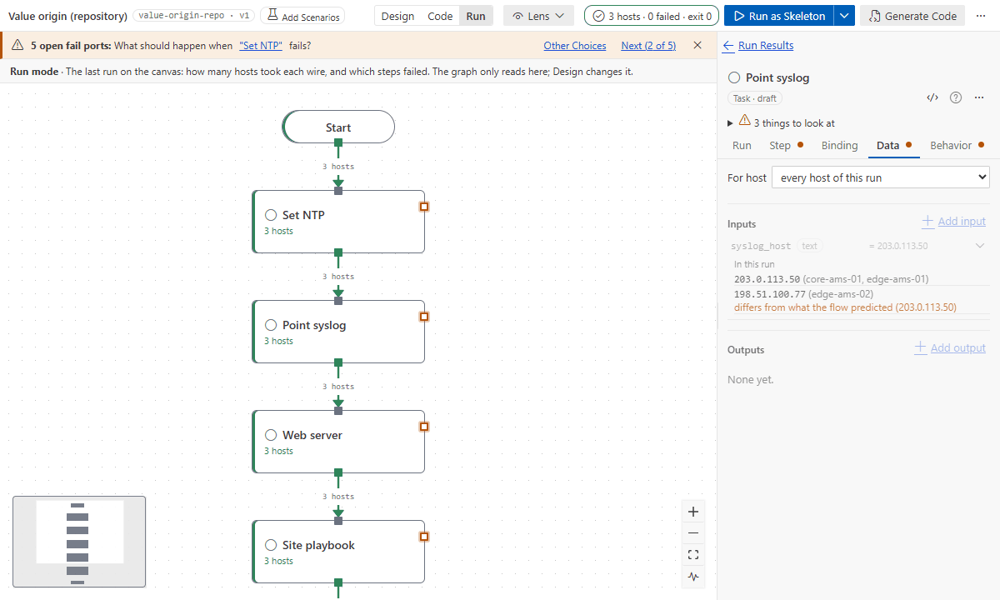
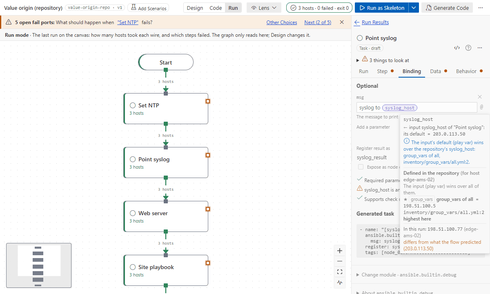
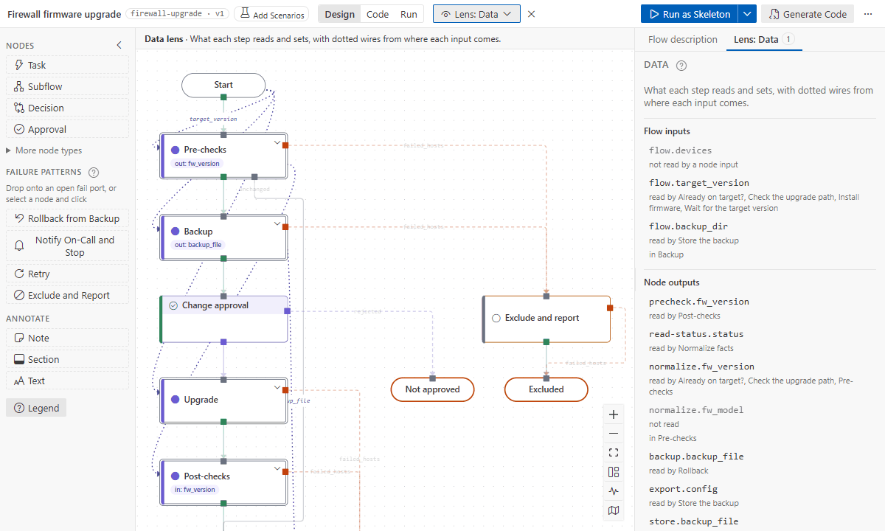

# Data between steps

Steps pass values through declared **inputs** and **outputs**, never through variables another step
happens to leave on the host. The design then shows every data dependency. The designer checks
each name a step reads, and the generated code passes the values in.

## Outputs

An output is a value a step produces.

| The step                             | Output `from:`                                                                                      |
| ------------------------------------ | --------------------------------------------------------------------------------------------------- |
| a module step: its registered result | `impl.register`, or a part: `impl.register.json`, `impl.register.stdout`                            |
| a `set_fact` step or a role          | (none: a fact of the output's name)                                                                 |
| a subflow                            | the inner step's output it lifts: `<step key>.<output>`; none for the inner output of the same name |
| an unbound step                      | (none: skeleton runs set a placeholder, so data flows through)                                      |

In the binding page, click a module return under **Returns** to make it an output, or tick
**Expose as node output** for the whole result.

**A fact a `set_fact` step sets** is a value too. A later step that reads it with no input works
while both run in one play, but the flow does not show it, and a run in parts (AWX, approvals)
loses it. So the designer offers it wherever you look for a value:

- the **@** list in a parameter ("test_message · fact set by Save var"),
- the warning on the reading step ("Save var sets it"), with the quick fix **Add test_message as
  an Input** in the text editor and **Add as input** in the step's Details,
- the Data lens, which draws such a read as a warning-coloured wire "(not declared)" with the same
  fix,
- **Add from…** under the step's Inputs.

Each makes the fact an output of the step that sets it and an input of the step that reads it, in
one edit.

## Inputs

An input is a value a step reads. Its `from:` says where it comes from:

| From                                                             | `from:`                                                 |
| ---------------------------------------------------------------- | ------------------------------------------------------- |
| a flow input                                                     | `flow.target_version`                                   |
| an output of a step that runs before, on this level or around it | `read-status.status`, `read-status.status.json.version` |
| inside a subflow: that subflow's own input                       | `rollback.backup_file`                                  |
| a subflow's output (lifted from inside it)                       | `precheck.fw_version`                                   |

Parameters read inputs by name, `{{ fw_version }}`. So do `assert` `that:` lists, decision
conditions and `until`, without braces. The easy way to add an input is the **@** picker in a
parameter: it offers node inputs, flow inputs, the enclosing subflows' inputs, outputs of upstream
steps, and outputs of steps inside earlier subflows. An upstream module step's result that is not
an output yet is offered too ("result of Read the software version · makes it an output there"):
picking it makes the result an output of that step and an input of this one, with its `from`.

A result is a map. To read one field of it, such as the standard output, pick the field: once you
pick a result, the list offers the fields its module documents (`read_version_result.stdout`,
`.stdout_lines`, `.rc`, each with what the docs say). Typing `.` right after a result's chip, or
`@read_version_result.std`, offers them too. The field goes into the chip,
`{{ read_version_result.stdout }}`; text typed after a chip stays outside the braces.

A step input needs a source: a `from:` or a default. One with neither (`input-unfed`) is a warning,
and its message names where the value is: the step that registers a result of that name, or the
flow input of that name.

- **A default** is what the step gets when its `from:` left nothing (the generated play var falls
  back to it), or, without a `from:`, the value itself. A value with a default is always defined,
  so an `is defined` test on it always passes.
- **Optional:** `optional: true` on an input says the step checks for a missing value itself
  (`x is defined`, `| default`). The designer then does not warn that some paths reach the step
  without it.
- **Set outside the flow:** variables something else gives at run time (AWX or Kestra extra vars,
  inventory variables, the vars a caller passes) go into `flow.external_vars`, with where they
  come from. Steps read them without an input. AWX's own `awx_*` and `tower_*` variables need no
  entry.
- **Inputs are play variables:** a fact (`set_fact`) or a register of the same name, set earlier on
  the host, wins over them, and an extra var wins over both. Give inputs names that no step sets
  as a fact, so `from:` decides what the step reads.



## What a run gives back (flow outputs)

A flow's outputs are what a run gives back to whoever launched it: Ansible Flow Server records
them with the run, and a flow that launched this one with the collection
`chistokhinsv.ansible_flow` gets them (`run` with `wait: true`, or `run_info`), per host. Add them
under **Run outputs** in the Flow panel (nothing selected): **Take a step's output** offers what
reaches the end of the flow (a step's output, its result, a fact it sets, which becomes its output).

```yaml
flow:
  outputs:
    backup_file:
      type: string
      from: backup-config.backup_ref
```

- Each host that has the value at the end of the run gives it; a host without one is left out.
- `from:` names a top-level step's output (`<step>.<output>[.path]`); it follows a renamed step or
  output.
- A run with approvals carries only hosts past each approval, so an output of a step before one
  has no value at the end (warning `flow-output-before-approval`).
- The values are kept with the run (at most 256 KB of them): do not give back secrets.
- The run's panel lists them per host under **Outputs**.

## Across subflow boundaries

```
backup (subflow)                    rollback (subflow)
  store ──backup_file──▶ lifted       input backup_file ◀── from: backup.backup_file
  as backup.backup_file                 restore: input file ◀── from: rollback.backup_file
```

- **Into a subflow:** give the subflow an input (`backup_file`, `from: backup.backup_file`). The
  steps inside read it as `rollback.backup_file`. Inside a subflow, `<that subflow>.<name>` always
  means its input.
- **Out of a subflow:** the subflow lifts an inner output as its own (`backup.backup_file`). Without
  a `from`, a subflow output lifts the only inner output of the same name. The validator warns
  (`subflow-output-unset`) when nothing inside sets it.
- **From a step inside another subflow:** pick it from the @ list
  (`precheck/normalize.fw_model · lifts it to precheck`). The designer adds the output to `precheck`
  and the input to your step in one edit. AI assistants do the same with the path
  `precheck/normalize.fw_model`.

Renaming an output rewrites the inputs that read it; renaming a subflow input rewrites the inner
steps that read it.

## Where a value comes from

Hover a variable in a step's parameters (a chip such as `code`, or a name inside `{{ }}` in a YAML
box) and the tooltip shows where its value comes from, hop by hop, as the flow says it:

```
code
← input code of "Report"
← output rc of subflow "Upgrade", lifted from "Stage image"
← result of "Stage image" (ansible.builtin.command), registered as stage_result · rc
    Return code
```

- **What the chain follows:** node inputs, subflow inputs, outputs a subflow lifts from a step
  inside it, a module step's registered result (with the field's description from the module's
  docs), facts a step sets with `set_fact`, flow inputs, names the flow says are set outside it
  (**Set outside the flow**), and Ansible's own variables (`inventory_hostname`, `group_names`, ...).
- **Values:** a default or a literal is shown (`= 17.9.4`), cut in the middle when it is long. A
  `set_fact` value that is a template shows the template, and the variables it reads follow,
  indented. Nothing is rendered: only Ansible works out a template, when the run gets there.
- **Secrets are never shown:** when a name on the way looks secret (password, token, key, vault),
  a value is a vault value, or a step on the way has `no_log`, no value, default or template is
  shown on any hop, only "secret: not shown".
- **What the flow cannot know** says so: a name nothing in the flow sets reads "decided at run
  time (inventory, group_vars, facts or extra vars)", and an output a role sets reads "set by role
  … when it runs".
- **Which value wins:** where the flow knows, a line under the chain says so: a flow input of the
  same name (an extra var) wins over a step's input, another step sets the input's name after its
  source (`input-shadowed`), or the step reads the host's own variable before the input's default.
- **Go to a step:** click a hop to select its step and open its Details. Point at the tooltip to
  keep it open.

In **Details › Data**, open an input row: **Comes from** shows the same chain. Hovering the arrow
text of a closed row shows it as a tooltip. A wire of the Data lens has the chain in its tooltip too.
The same views are in Ansible Flow Server's pages. AI assistants get each input's chain from
`flow_describe` when they ask for some nodes.



### Where the repository sets it

In VS Code the designer also reads the repository, so a name the flow does not set is not just
"decided at run time". Under the chain, **Defined in the repository** lists every place that sets
the name, highest precedence first:

- the inventory file (a group's `vars:`, a host's own line), `group_vars/` and `host_vars/`
  beside the inventory and at the repository root (flow runs load the root's too, and they win
  over the ones beside the inventory);
- for a step that runs a role: the role's `defaults/main`, `vars/main` and the options of
  `meta/argument_specs` (documentation: Ansible does not set their default);
- for a step that runs a playbook or a task file: its literal `vars_files` and `include_vars`
  (an `include_vars` stays with the host, so later steps see it too).

Each line has its precedence in words (role default, inventory group var, group_vars, host_vars,
play var, role var, include_vars), its value (a template as written, never worked out), and its
file and line: click it to open the file there. Vaulted values and secret-looking names show no
value at all.

**Which one wins** depends on the host: a host's own variables beat its groups', a child group
beats its parent, and `all` comes first. Pick a host under **Inputs** in **Details › Data** (**For
host**), or select a host in the Inventory view: the winner for that host is marked with a star,
and lines for other hosts are dimmed. Without a host, a winner is marked only when every line
applies to every host. With a dynamic inventory source, a host the inventory files do not name, or
an `include_vars` under a condition, none is marked, and the list says why.

A step's input is a play var, and a play var beats the inventory: a note says so, and an input
with a **default** and no source while the inventory sets the same name gets a finding
(`input-hides-inventory`): the step never gets the inventory's value. Remove the default to let
the host's own value through. A role var or an `include_vars` of the same name beats an input,
and a note says that too.





The repository is read again when a file is saved. Ansible Flow Server's pages do not read it yet:
they show the chain from the flow alone.

### The value in a run

A run records the value each step's inputs had for each host, as Ansible gave them to the step.
In **Run** mode, with a run shown, **Details › Data** has **In this run** under each input: the
values, with the hosts that had each one. Pick a host in **For host** above the inputs to see that
host's value alone. When the flow or the repository states a value for that host and the run had
another, it says **differs from what the flow predicted** (or the repository) and what that was.
A variable's tooltip adds **In this run:** with the value for the host picked (or for the run's
only host). In the step's **Run** tab, the variable icon on a host's row lists all its inputs.





What is never recorded, so it shows as **secret: not recorded**:

- every input of a `no_log` step, an input with a secret-looking name (password, token, key,
  vault, ...), and an input whose chain is secret;
- a value that holds a vaulted value anywhere inside it, or one of the run's secret inputs;
- inside a recorded dictionary, the value of a secret-looking key shows as `********`.

A value longer than 2000 characters is cut in the middle and says how long it was. A run records
256 KB of values at most; past that, a value says the run's limit was reached. An input the host
did not have says **not defined for this host**. Only a step's own inputs are recorded, not facts
or host variables in general, and not the variables of a step that runs a playbook.

Recording is on by default. Turn it off with `afd.run.recordInputs` (on Ansible Flow Server, its
administrator sets `AFS_RUN_RECORD_INPUTS`): the runs then record no input values at all. In the
generated code each step with inputs has a task `[<key>] record inputs` before its own; it does
nothing when recording is off and never fails a run.

## The Data lens

Top bar → **Lens** → **Data** draws a dotted wire for every `from:`. It lists the flow inputs and
the outputs, with who reads each one. Findings: inputs that resolve to nothing, outputs nothing
reads.



## Warnings you may see

| Code                    | Means                                                                  |
| ----------------------- | ---------------------------------------------------------------------- |
| `from-unresolved`       | a `from:` names nothing this step can read; the message says the fix   |
| `binding-unknown-var`   | a parameter (or an `assert` `that:`) reads a name that is not an input |
| `condition-unknown-var` | a decision condition or `until` reads a name that is not an input      |
| `subflow-output-unset`  | a subflow output that nothing inside sets                              |
| `input-unfed`           | a step input with no `from:` and no default: nothing gives it a value  |
| `register-collision`    | (error) the register another step registers too, or a flow input name  |
| `ref-may-be-undefined`  | the producing step does not run (or succeed) for every host that reads |

A step's Retries, Delay and Timeout can read an input too, as a value given at run time: see
[Retries and polling](polling-and-retries.md#a-wait-the-operator-sets-at-run-time). Renaming the
input renames it there and in Until.

A flow input read directly is only a note: add it as an input to show the dependency. Full list:
[problem codes](../reference/problems.md).

A step's own Details list its problems without the step's name, each with what to do. A name the
step reads that is not one of its inputs has **Add as input**: it adds the input from where the
value is (a flow input, the subflow's input, an earlier step's output, a `set_fact` before it, or
one inside an earlier subflow, which each subflow on the way then lifts). In the text editor the
same fix is the warning's quick fix, **Add … as an Input**.
When nothing in the flow sets the name, the input has no `from:` and the name goes into
`flow.external_vars` as set outside the flow, so the other steps that read it stop warning too.

### Each step keeps its own outputs

A role, a playbook or a step not bound yet sets its output as a fact named after the output
(`result`), which any other step setting `result` would overwrite. So the generated code copies it
right after the step, for the hosts that finished it, into a variable of the step's own:
`afd_<key>__<output>` (`afd_backup__result`), with the keys of the subflows around it in front when
the same key is used on another level. `from: backup.result` reads that copy, so two steps may
name their outputs alike. An output the code did not set stays unset, and its reader fails as
before.

An output read from the register (`impl.register`) is the register itself. Its name is the
step's (`<key>_result` unless you set **Register result as** on the Binding tab), so it is an error
(`register-collision`) when another step registers the same name between the step that sets it
and the reader, or it is the name of a flow input (an extra var, which always wins): give one step
its own register name. Steps that register the name again before the step that sets it, or after
the reader, are fine: a probe and a later wait that reuse one register is a normal playbook pattern.

### Values that may be missing

A step can only read what has run for its hosts. The designer warns (`ref-may-be-undefined`) when
the producing step is not on every path to the reader (a branch or a failure path goes around it),
or when hosts that failed in it are wired on to the reader. Read the value after the paths join,
wire the failure path elsewhere, or read it with `| default(…)` or behind an `is defined` test (in
the step's `when`, or a decision before it), as imported handlers do. A step that handles the
missing value itself can mark the input `optional: true`.

### A failure, read in a later step

Each step runs in a play of its own, so the step its `failed_hosts` lead to cannot see Ansible's
`ansible_failed_result`. Every step's rescue keeps the failure as host facts instead:
`afd_failed_result` (the failed task's result, e.g. `afd_failed_result.msg`), `afd_failed_task`
(its name) and `afd_failed_node` (the step's key path).
