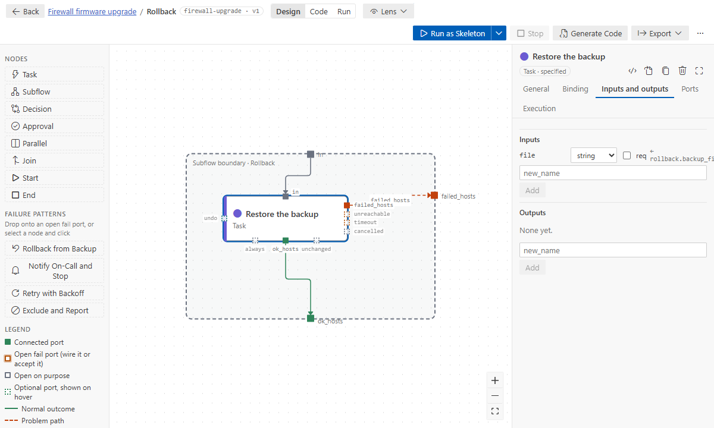
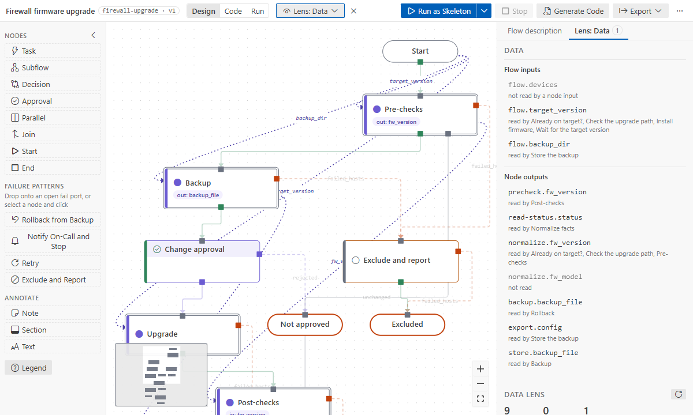

# Data between steps

Steps pass values through declared **inputs** and **outputs**, never through variables another step
happens to leave on the host. The design then shows every data dependency. The designer checks
each name a step reads, and the generated code passes the values in.

## Outputs

An output is a value a step produces.

| The step                             | Output `from:`                                                                                      |
| ------------------------------------ | --------------------------------------------------------------------------------------------------- |
| a module step: its registered result | `impl.register`, or a part: `impl.register.json`, `impl.register.stdout`                            |
| a `set_fact` step or a role          | (none: a fact of the output's name)                                                                 |
| a subflow                            | the inner step's output it lifts: `<step key>.<output>`; none for the inner output of the same name |
| an unbound step                      | (none: skeleton runs set a placeholder, so data flows through)                                      |

In the binding page, click a module return under **Returns** to make it an output, or tick
**Expose as node output** for the whole result.

## Inputs

An input is a value a step reads. Its `from:` says where it comes from:

| From                                                             | `from:`                                                 |
| ---------------------------------------------------------------- | ------------------------------------------------------- |
| a flow input                                                     | `flow.target_version`                                   |
| an output of a step that runs before, on this level or around it | `read-status.status`, `read-status.status.json.version` |
| inside a subflow: that subflow's own input                       | `rollback.backup_file`                                  |
| a subflow's output (lifted from inside it)                       | `precheck.fw_version`                                   |

Parameters read inputs by name, `{{ fw_version }}`. So do `assert` `that:` lists, decision
conditions and `until`, without braces. The easy way to add an input is the **@** picker in a
parameter: it offers node inputs, flow inputs, the enclosing subflows' inputs, outputs of upstream
steps, and outputs of steps inside earlier subflows.



## Across subflow boundaries

```
backup (subflow)                    rollback (subflow)
  store ──backup_file──▶ lifted       input backup_file ◀── from: backup.backup_file
  as backup.backup_file                 restore: input file ◀── from: rollback.backup_file
```

- **Into a subflow:** give the subflow an input (`backup_file`, `from: backup.backup_file`). The
  steps inside read it as `rollback.backup_file`. Inside a subflow, `<that subflow>.<name>` always
  means its input.
- **Out of a subflow:** the subflow lifts an inner output as its own (`backup.backup_file`). Without
  a `from`, a subflow output lifts the only inner output of the same name. The validator warns
  (`subflow-output-unset`) when nothing inside sets it.
- **From a step inside another subflow:** pick it from the @ list
  (`precheck/normalize.fw_model · lifts it to precheck`). The designer adds the output to `precheck`
  and the input to your step in one edit. AI assistants do the same with the path
  `precheck/normalize.fw_model`.

Renaming an output rewrites the inputs that read it; renaming a subflow input rewrites the inner
steps that read it.

## The Data lens

Top bar → **Lens** → **Data** draws a dotted wire for every `from:`. It lists the flow inputs and
the outputs, with who reads each one. Findings: inputs that resolve to nothing, outputs nothing
reads.



## Warnings you may see

| Code                    | Means                                                                  |
| ----------------------- | ---------------------------------------------------------------------- |
| `from-unresolved`       | a `from:` names nothing this step can read; the message says the fix   |
| `binding-unknown-var`   | a parameter (or an `assert` `that:`) reads a name that is not an input |
| `condition-unknown-var` | a decision condition or `until` reads a name that is not an input      |
| `subflow-output-unset`  | a subflow output that nothing inside sets                              |
| `register-collision`    | (error) the register another step registers too, or a flow input name  |
| `ref-may-be-undefined`  | the producing step does not run (or succeed) for every host that reads |

A flow input read directly is only a note: add it as an input to show the dependency. Full list:
[problem codes](../reference/problems.md).

### Each step keeps its own outputs

A role, a playbook or a step not bound yet sets its output as a fact named after the output
(`result`), which any other step setting `result` would overwrite. So the generated code copies it
right after the step, for the hosts that finished it, into a variable of the step's own:
`afd_<key>__<output>` (`afd_backup__result`), with the keys of the subflows around it in front when
the same key is used on another level. `from: backup.result` reads that copy, so two steps may
name their outputs alike. An output the code did not set stays unset, and its reader fails as
before.

An output read from the register (`impl.register`) is the register itself. Its name is the
step's (`<key>_result` unless you set **Register result as** on the Binding tab), so it is an error
(`register-collision`) when the reader's register is also registered by another step, or is the
name of a flow input (an extra var, which always wins): give one step its own register name.

### Values that may be missing

A step can only read what has run for its hosts. The designer warns (`ref-may-be-undefined`) when
the producing step is not on every path to the reader (a branch or a failure path goes around it),
or when hosts that failed in it are wired on to the reader. Read the value after the paths join,
wire the failure path elsewhere, give the input a default, or read it with `| default(…)` in the
binding, as imported handlers do.
