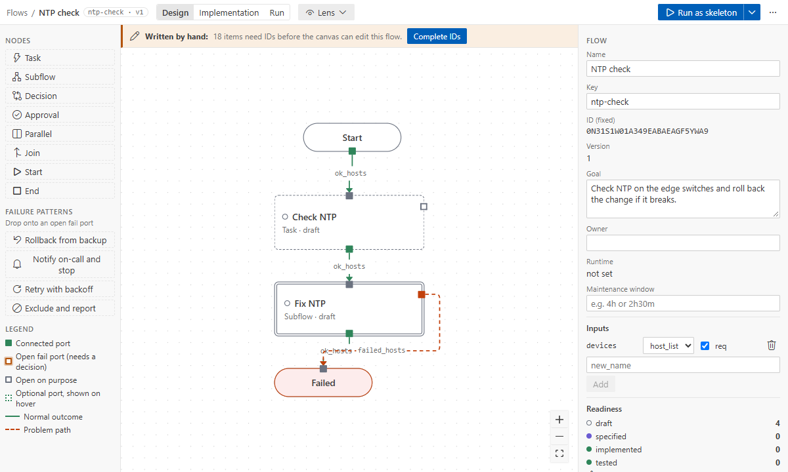

# Hand-written YAML and Complete IDs

A flow file is YAML you can read and write. The designer uses 26-character IDs (ULIDs) so that
renames never break anything. You do not have to write them: name nodes by **key**, and let
**Complete IDs** add the IDs.

## Write a flow by key

```yaml
schema_version: 2
flow:
  key: ntp-check
  name: NTP check
  version: 1
  inputs:
    devices: { type: host_list, required: true, targets: true }
nodes:
  - { key: start, type: start, title: Start }
  - { key: check-ntp, type: task, title: Check NTP, intent: Read the NTP peers }
  - { key: done, type: end, title: Done, outcome: success }
edges:
  - from: { node: start, port: ok_hosts }
    to: { node: check-ntp, port: in }
  - from: { node: check-ntp, port: ok_hosts }
    to: { node: done, port: in }
```

- `schema_version` is the file's format: 2 for new flows. A flow in format 1 still opens and
  runs; **Upgrade Flow Format** (the banner over the canvas, or the Command Palette) moves it to 2
  in one edit, and one undo reverts it. Nothing is upgraded without asking.
- Keys are lowercase letters, digits and dashes, unique on their level.
- Wires, subflow entries and exits, decisions and layout may name nodes by key.
- The [flow file format](../reference/flow-format.md) lists every field.

### Notes, sections and text

Format 2 flows can carry words that explain them and never run: `annotations:` next to `nodes:`
(and `subflow.annotations` inside a subflow). Changing them changes no version and keeps tested
steps tested.

```yaml
annotations:
  - kind: note
    on: check-ntp # a note on a node: x, y count from the node, and it moves with it
    x: 232
    y: 0
    text: |-
      Read-only: **safe** to rerun.
      Runbook: https://wiki.example.net/ntp
  - { kind: section, x: 40, y: 120, width: 520, height: 360, color: blue, text: Change window }
  - { kind: text, size: l, x: 40, y: -60, text: NTP check }
```

Leave `id:` and `key:` out here too: Complete IDs adds them (`note-1`, `section-1`, `text-1`) and
turns `on: check-ntp` into the node's ID. The text is Markdown: `**bold**`, `*italic*`,
`` `code` ``, `- ` lists and `[links](https://...)`.

## Complete the IDs

The designer opens such a file with a **Written by hand** banner. It shows the flow, but locks
canvas edits, runs and code generation until the IDs are there. The Problems panel lists each gap
(`missing-id`).



Click **Complete IDs** in the banner, use the lightbulb quick fix in the text editor, or run
**Ansible Flow: Complete IDs**. It adds every ID and turns key references into ID references, in one
edit that one undo reverts. Comments and formatting stay as they are.

Paste does the same for snippets ([copy and paste](copy-paste.md)).

## Edit with the Red Hat YAML extension

With the Red Hat YAML extension installed, **Open in Text Editor** gets completion, hovers and validation
from the flow schema. The schema is registered for `*.flow.yaml`.

## Keep in mind

- Do not edit `flow.version`, `layout` or files in `generated/`. The designer bumps the version on
  save (once per commit) and regenerates the code.
- Every fail port needs a wire or a `decisions:` entry with a reason. In format 2 every decision
  is `kind: accepted`, with the `node` and what it accepts in `finding`: `port:failed_hosts`,
  `drift:<item>`, `lens:<finding id>`, or `check:<code>[:<subject>]` for a warning kept as it is
  (e.g. `check:binding-unknown-var:ntp_servers` for a variable set in `group_vars`).
- In format 2 the designer keeps `status` in line with what each node has; write what you like,
  the next edit of the node sets it again (a hand-written mismatch shows as a note in Problems).
  `status: tested` needs a `tested:` record on the node: `run`, `flow_version` and `commit` from a
  passing run, or `reason`, `by` and `at` by hand. In format 1 it is a `finding_accepted` decision
  `status:tested|<node id>`.
- In format 2 `flow.runtime` names only the AWX `template`; whether it runs as a job or a workflow
  follows from the flow.
