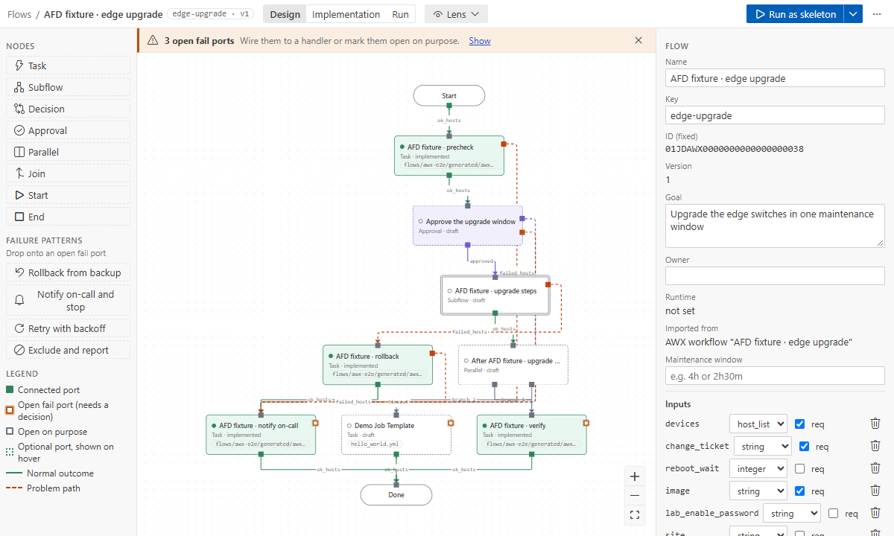

# Import an AWX workflow

Turn a workflow job template you already have into a flow. The import is a one-time copy: AWX is
only read, and the new flow is yours to change.

## Run the import

Command Palette → **Ansible Flow: Import AWX Workflow…**
- **From AWX:** uses `afd.awx.url` and the stored token ([AWX](awx.md)).
- **From an export file…:** a file made with
  `awx export --workflow_job_templates --job_templates > awx-export.json`.

Pick the workflow and the new flow's key. The flow opens, laid out top-down at every level; its
description shows where it came from. **Show notes** lists what did not map one to one.

## How things map

| AWX                                                                   | Flow                                                                                                             |
| --------------------------------------------------------------------- | ---------------------------------------------------------------------------------------------------------------- |
| job template node                                                     | a task bound to the template's playbook: **implemented** when the playbook is in this repository, else **draft** |
| node limit, tags, extra data, machine credential, EE, become, timeout | the task's settings and parameters                                                                               |
| nested workflow                                                       | a subflow                                                                                                        |
| approval                                                              | an approval, with its timeout                                                                                    |
| project or inventory sync                                             | a draft task                                                                                                     |
| `success` / `failure` edge                                            | `ok_hosts` / `failed_hosts`                                                                                      |
| `always` edge                                                         | both `ok_hosts` and `failed_hosts` (AWX counts it as a failure handler)                                          |
| several children                                                      | a parallel node; several roots start in parallel                                                                 |
| convergence "all"                                                     | a join                                                                                                           |
| a failure with no AWX path                                            | an open fail port: the banner shows what AWX would fail on                                                       |
| survey questions, extra vars                                          | flow inputs; passwords, `$encrypted$` values and secret-looking names by name only                               |
