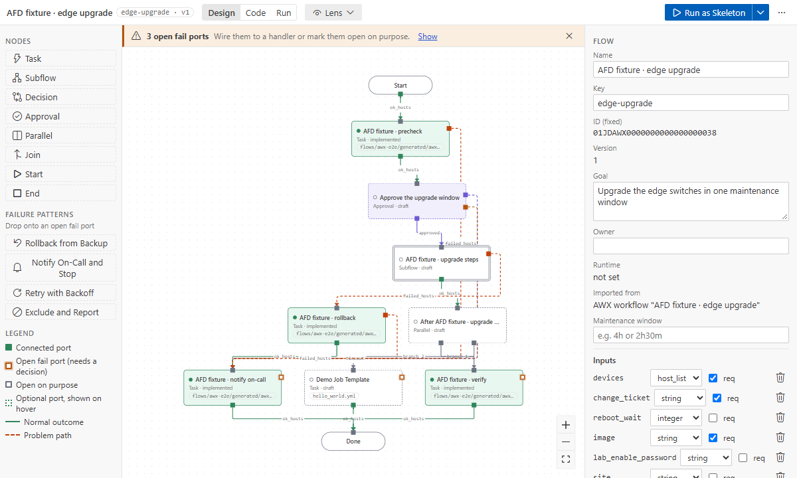

# Import playbooks and AWX templates

Turn automation you already have into flows: playbooks and folders of playbooks (with their roles,
task files, handlers and variables), AWX job templates and AWX workflows. An import is a one-time
copy: the playbooks and AWX are only read, and the new flow is yours to change.

New to it? [Tutorial 5](../tutorials/05-import-playbooks.md) imports a sample repository step by step:
**Open Sample Flow…** → _Playbooks to import: edge-baseline_ copies it into an empty folder.

## Import playbooks

Command Palette → **Ansible Flow: Import Ansible Playbooks…**, or right-click a playbook or a
folder in the Explorer.

- **A playbook** becomes one flow. Pick its key (the folder under `flows/`).
- **A folder** lists the playbooks it finds. Those no other playbook imports (like `site.yml`)
  are selected; each one you keep becomes its own flow, with a key from its file name.

The first flow opens in the designer. **Show notes** lists what did not map one to one. The flow
stores no positions, as a new flow does: the canvas lays every level out, and _Tidy Up_ keeps a
layout.

The result is a faithful copy: one step per task, in the playbook's order. Running the flow does
what the playbook did. This is checked in Ansible 2.19 to 2.21 by running a playbook and its import
side by side.

### How playbooks map

| Playbook                                         | Flow                                                                                                                                                        |
| ------------------------------------------------ | ----------------------------------------------------------------------------------------------------------------------------------------------------------- |
| one play                                         | its steps on the top level                                                                                                                                  |
| several plays, `import_playbook`                 | a subflow each                                                                                                                                              |
| the first play's `hosts`                         | the default of the `devices` input (the hosts the flow runs on)                                                                                             |
| a later play on other hosts                      | its subflow runs on them (_Inventory target_)                                                                                                               |
| `gather_facts` (on by default)                   | a _Gather facts_ step                                                                                                                                       |
| a task                                           | a step bound to its module, with its parameters; `when`, `loop`, `ignore_errors` and the like stay as [task keywords](binding-and-catalog.md#task-keywords) |
| `register`, `set_fact`, `vars_files`             | outputs; the steps that read them get inputs (`from:`)                                                                                                      |
| `block` with `rescue` / `always`                 | a subflow; its `failed_hosts` lead to the rescue steps, and the always steps run after both paths                                                           |
| a plain `block`                                  | its tasks, with the block's keywords on each                                                                                                                |
| `include_tasks` / `import_tasks` of a file       | a subflow named after the file                                                                                                                              |
| a role                                           | a step bound to the role                                                                                                                                    |
| a role whose `main.yml` only includes task files | a subflow bound to the role, one step per file (`tasks_from`)                                                                                               |
| handlers                                         | steps after the play's tasks, run when a step that notified them changed something                                                                          |
| play `vars`, `vars_prompt`                       | flow inputs; vault values and prompted secrets by name only                                                                                                 |
| `template` / `copy` sources, vars files          | paths the generated playbooks find (`{{ playbook_dir }}/…`)                                                                                                 |

A failure the playbook does not handle stays an open fail port: the banner shows it, because
Ansible stops that host there too.

These have no one-to-one form and are noted:
- a dynamic include (templated file name, or in a loop): a draft step;
- `meta` tasks other than `flush_handlers`: a draft step;
- a module with an unknown short name: a draft step;
- play `serial`, `any_errors_fatal` and `max_fail_percentage`: they apply to each step;
- `strategy` and `order`: left out;
- a role that generated playbooks cannot find: add its folder to `roles_path` in `ansible.cfg`.

## With an AI assistant

The import commands ask how to make the flow: **As is** (above), or **With an AI assistant**. An
assistant designs the flow by intent: a few subflows by purpose (pre-checks, backup, the change,
verification, rollback), steps named by what they achieve, and the same modules, parameters and
keywords as the playbook.

- **Copilot Chat** opens in agent mode with the prompt filled in; read it and send it.
- **Another assistant** (Claude Code, Codex, Gemini CLI, …): the prompt is on the clipboard; paste
  it there. The assistant needs the Ansible Flow tools: run _Set Up AI Assistants…_ once.

The prompt names the source and the flow to write. The assistant reads the source with
`source_outline` (each task's binding, ready to copy), builds the flow with `flow_new` and
`flow_edit`, keeps failures open where the playbook does, and reports what it grouped, changed or
left out. Review the flow on the canvas like any change.

You can also just ask, for example "turn site.yml into a flow, grouped by purpose", or "import
site.yml as is" (the assistant then uses `flow_import`). See [AI assistants](ai-assistants.md).

## Import an AWX workflow or job template

Command Palette → **Ansible Flow: Import AWX Workflow or Job Template…**
- **From AWX:** uses `afd.awx.url` and the stored token ([AWX](awx.md)).
- **From an export file…:** a file made with
  `awx export --workflow_job_templates --job_templates > awx-export.json`.

Pick a workflow template or a job template, then the new flow's key. The flow opens, laid out
top-down at every level; its description shows where it came from.

- **A job template** becomes a flow whose step is the template:
  - its limit is the default of the hosts input;
  - its survey and extra vars are flow inputs;
  - its credential and execution environment are settings.
- **A playbook in this repository** (the template's project checked out here) is imported into
  steps, as above, inside the template's step. A playbook the designer generated stays one step.
- **A playbook that is not here** stays one playbook step, a draft; the notes name the project and
  where it lives. Check the project out and import again to get its steps.
- **With an AI assistant**, the command writes `flows/<key>/source/awx-export.json` for the
  assistant to read: the template, its nodes and edges, and the job templates, with secret values
  left out (only their names stay). The AWX token never leaves VS Code.

### How workflows map

| AWX                                                                   | Flow                                                                                                        |
| --------------------------------------------------------------------- | ----------------------------------------------------------------------------------------------------------- |
| job template node                                                     | a subflow of its playbook's steps when the playbook is here; else a step bound to the playbook, a **draft** |
| node limit, tags, extra data, machine credential, EE, become, timeout | settings of the node; extra data and become reach each step of an imported playbook                         |
| nested workflow                                                       | a subflow                                                                                                   |
| approval                                                              | an approval, with its timeout                                                                               |
| project or inventory sync                                             | a draft task                                                                                                |
| `success` / `failure` edge                                            | `ok_hosts` / `failed_hosts`                                                                                 |
| `always` edge                                                         | both `ok_hosts` and `failed_hosts` (AWX counts it as a failure handler)                                     |
| several children                                                      | a parallel node; several roots start in parallel                                                            |
| convergence "all"                                                     | a join                                                                                                      |
| a failure with no AWX path                                            | an open fail port: the banner shows what AWX would fail on                                                  |
| survey questions, extra vars                                          | flow inputs; passwords, `$encrypted$` values and secret-looking names by name only                          |
