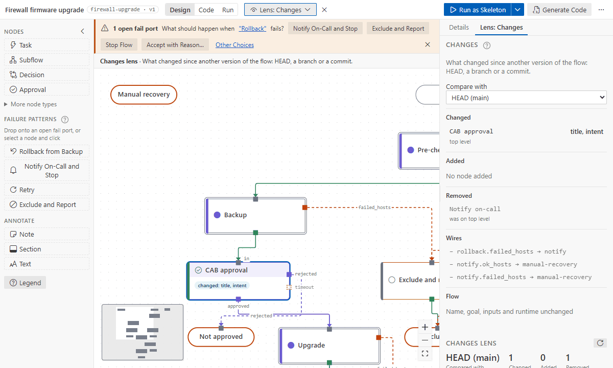

# Lenses

A lens looks at the whole flow from one angle. It fills the node chips and opens a **Lens** tab in
the right panel, with its list and its findings; the panel you had (the flow, a node's Details, the
mode's panel) stays in the tab beside it, and selecting a node switches to it. Pick a lens in the top
bar's **Lens** dropdown; ✕ clears it. Lenses work in every mode and never edit the flow. Hover a row
to highlight its nodes.

A line over the canvas says which lens is on and what it shows. A chip appears only where a step
has something for the lens. When no step on the level has one, the line says why: no step reads or
sets data, none is bound yet, or, for the Inventory lens, the flow targets are not set (with **Set
Targets…** beside it).

| Lens          | Shows                                                                                                             | Finds                                                                                                                                             |
| ------------- | ----------------------------------------------------------------------------------------------------------------- | ------------------------------------------------------------------------------------------------------------------------------------------------- |
| **Inventory** | each node's target and host count from your inventory; groups added beyond the flow targets (`+ core_spines · 2`) | a handler that targets more than it receives (Rollback on `all`), groups that are not flow inputs, patterns that match nothing, production groups |
| **Data**      | inputs and outputs, dotted data wires from `from:`                                                                | inputs that resolve to nothing, outputs nothing reads                                                                                             |
| **Code**      | each binding with its collection version and the execution environment                                            | not in the environment, removed or deprecated, versions that miss `collections/requirements.yml`                                                  |
| **Access**    | credentials, the connection user, become, vaulted variables (by name and file, never the value)                   | a credential unlike its neighbours', become alone, node credentials outside AWX                                                                   |
| **Timing**    | serial, timeout and average durations from the last 20 real runs                                                  | the slowest path does not fit `flow.maintenance_window`, a node close to its timeout                                                              |
| **Changes**   | what changed since HEAD, a branch or a commit: chips on changed and added nodes, ghosts where removed nodes stood | nothing to fix: it lists every change for a review                                                                                                |
- **Inventory** and **Access** read your inventory through your Ansible environment when you open
  them. **Set targets…** chooses the flow targets (remembered for runs too).
- A finding's button fixes it where it can. **Accept with Reason…** keeps it, with a reason recorded in
  the flow (an `accepted` decision with `finding: lens:<id>`; `finding_accepted` in a format 1 flow);
  **Reopen** removes that.
- **A step that sets become unlike its neighbours** is flagged by **Access**. If it really needs
  root, keep it and record why: the finding says so and puts **Accept with Reason…** first. The
  step's **Execution › Privilege** fold says the same, with the lens off too, until it is accepted.
- With a lens on, a selected step's **Details** show the findings on that step in a fold under its
  name (_Lens: Access · 2 on this step_), with the same buttons. The fold is open while a finding is
  not accepted; after a fix, **Next Finding** goes to the next step that has one.
- Where a list has a step inside a subflow, each row says where its step is ("in Drain the
  switch", "on the top level"). Hovering a row lights its step, or the subflow that holds it.
- After a fix in the Lens tab, the next open finding gets the focus. The tab keeps its scroll
  position while you check a step.
- Set the maintenance window in the flow panel (e.g. `4h` or `2h30m`).

## Compare with HEAD (Changes)

**Lens → Changes** compares the flow with another version of it from Git, as a review reads a
change. **Compare with** in the lens panel picks the version: HEAD (the default), another local
branch, or one of the last commits that touched the flow. While the flow has marks for changes made
outside the designer, the first choice, and the default, is the flow as it was before them: "the
flow as you last had it open" (or "before the outside changes"). A colleague's change you pulled is
already in HEAD; this is how to see it field by field.

- A changed node gets a chip naming what changed (`changed: title, binding`); an added node gets
  `added`; a subflow says how many changes are inside it, so you know where to go in.
- A removed node is drawn as a dashed, struck-through ghost where it stood (or beside the level
  when that version stored no place).
- Select a node: **Since <version>** at the top of its Details lists each field, before → after.
- The panel lists the changed, added and removed nodes, the wires added or removed, and changes to
  the flow itself (name, goal, inputs, runtime, format). A row with a node shows it.
- [Notes, sections and text](annotations.md) that were added or changed are outlined; the
  **Annotations** list names what changed in each (text, color, the node a note is on) and the ones
  removed. Moving one is not a change.

Unsaved edits count: the lens compares what you see with the version you picked. Nodes match by
ID; a flow that got its IDs later (Complete IDs) matches by key.
