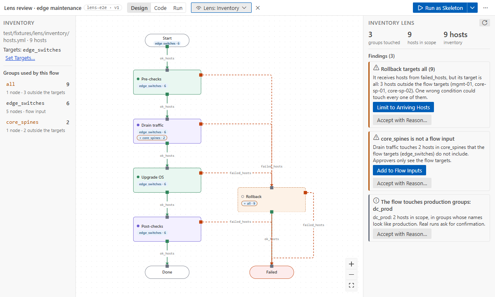

# Lenses

A lens looks at the whole flow from one angle. It fills the node chips, adds a list on the left and
findings on the right. Pick one in the top bar's **Lens** dropdown; ✕ clears it. Lenses work in
every mode and never edit the flow. Hover a row to highlight its nodes.

| Lens          | Shows                                                                                                             | Finds                                                                                                                                             |
| ------------- | ----------------------------------------------------------------------------------------------------------------- | ------------------------------------------------------------------------------------------------------------------------------------------------- |
| **Inventory** | each node's target and host count from your inventory; groups added beyond the flow targets (`+ core_spines · 2`) | a handler that targets more than it receives (Rollback on `all`), groups that are not flow inputs, patterns that match nothing, production groups |
| **Data**      | inputs and outputs, dotted data wires from `from:`                                                                | inputs that resolve to nothing, outputs nothing reads                                                                                             |
| **Code**      | each binding with its collection version and the execution environment                                            | not in the environment, removed or deprecated, versions that miss `collections/requirements.yml`                                                  |
| **Access**    | credentials, the connection user, become, vaulted variables (by name and file, never the value)                   | a credential unlike its neighbours', become alone, node credentials outside AWX                                                                   |
| **Timing**    | serial, timeout and average durations from the last 20 real runs                                                  | the slowest path does not fit `flow.maintenance_window`, a node close to its timeout                                                              |
- **Inventory** and **Access** read your inventory through your Ansible environment when you open
  them. **Set targets…** chooses the flow targets (remembered for runs too).
- A finding's button fixes it where it can. **Accept with Reason…** keeps it, with a reason recorded in
  the flow (`finding_accepted`); **Reopen** removes that.
- Set the maintenance window in the flow panel (e.g. `4h` or `2h30m`).
