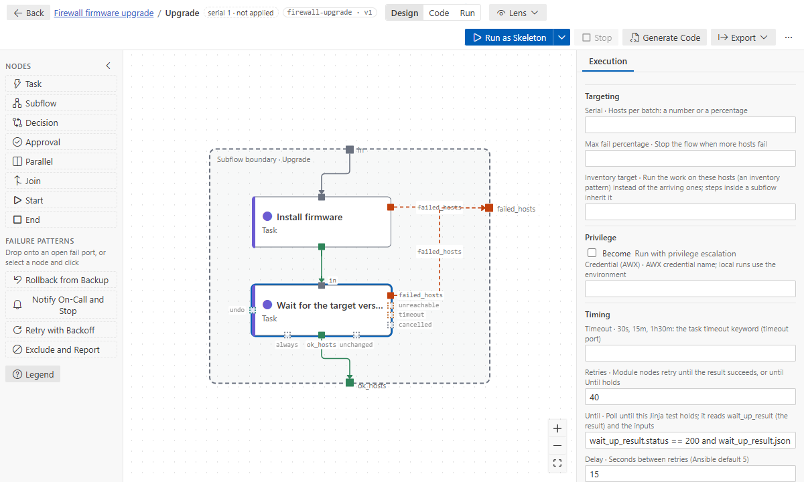

# Retries and polling

Two different needs, set on the step's **Execution** tab (Details page):

| You want                                                          | Set                                                  |
| ----------------------------------------------------------------- | ---------------------------------------------------- |
| try again when the module fails (a flaky API)                     | **Retries**                                          |
| ask again and again until a state is reached (a device rebooting) | **Retries**, **Until** and **Delay**                 |
| run the step again later for the failed hosts, then continue      | the **Retry with Backoff** pattern on `failed_hosts` |



## Retries

With only **Retries** set, a module step tries up to that many more times and stops at its first
success: the generated task gets `until: <register> is succeeded`.

## Polling with Until

**Until** is a Jinja test without braces. It reads the step's registered result by its name (the
field's label shows it, default `<key with _>_result`) and the step's inputs:

```yaml
settings:
  retries: 40 # tries
  delay: 15 # seconds between tries (Ansible's default is 5)
  until: wait_up_result.status == 200 and wait_up_result.json.version == target_version
```

The step polls for up to `retries × delay` (here 10 minutes). It succeeds when the test holds, and
fails (`failed_hosts`) when it never does.

- `target_version` here is an input of the step (`from: flow.target_version`). The validator
  checks every name in Until (`condition-unknown-var`).
- Until applies to **module** steps. On a role or a playbook it is ignored, with a warning
  (`until-not-module`): put the polling in its own module step.
- A failed attempt, such as connection refused during a reboot, counts as "not yet": the step
  keeps polling.
- **Timeout** (Execution tab) limits one attempt. With the optional `timeout` port enabled, hosts
  that time out leave through it.

## Retry with Backoff (pattern)

The pattern adds a retry step after `failed_hosts`. It runs the work again for those hosts and
rejoins the happy path, so the flow shows the retry as a step of its own.
