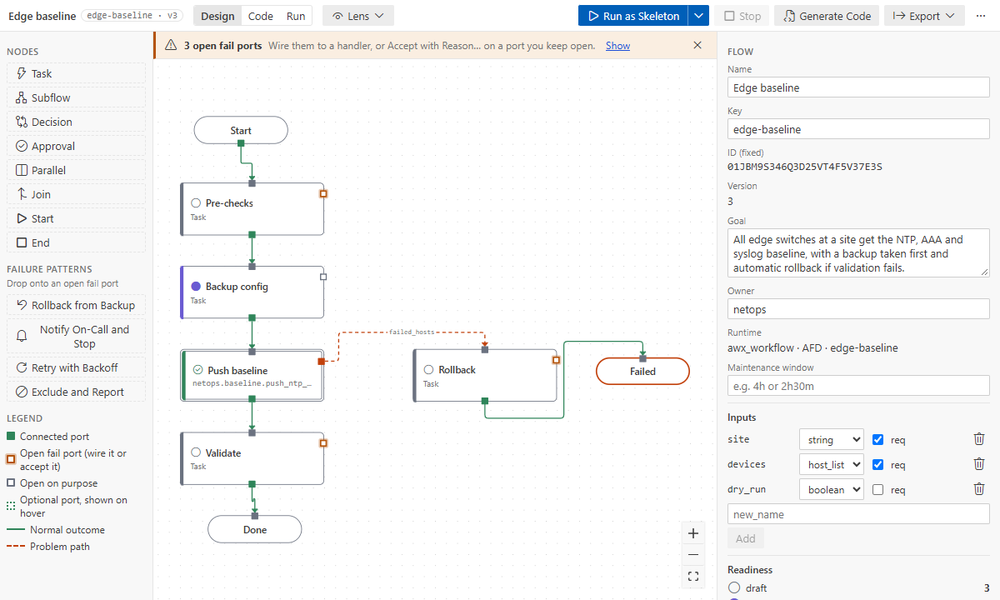
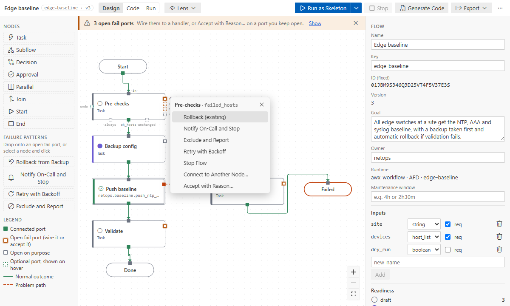

# Ports and failure patterns

Hosts leave a node through its **ports**: the ones that succeeded through `ok_hosts`, the ones that
failed through `failed_hosts`, and so on. Each port is wired to the next node, or left open. Every
**fail port** needs a handler, or a reason to leave it open (**Accept with Reason…**).

## Ports per node type

| Type          | Ports                            | Optional (enable when needed)                                        |
| ------------- | -------------------------------- | -------------------------------------------------------------------- |
| start         | `ok_hosts`                       |                                                                      |
| end           | `in`                             |                                                                      |
| task, subflow | `in`, `ok_hosts`, `failed_hosts` | `unreachable`, `unchanged`, `always`, `cancelled`, `timeout`, `undo` |
| decision      | `in`, `true`, `false`            |                                                                      |
| approval      | `in`, `approved`, `rejected`     | `timeout`                                                            |
| parallel      | `in`, `branch_1..n`              |                                                                      |
| join          | `in`, `ok_hosts`                 | `failed_hosts`                                                       |

**Fail ports** are `failed_hosts`, `unreachable`, `timeout` and `rejected`.

## What a port looks like

- At rest, a node shows its wired ports, its **open fail ports** (amber) and ports left open on
  purpose (gray).
- Hover or select a node to see every port its type has, with names.
- The banner at the top counts open fail ports; **Show** selects them one by one.



## The port menu

Click a port.



- **An open fail port** offers suggestions for its kind. `failed_hosts`: Rollback, Notify on-call
  and stop, Exclude and Report, Retry, Stop flow, Connect to Another Node…, Leave open
  on purpose…. `unreachable` never offers Rollback: an unreachable host cannot be rolled back.
- **A wired port** offers Insert Node on This Wire, Rewire to Another Node… and Disconnect.
- **An optional port** that is off shows, dotted, when you hover or select the node. Its menu
  starts with **Enable Port**; dragging a wire from it enables it too. The **Ports** tab of the
  Details lists every port with the same menu.

## Failure patterns

A pattern adds a handler node and the wires around it, in one undo step (Retry adds no node):

| Pattern                       | Adds                                       | Ends at         |
| ----------------------------- | ------------------------------------------ | --------------- |
| Rollback from Backup          | a Rollback handler (one per level, reused) | `failed`        |
| Notify On-Call and Stop       | a notify handler                           | `stopped`       |
| Exclude and Report            | an exclude handler                         | `excluded`      |
| Retry (module steps)          | retries 3, delay 10 s on the step itself   | (the same port) |
| Stop flow                     | nothing but the wire                       | `stopped`       |
| Escalate Approval (approvals) | a second approval                          | `stopped`       |

You can also drag a pattern from the palette onto an open fail port or a node.

**End nodes:** a pattern reuses an end node of this level only when it has the pattern's key
(`stopped`, `failed`, `excluded`, `done`). Otherwise it adds a new one. So a rejected approval
does not land in "Rolled back" just because both end with outcome failed. To merge two ends,
rewire one port to the other end.

## Leave open on purpose

Some failures should just fail the run, for example a read-only check during a change window.
Choose **Accept with Reason…** and give the reason. The flow records it with your Git user name
(shown here by key; the file stores the node's ID):

```yaml
decisions:
  - kind: accepted
    node: check-ntp
    finding: port:failed_hosts
    reason: Read-only check; failing the run is enough
    by: Jane Example
```

(In a format 1 flow the same decision reads `kind: open_on_purpose` with `port: failed_hosts`.)

The warning goes away. The hosts still fail at the end of the run, with your reason in the
message. Wiring the port later removes the decision in the same edit.

## Success ports that lead nowhere

A success port (`ok_hosts`, `unchanged`, a decision branch) that is not wired strands its hosts:
they stop there without reaching an end node. The designer warns at every level:
`success-port-unwired` on the top level, `inner-exit-unmapped` inside a subflow (wire it on, or
make it an exit of the subflow).

## What happens at run time

Every task rescues its failures, so failed hosts take their port instead of stopping the play. A
final **outcome play** fails the hosts left on open ports or on failed end nodes. The job still
ends red, but every branch runs first.

A module step without the optional `unreachable` port treats unreachable hosts as Ansible does:
they fail the run (or the enclosing subflow's `unreachable` port, when it has one). The banner does
not count this, since nearly every step would be listed; enable `unreachable` on the steps where
you want to handle it.

See also: [control flow](control-flow.md), [problem codes](../reference/problems.md).
