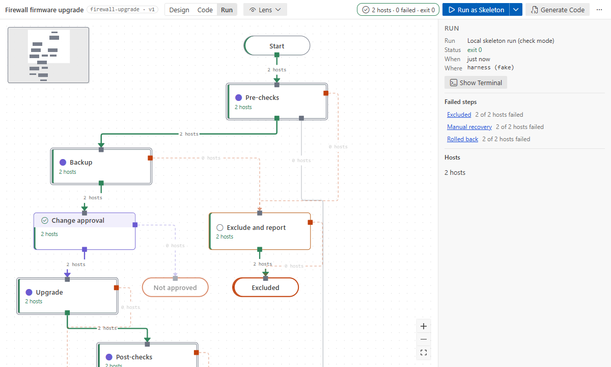

# Runs and environments

Designing needs no Ansible. Runs, syntax checks, the module catalog and Code mode need an
**Ansible environment** with ansible-core 2.19 or later.

## Choose an environment

The quickest way: **Set Up Ansible Environment…** (Command Palette, or the button on the error a
run shows when it has nowhere to run). It looks for Docker and Podman and proposes the public
Ansible dev tools image, `ghcr.io/ansible/community-ansible-dev-tools:latest` (ansible-core 2.21
at the time of writing; replace it with your organisation's image if you have one). The first run
pulls it, which takes a few minutes. On Windows it also lists your WSL distributions: Ansible then
runs inside the one you pick, from Windows VS Code, and you install it there yourself
(`pipx install ansible-core`). Or set it by hand:

| You have                                                              | Set                                                                                                  |
| --------------------------------------------------------------------- | ---------------------------------------------------------------------------------------------------- |
| Docker or Podman                                                      | `afd.environment.image` = an execution environment image, e.g. `registry.example.net/ee/netops:2.19` |
| a WSL distribution on Windows with Ansible installed in it            | `afd.environment.kind` = `wsl`, and `afd.environment.wslDistro` = its name (empty: WSL's default)    |
| VS Code Remote (WSL, SSH, Dev Container) with Ansible installed there | nothing: local mode runs inside the remote                                                           |
| a local venv with Ansible                                             | `afd.environment.python` = its interpreter, or leave it to `ansible.python.interpreterPath`          |

`afd.environment.kind` is `auto`: `container` when an image is set, else `local`. With the Red Hat
Ansible extension enabled, its execution environment image and container engine are used when ours
are empty. `afd.environment.containerOptions` adds `docker run` arguments, e.g. to mount your SSH
keys: `["-v", "/home/jane/.ssh:/home/ansible/.ssh:ro"]`.

**WSL:** the distribution sees your drives under `/mnt` (`C:\repo` is `/mnt/c/repo`), so the
repository stays on Windows. WSL 1 and WSL 2 both work. Install Ansible there as on Linux, e.g.
`pipx install ansible-core`, and the collections your flows use (`ansible-galaxy collection
install cisco.ios`): an image brings them, a distribution does not. The extension uses the PATH of
a login shell (so `~/.local/bin` counts) and the Python on the first line of `ansible-playbook`,
so a pipx venv needs no setting (`afd.environment.python` overrides it). Name the distribution:
with Docker Desktop, WSL's default may be `docker-desktop`, which has no Ansible.

Runs on `/mnt` are slower than on Linux disks. SSH keys and `~/.ansible` come from your home folder
in the distribution, not from Windows: keep keys there with `chmod 600`, as ssh refuses a key under
`/mnt/c`, which looks readable to everyone. For the same reason Ansible would ignore the
repository's `ansible.cfg`; the extension names it explicitly, as it does for containers. WSL 1
shares the network of Windows: an antivirus that inspects HTTPS breaks downloads in WSL 1 (apt,
`ansible-galaxy`, `get_url`) until the distribution trusts the antivirus's root certificate. WSL 2
is not affected.

The extension talks to the environment through a small Python helper that uses only the standard
library, so any image with ansible-core works.

## Run as Skeleton

**Run as Skeleton** in the designer (top bar, or Ctrl+F5) opens the **launch dialog**:
- every flow input, by name and type, with what it was last time (remembered per flow) or its
  default; the first skeleton run suggests `localhost` for the hosts;
- host lists take hosts or groups, comma-separated; the inventory's groups are buttons under the
  field. Lists take items separated by commas (`10.20.0.10, 10.20.0.11`) or a JSON list, and the
  dialog says what the field reads as ("2 items: …"). Dicts take `key: value` lines or JSON;
- the hosts the targets match in the inventory, counted again as you change them;
- **Run as Skeleton**, which generates the code and runs `ansible-playbook --check` in your
  environment. Escape or Cancel closes the dialog.

From the Command Palette (**Ansible Flow: Run as Skeleton**), or with no designer open, the run
asks for each input in an input box instead.

## While a run goes

- **The canvas follows it.** A run started from the designer switches it to **Run** mode. The step
  that runs now has a pulsing outline and reads "running…"; a subflow does too while a step inside
  it runs. Steps that are done show their hosts as they finish, about every half second, and steps
  not reached yet read "waiting". The top bar says which step runs.
- **The terminal stays out of the way** while the flow's designer is open: the run's output goes
  to its own terminal, which is not brought forward.
  - It shows by itself when the canvas cannot explain the run: the run did not start, produced no
    events, or failed before its first step (an inventory or syntax error).
  - **Show Terminal** (top bar, run panel) brings forward that run's terminal, not just the last
    one. With no designer open, the terminal shows as before.
- **No new events for 20 s:** a notification and the top bar say so, with **Show Terminal**. A
  step may be slow, or the run may be waiting for input there (an SSH host key question, a
  `pause`).

Unbound steps print `TODO: <intent>`. Bound modules run in check mode; the catalog badges say which
modules support it.

## The Inventory view

**Inventory**, in the **Ansible Flows** view of the Activity Bar, lists the inventory the runs use
(`afd.run.inventory`, else `ansible.cfg`'s), read in your Ansible environment. Each group shows its
host count and opens into its child groups and its hosts. **Run Flow on This Group…** (the play
button on a group or a host) opens the launch dialog of the flow you are working on, with that group
as its targets. **Refresh Inventory** reads it again after you edit the inventory.

## Run for real

**Run for Real…** (under the arrow of _Run as Skeleton_) opens the same dialog. It also says, in
words, what the run touches:
- the inventory (`afd.run.inventory`, else `ansible.cfg`'s default);
- how many hosts match the targets, and hosts missing from the inventory;
- groups whose names look like production.

**Run for Real** in the dialog runs with no further question. Just before it starts, the run
counts the hosts again: when the inventory answers differently from what the dialog showed, nothing
runs, and the dialog opens again with the new facts. From the Command Palette the same facts come
as a confirmation.

The vault password is asked per run (in the dialog, a field) when the inventory or repository vars contain vault data
(`afd.run.askVaultPassword`). It is passed through an environment variable, never stored or logged.
Secret-looking inputs (names with password, secret, token, key or vault) are typed hidden, travel
the same way and are never remembered. Other input values are written for the run only and deleted
when it ends.

## After a run

- While a run goes, the Run button is **Stop** (or **Ansible Flow: Stop Run**, Shift+F5): it ends
  the run, which shows as stopped, not failed.
- The top bar shows hosts, failures and the exit code; **Show terminal** brings the output back.
- In **Run** mode, nodes show "3 hosts · 1 failed · 2.1 s", wires show how many hosts took them.
  Select a node or a wire to list the hosts and why they failed. For a local run, **Output** on a
  host's row shows what each task of that step printed for it: `msg`, `stdout` and `stderr` (up to
  2000 characters each), changed and the return code. A `no_log` task shows only that its output
  is hidden. Secret inputs never appear: their values are replaced in the run's kept events. With nothing selected, the panel
  lists the **Failed steps** of every level; click one to open it where it is.
- Every launch goes to a local audit log (**Ansible Flow: Show Run Audit Log**): who, when, which
  flow version, which targets, without input values. It rotates at 1 MB and keeps two older files;
  each flow keeps the event logs of its last 30 runs (`afd.runs.keep`).
- Runs need a trusted workspace: in Restricted Mode you can design and generate, but not run
  ([settings](../reference/settings.md#restricted-mode)).
- After a passing real run of the current flow version, the run panel offers **Mark N nodes
  tested**.

## Approvals in local runs

Approvals approve by themselves in local runs. To try another path, run the generated playbook from
a terminal with `afd_approvals` ([approvals](approvals.md)).

## Syntax check

**Ansible Flow: Check Flow** runs `ansible-playbook --syntax-check` in the
environment and puts errors on the generated files in the Problems panel.
