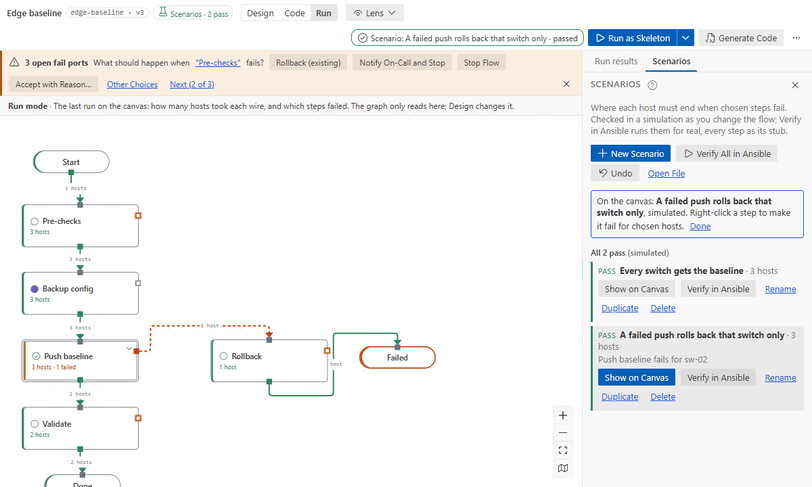
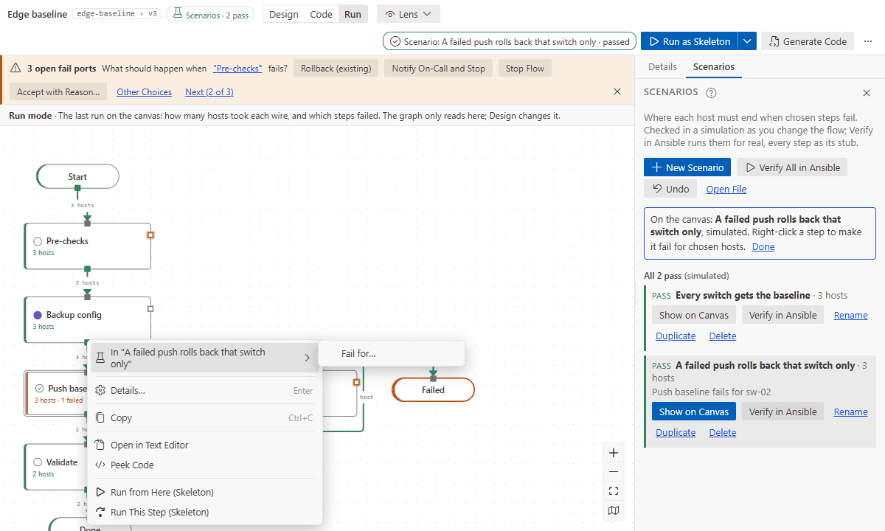

# Scenario tests

A scenario says what happens to each host when chosen steps go wrong: which hosts fail where, and
the end each host must reach. The designer checks it two ways:

- **As you edit,** in a simulation of the generated code. It answers in milliseconds, without
  Ansible.
- **In Ansible,** when you ask. The flow runs with every step as its stub: no module, role or
  playbook runs, and nothing leaves the machine.

Scenarios live next to the flow, in `<flow key>.scenarios.yaml`, so a pull request that changes the
routing shows the scenarios it changes. The designer writes the file for you; you can also edit it
by hand.

## Add a scenario

The **Scenarios** chip in the top bar says how the flow's scenarios stand ("Scenarios · 3 pass",
"Scenarios · 1 failing"), or offers **Add Scenarios**. It opens the **Scenarios** tab in the side
panel.

**New Scenario** asks for a name and a number of hosts (`host-01`, `host-02`, …: names only, they
run on this machine). The scenario starts with every host where the flow sends it now, so it passes,
and from then on it guards that routing.



## Plant what goes wrong

**Show on Canvas** shows a scenario's simulated run in Run mode: hosts on every wire, and where
each one ended. Right-click a step, then **In "<scenario>"**:

- **Fail for…**, **Unreachable for…**, **Time Out for…** or **Unchanged for…**, for the ports the
  step has, then tick the hosts;
- **Take False for…** on a decision (every other host takes true: the steps that feed its condition
  are stubs);
- **Approved**, **Rejected** or **Timed Out** for the run, on an approval;
- **Expect host-0x Here** on an end node.



The canvas and the tab update as you choose. A row says what the scenario plants ("Push baseline
fails for sw-02") and where a host now ends when that is not where the scenario expects it ("sw-02
now ends at Validate's open failed_hosts; expected Done").

- **Accept New Ends** writes the new ends as the expectations, when the new routing is what you
  want.
- Each change is one edit of the scenarios file, and **Undo** in the tab takes the last one back.
- **Rename**, **Duplicate** and **Delete** are on each row.

## Read the results

- **In the tab:** every row has its simulated verdict. Under it is the last run in Ansible
  ("Ansible: passed 5 min ago"), marked _out of date_ once the flow's routing or the scenario
  changes. A status, a position or a note is no routing change.
- **In Problems:** the file is checked as you type, open or not. Steps, ports, hosts and ends that do
  not exist are errors. A host that runs but has no expectation is a warning: nothing checks where it
  ends. A host the simulation sends elsewhere gets a warning on its `expect` line, and the flow gets
  one per failing scenario.
- **Best effort:** a few things are not modelled by the simulator, and a scenario that uses one is
  marked _simulated as a best effort_:
  - a host pattern among the hosts;
  - a regex or slice in an `inventory_target`;
  - Jinja in a title, intent or output default that a stub run renders;
  - `serial` with `max_fail_percentage`.

  Verify those in Ansible.

## In the Testing view

VS Code's **Testing** view lists every flow with scenarios, and its scenarios under it. It has two
ways to run them:

- **Check (simulated)**, the default: instant.
- **Verify in Ansible**: the stub run described below.

A failing scenario's message points at the `expect` line of each host that ended elsewhere.

## When the flow changes

Renaming a step, an end or a subflow, or extracting steps into a subflow, renames them in the
scenarios file too, in the same edit, and saves it with the flow. The flow tools of AI assistants do
the same. Deleting a step leaves its name in the file, and Problems says it is gone.

## Run them in Ansible

**Verify in Ansible** (a row, or **Verify All in Ansible**), **Run ▾ › Run Scenarios** and the
Command Palette's **Run Scenarios** run scenarios in the run environment: the Ansible image or
Python you run flows with. Each scenario runs every step as its stub, so nothing reaches a device. A
notification says how many failed and names the first miss ("lab-sw-04 ended at Stopped; the
scenario expected Reported to NetOps").

- **Show on Canvas** (in the notification) opens the first failing scenario in Run mode, like a run:
  each step shows the hosts that took its ports, and each wire how many took it.
- **The run panel** (Run mode, nothing selected) lists every scenario: pass or fail, and each host
  that ended elsewhere, by the ends' titles. When the scenario planted the failure, it also says why:
  "lab-sw-04 ended at Stopped; the scenario expected Reported to NetOps, because the scenario forces
  Check uplink is redundant to fail for it (force: failed), so it leaves by failed_hosts". Click one
  to show it; **Back to Last Run** puts the last run back.
- **A failure the scenario planted says so.** The steps are stubs, so a host fails only where the
  scenario's `force` sends it. The step's Run tab says "Forced by the scenario (failed) · ended at
  Stopped; the scenario expected Reported to NetOps" for that host; the second part appears when the
  host missed. The step's binding and the inventory have nothing to do with it.
- **An end node** in a scenario lists the hosts expected there and the hosts that came, with where
  each ended.
- The full output stays in the Ansible Flow log (**Show Log**).

## Write one by hand

**Run ▾ › Run Scenarios** on a flow without scenarios offers **Create Scenarios File**: one scenario
where every host reaches the end. A scenario has:

- `inputs`: the run inputs. The flow's targets input (a host list) names the hosts; use any names
  you like (they connect locally). A host or group name is one word: letters, digits, `.`, `_` and
  `-`. Inputs set no `ansible_*` variable (`ansible_connection`, `ansible_host`): those would take
  the run off the local connection, so the file check refuses them.
- `force`: per step (its key, or `subflow/step` inside a subflow), the hosts sent down a port:
  - `failed` (to failed_hosts);
  - `unreachable`, `timeout` and `unchanged`, when the step has that port;
  - `false` on a decision.
- `approvals`: per approval, `approved` (the default), `rejected`, or `timeout` when the approval
  has that port.
- `groups`: hosts for the patterns an `inventory_target` names.
- `expect`: per host, the end node it reaches (`done`, or `subflow/end`), or `<step>.<port>` for an
  output nobody wired, where the host stops. A wired port is no place to stop: the host goes on, so
  expect the end it reaches.

```yaml
flow: edge-baseline
scenarios:
  - name: a failed push rolls back that switch only
    inputs:
      devices: [sw-01, sw-02]
      site: lab
    force:
      push-baseline:
        failed: [sw-02]
    expect:
      sw-01: done
      sw-02: failed
```

The Hello and Edge baseline samples (**Open Sample Flow…**) come with scenarios like this one.

## With an AI assistant

The flow tools have `flow_scenarios`. An assistant can:

- list and check scenarios in the simulation;
- add one by step key (the expectations default to where the simulation sends each host);
- update one, or take the new ends;
- delete one;
- verify them in Ansible.

`flow_describe` says how a flow's scenarios stand. See [AI assistants](ai-assistants.md).

In Copilot, verify is **Run Scenarios**, so it needs a trusted workspace. Terminal agents verify
through the MCP server, which runs Ansible in the environment of your VS Code **user** settings
(`afd.environment.*`, as **Set Up Ansible Environment…** writes them). A repository's own
`.vscode/settings.json` can name an image, container options or mounts, so the server ignores those
keys there unless you start it with `AFD_MCP_WORKSPACE_ENVIRONMENT=1`. `AFD_USER_SETTINGS` names
the user settings file when it is not found. The repository's `ansible.cfg` never applies to a
scenario run.

## In CI

**Ansible Flow: Copy Scenario Runner to Repository** puts the command-line runner into
`.afd/afd-scenarios.js`; commit it. A CI job with Node and Docker runs every flow's scenarios:

```bash
node .afd/afd-scenarios.js --image ghcr.io/example/netops-ee:2.19 --junit scenarios.xml flows
```

It exits 1 when a scenario fails, and writes JUnit XML for the CI's test report. Where it runs:

- **Default:** `ansible-playbook` on the runner (Linux; `--python` names the interpreter).
- **`--wsl`** (or `--wsl-distro NAME`): WSL, from Windows.

Each scenario runs in a folder of its own under the system temp folder. With `--python` and `--wsl`
only you can read it. With `--image`, the image's user can read it and writes the run's events
into an `events` folder inside; nothing else in the run folder is writable by others.

Two options need no Ansible:

- `--simulate` works out where each host goes in a few milliseconds, the way the generated code
  routes them. A scenario that uses something the simulator does not model is skipped (`SKIP`, and
  `<skipped/>` in JUnit), with the reason.
- `--check` only checks the scenario files against their flows.

`--help` lists every option.
