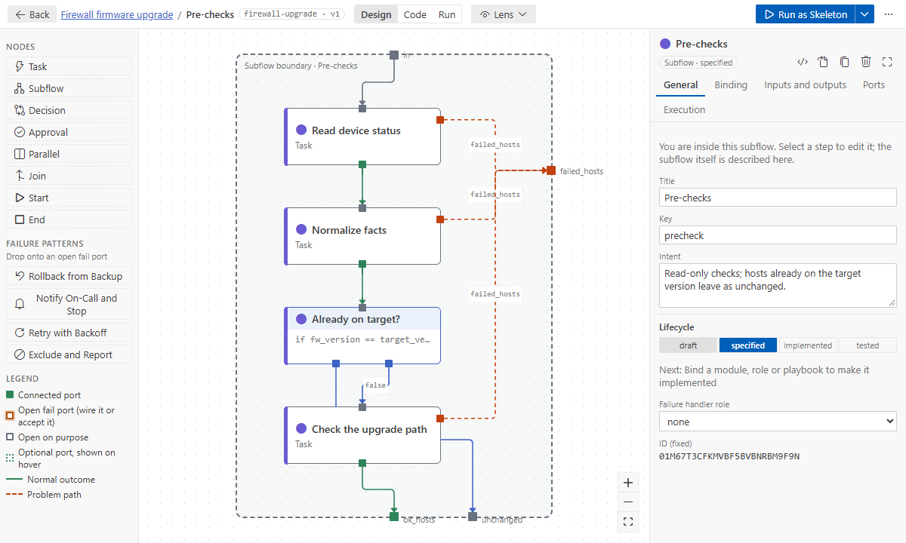
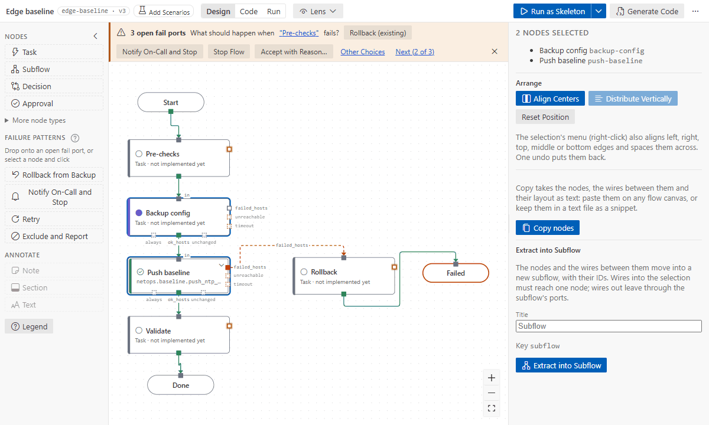

# Subflows

A **subflow** node is a phase with its own inner steps: a level of its own. Use subflows to keep each
level short, top-down: the top level reads like a runbook, and each subflow holds the details of one
phase.

## Open, navigate, go back

- Double-click a subflow, press **Enter**, or use **Open Subflow** (node menu, its Details, its
  preview card).
- **Back**, the breadcrumb, or **Alt+↑** returns to the parent level.
- With nothing selected, the right panel describes the subflow you are in (its title, intent,
  contract and ports), not the whole flow.
- Chips at the top show the settings of the subflows around you. The inner steps inherit the
  inventory target (**inherits …**). In a format 2 flow they also inherit **become** and its user
  (Execution › Privilege), the nearest subflow's setting winning, so a step can still turn it off.
  In a format 1 flow become set on a subflow is shown as **not applied**: set it on the steps.
  Serial is per node: it batches the hosts of that node's own play.
- Pause on a subflow node to preview its inner steps, exits and last-run results.



## The boundary

A dashed **boundary frame** carries the subflow's own ports: `in` on top, outcomes below, problems
on the right.

- **Entry:** drag from the frame's `in` to the inner step that receives the hosts. The first step
  you add to an empty subflow becomes the entry.
- **Exits:** drag from an inner port to a frame port. For example, the last step's `ok_hosts` to the
  frame's `ok_hosts`, and every inner `failed_hosts` to the frame's `failed_hosts`. An optional port
  (such as `unchanged`) is enabled on the subflow when you use it.
- **Exit reasons:** select an exit wire to give it a reason (shown on the wire, e.g. _SSH timeout_),
  or to remove it.

Hosts that leave through an exit continue from the subflow node's port of the same name on the
parent level.

## Extract steps into a subflow

1. Select several connected steps: Ctrl+click, or Shift+drag a box.
2. **Extract into Subflow** in the right panel (or the selection's right-click menu), and give it a
   title.



The steps and the wires between them move into the new subflow, with their IDs, in one undo step:
- wires in must reach one step, which becomes the entry;
- wires out become exits through the subflow's ports;
- outputs that steps outside read become subflow outputs, and those references are rewritten.

It works inside subflows too.

## Data across the boundary

- **An inner step reads its subflow's input** as `from: <subflow key>.<input>`, e.g.
  `rollback.backup_file`.
- **Steps outside read what the subflow lifts:** a subflow output names the inner output it lifts
  (`from: store.backup_file`). Without `from`, it lifts the inner output of the same name.
- **The @ picker lifts for you** when you pick an output of a step inside another subflow.

Details in [data between steps](data-between-steps.md).

## What the validator checks

A missing entry, outer ports no inner step feeds, inner outcomes that lead nowhere, exits that
refer to steps outside, and subflow outputs nothing inside sets.

## Rolling subflows

By default each step of a subflow runs on every arriving host before the next step starts. For a
rolling change (upgrade a few switches at a time, each fully, then the next few), set **Rolling
batch** on the subflow (Execution › Targeting): a number of hosts, or a percentage like `25%`.

```yaml
settings:
  rolling: 2 # 2 hosts at a time through every step inside
```

The subflow's steps then run in one play with `serial: 2`: a batch goes through all of them, the
hosts take the same ports as without rolling, and then the next batch starts. The level shows a
`rolling, 2 at a time` chip.

Every step must fit in one play: tasks (bound to a module or a role, or not bound yet), decisions
and end nodes. A nested subflow, an approval, a parallel or join, a playbook binding, an
`inventory_target`, or a step's own `serial` or `max_fail_percentage` needs plays of its own: the
validator reports `rolling-unsupported` on that step, and the code runs the steps play by play.
`serial` on the subflow node itself batches nothing inside; use **Rolling batch**.

## Shared subflows

A subflow written once can be used in other flows: **Insert Shared Subflow…** (the canvas menu, or the
Command Palette) lists the subflows of every other flow in the workspace and copies the one you pick
here, pinned to that flow's version (format 2):

```yaml
- key: backup
  type: subflow
  title: Backup
  ref:
    from: ../shared/backup.flow.yaml#backup # the file, relative to this flow, and the subflow
    version: 3 # the source flow's version the copy was made from
    design: 6c1f0a2e # a fingerprint of the copy as it was made
  subflow: ... # the copy itself: the code, runs and reviews need nothing else
```

- Its level shows **shared from … · edit it there** and takes no edits: change the source flow.
- When the source flow has a newer version, the copy shows a problem with **Update Shared Subflow**:
  it copies the subflow again (its steps start untested: they have not run here). Saving the source
  is enough for open flows to notice.
- A copy changed here anyway (by hand or by an agent) is flagged (`shared-edited`); **Unlink Shared
  Subflow** makes it this flow's own, to edit here.
- A source that is gone (the file or the subflow) is an error, with Unlink as the way out.

The flows of a folder such as `flows/shared/` become a pattern library: real flows, tested like any
other, whose subflows the others reuse.

## Generated code

Each subflow level is its own playbook, `generated/<flow key>.<subflow key>.yml`, imported where
the subflow node sits; a rolling subflow's level is one play. See [generated code](code-generation.md).
