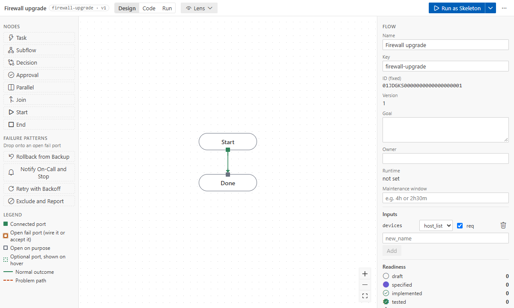
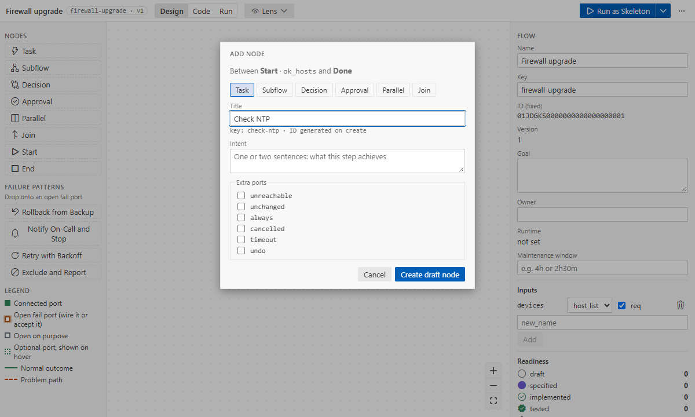
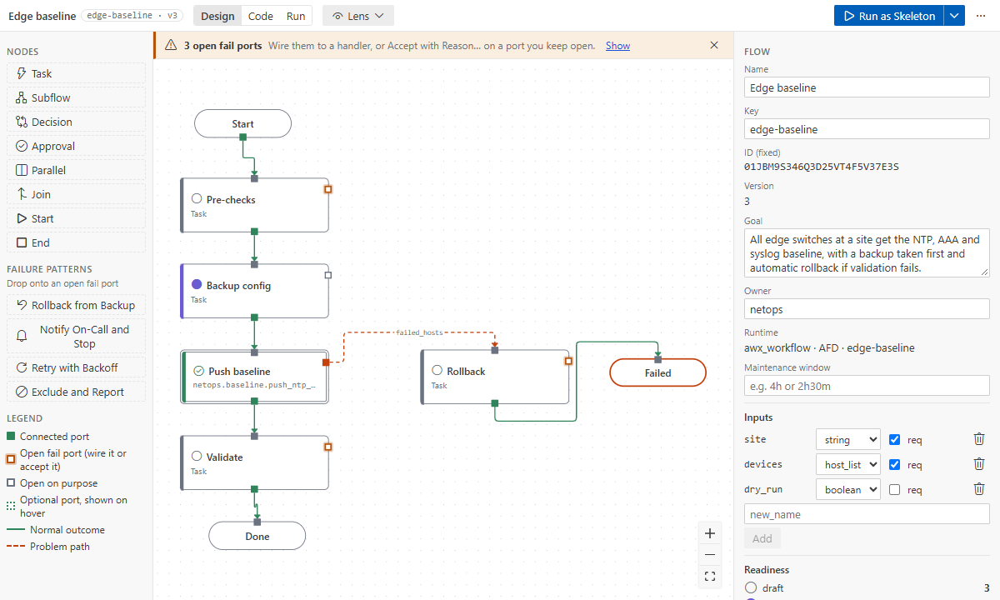
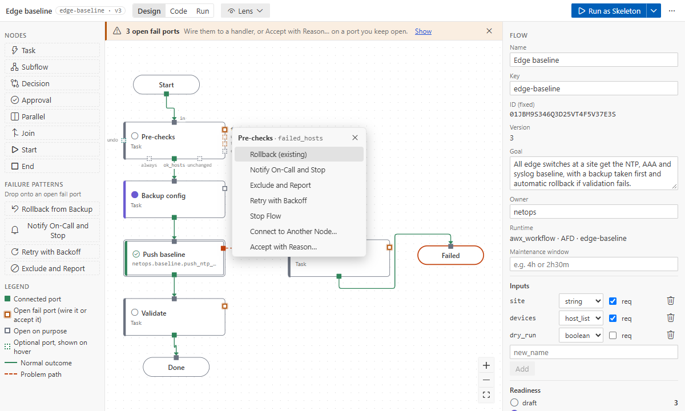
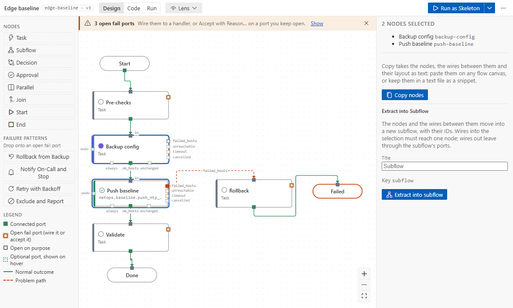
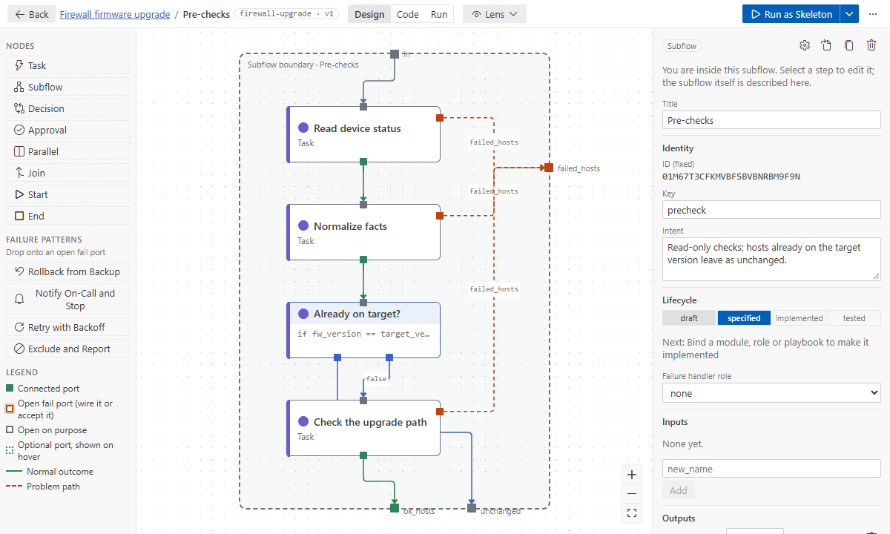
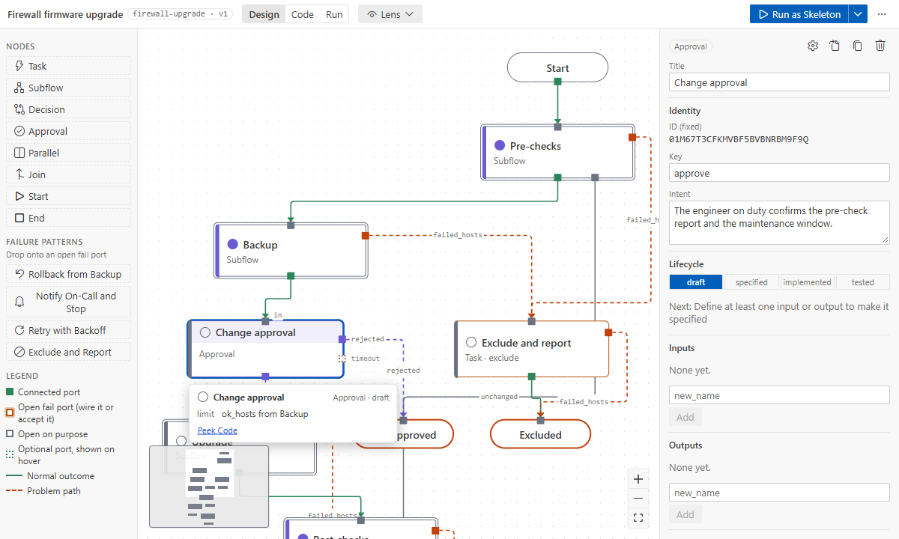
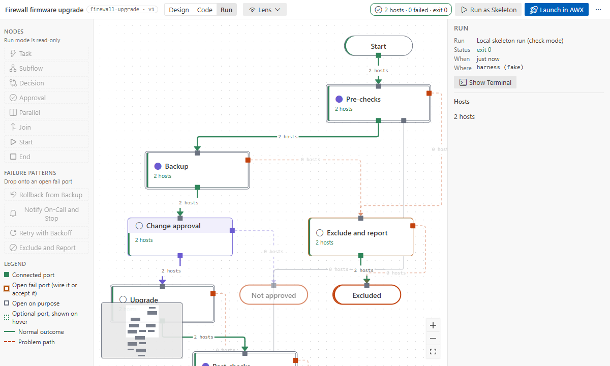

# Tutorial 1: your first flow

**Goal:** design an "NTP baseline" flow for switches. You will add steps, handle every failure,
put the details in a subflow, see the generated playbook and run the flow as a walking skeleton.

**Time:** 15 minutes. **You need:** VS Code with the extension and a folder open (an empty one is
fine). Designing needs no Ansible. Only the last step, the skeleton run, needs an Ansible
environment ([runs and environments](../how-to/runs-and-environments.md)).

## 1. Create the flow

1. Command Palette (Ctrl+Shift+P) → **Ansible Flow: New Flow…**
2. Name it `NTP baseline`.

The extension creates `flows/ntp-baseline/ntp-baseline.flow.yaml` and opens it in the designer.
A new flow has a **Start** and a **Done** node, and one flow input, `devices`: the hosts the flow
runs on.

What you see:
- the **palette** on the left (node types and failure patterns);
- the **canvas** in the middle;
- the **flow panel** on the right (name, goal, inputs) when nothing is selected, or the
  **inspector** of the selected node.

> The file is plain YAML. **Open in Text Editor** in the top bar's "…" menu opens it next to the
> designer; both edit the same document, so undo, save and Git work as usual.

## 2. Add steps on the wire

Hosts travel along wires. To put a step between Start and Done:

1. Click the wire's source port, the small square under **Start** (`ok_hosts`).
2. Choose **Insert Node on This Wire**.
3. In Quick add, keep **Task**, type `Check NTP` and press Enter.

Add two more steps the same way, each on the wire after the previous one: `Push NTP servers` and
`Verify sync`. New nodes go next to where they belong; **Tidy Up** in the top bar's "…" menu lays
out the whole level again. Select a step to give it an **intent** in the inspector, one sentence on what it
does. The skeleton run prints it, and AI assistants and catalog searches use it.

Other ways to add a node: click or drag a type from the palette; drag from a port and release on
empty canvas; right-click the canvas → **Add Node Here…**. See
[canvas basics](../how-to/canvas-basics.md).

## 3. Handle every failure

Each task has a `failed_hosts` port. An **amber** port is a failure nobody handles yet, and the
banner at the top counts them.

Click an amber port to get the suggestions for it:

Handle the three ports:

| Step             | Port           | Choose                                                      | Why                                                   |
| ---------------- | -------------- | ----------------------------------------------------------- | ----------------------------------------------------- |
| Check NTP        | `failed_hosts` | **Exclude and Report**                                      | a read-only check: take those hosts out and list them |
| Push NTP servers | `failed_hosts` | **Notify On-Call and Stop**                                 | the change failed: someone must look                  |
| Verify sync      | `failed_hosts` | **Accept with Reason…**, reason "Verification only reports" | the run should fail for them, and that is expected    |

Each choice is **one undo step** (Ctrl+Z). A pattern adds a handler node and an end node, or
reuses an end node of the same kind on this level. _Leave open on purpose_ records your reason
and your Git user name in the flow. The banner is gone when every fail port is handled. More in
[ports and failure patterns](../how-to/ports-and-failure-patterns.md).

## 4. Put the details in a subflow

Keep the top level readable: "push" and "verify" are one phase.

1. Click **Verify sync**, then Ctrl+click **Push NTP servers**.
2. In the right panel, under **Extract into Subflow**, type the title `Apply baseline` and click
   **Extract into Subflow**.

The two steps move into a new **subflow** node, with their IDs and in one undo step. Wires that
left them become the subflow's exits: hosts that fail in _Push NTP servers_ now leave through the
subflow's `failed_hosts` to the notify handler. Double-click the subflow (or press Enter) to open
it. **Back** (or Alt+↑) returns to the top. See [subflows](../how-to/subflows.md).

## 5. Check and save

Run **Check Flow** (top bar "…" menu). The Problems panel lists what is left, each with its
fix. Then save (Ctrl+S).

Saving a flow without errors writes the playbooks next to it: `generated/ntp-baseline.yml` and
`generated/ntp-baseline.apply-baseline.yml` for the subflow level. Select a node: the inspector
shows its generated play.

> Do not edit files in `generated/`: they are rewritten from the flow. If you edit one anyway,
> the extension asks before overwriting it. See [generated code](../how-to/code-generation.md).

## 6. Run it as a walking skeleton

Your steps are not bound to code yet. In a skeleton run each of them prints `TODO: <intent>` and
succeeds, so you can run the whole flow now.

1. Click **Run as Skeleton** in the top bar.
2. For `devices`, enter `localhost` (or hosts from your inventory, comma-separated).

The extension generates the code and runs `ansible-playbook --check` in a terminal, in your Ansible
environment. When it finishes, the top bar shows the hosts, failures and exit code. Switch to
**Run** in the top bar: every wire shows how many hosts took it.

No Ansible environment yet? See [runs and environments](../how-to/runs-and-environments.md) and
[troubleshooting](../troubleshooting.md).

## What you learned

- A flow is a diagram in a YAML file. Every canvas action is one small, undoable text edit.
- Hosts travel along wires from port to port, and every fail port needs a handler or a reason.
- Subflows keep each level short.
- Saving generates the playbooks, and a skeleton run works before any code exists.

**Next:** [Tutorial 2: from design to production](02-design-to-production.md) binds these steps to
real modules.
