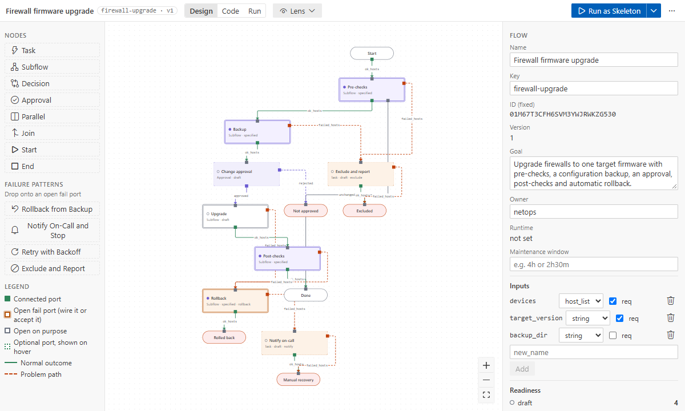
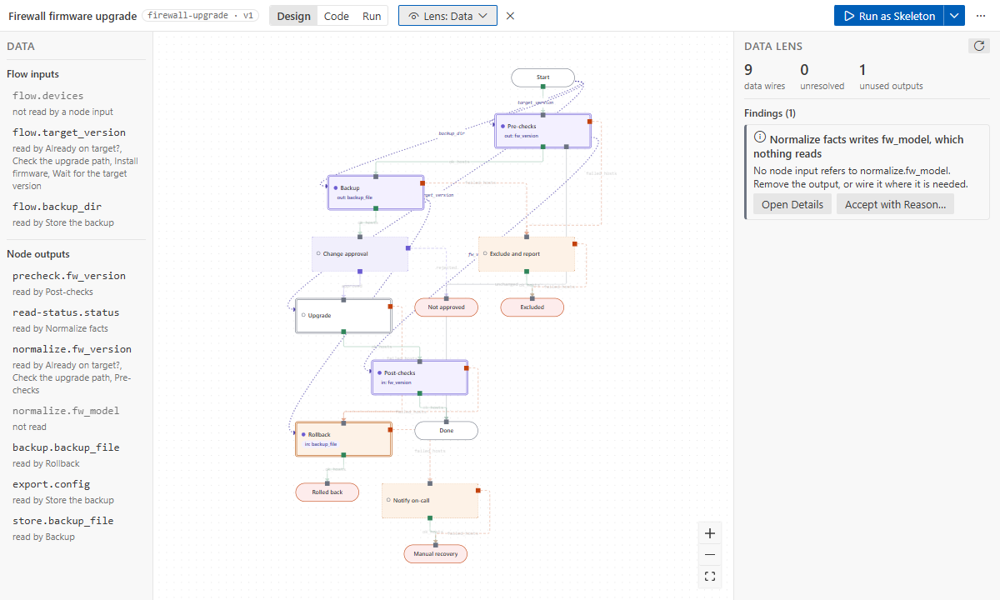
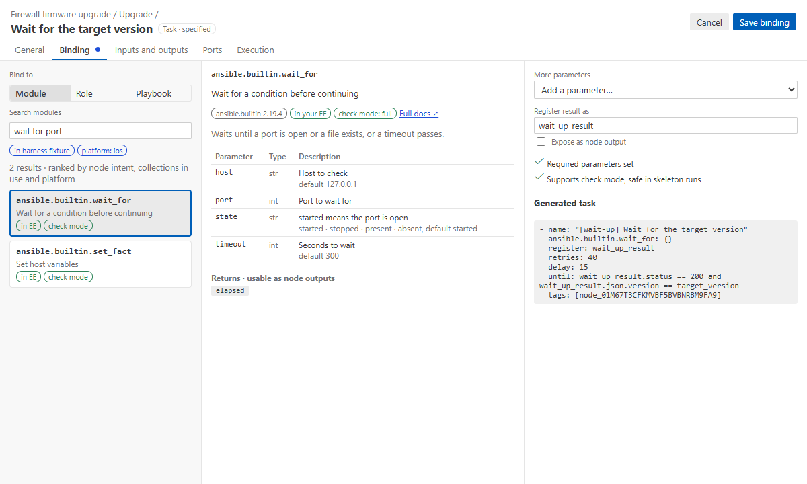
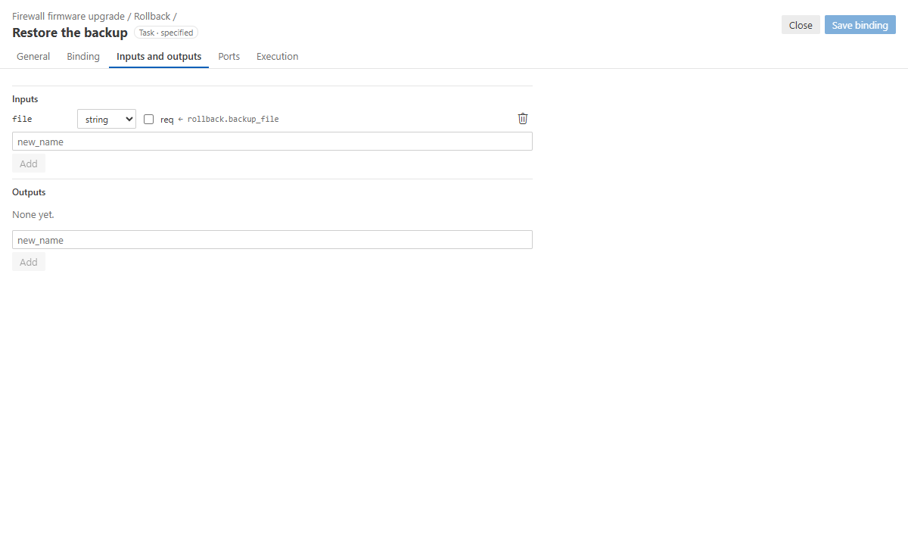
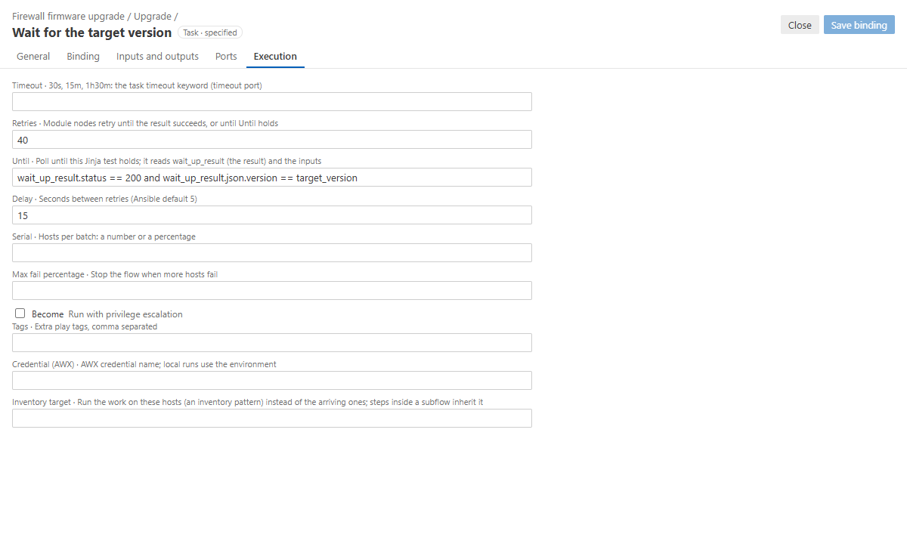
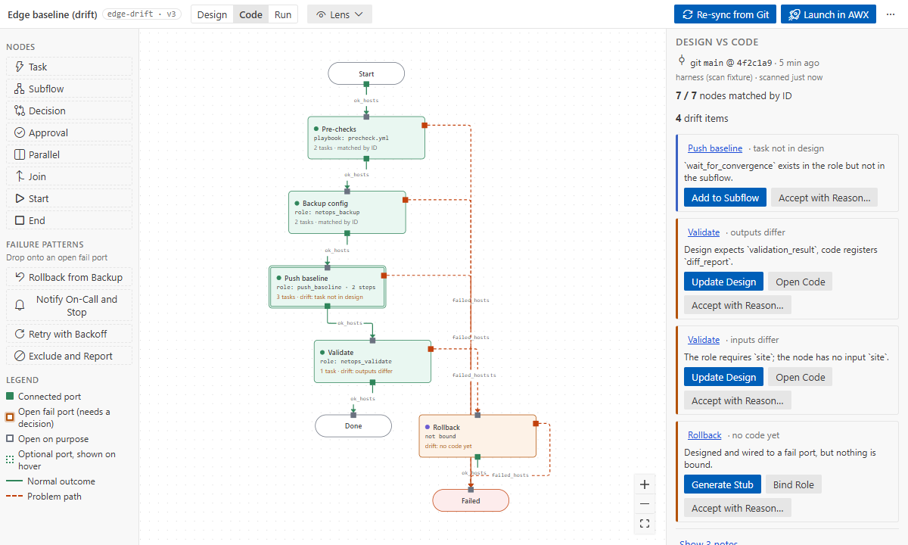

# Tutorial 2: from design to production

**Goal:** take a designed flow to code that runs for real. You will bind steps to modules from your
environment's catalog, pass data between steps (also across subflows), make a step poll until a
device is back, compare the design with the code, and run the flow for real.

**Time:** 30 minutes. **You need:**
- an Ansible environment with ansible-core 2.19 or later ([runs and
  environments](../how-to/runs-and-environments.md)), for the catalog and the runs;
- [Tutorial 1](01-first-flow.md), or the basics of the canvas.

## 1. Open the sample

Command Palette → **Ansible Flow: Open Sample Flow…** → **Firewall firmware upgrade**. It is
copied to `flows/firewall-upgrade/firewall-upgrade.flow.yaml`.



The top level reads like a runbook: pre-checks, backup, approval, upgrade, post-checks. Failed
hosts go to rollback, notify or exclude. Hosts already on the target version leave the pre-checks
through `unchanged`, straight to Done. The steps are **specified**: they declare their inputs and
outputs but run no code yet.

## 2. See the data

Top bar → **Lens** → **Data**. Dotted wires show where each step's inputs come from. The left panel
lists the flow inputs and every output with who reads it.



The finding on the right says _Normalize facts writes fw_model, which nothing reads_. A lens never
edits the flow; it shows and suggests. Close it with ✕.

How data is written in the flow (details in [data between steps](../how-to/data-between-steps.md)):

| Where the value comes from                         | `from:`                                 |
| -------------------------------------------------- | --------------------------------------- |
| a flow input                                       | `flow.target_version`                   |
| an output of an earlier step on this level         | `read-status.status`                    |
| inside a subflow: the subflow's own input          | `rollback.backup_file`                  |
| a subflow's output, lifted from its inner step     | `precheck.fw_version`                   |
| the step's registered module result (outputs only) | `impl.register` or `impl.register.json` |

## 3. Bind a step to a module

Double-click **Pre-checks** to open it, select **Read device status**, and click the gear in the
inspector. The Details page opens over the canvas. On **Binding**:

1. **Module** is selected. Search by what the step does, e.g. `http request json`. The first search
   in a folder reads your environment's collection docs (about 30 seconds, then cached).
2. Pick **ansible.builtin.uri**. The middle column explains it: parameters, returns, an example.
3. Configure: `url` = `https://{{ inventory_hostname }}/api/v2/status`.
4. In the right column, set **Register result as** to `status` (the name the next step already
   reads) and tick **Expose as node output**: the whole module result becomes the output
   `status` (`from: impl.register`), its JSON answer under `status.json`.
5. **Save binding**. The binding, the output and the status `implemented` are one undo step.

To expose one part of the result instead, click it under **Returns** in the middle column: `json`
becomes an output of the same name, `from: impl.register.json`.



Values are Jinja. In a parameter, type `@` (or use the @ button) to insert an input as a purple
chip. Choosing a flow input or an upstream output that is not an input yet adds it, with its
`from:`. More in [binding and the catalog](../how-to/binding-and-catalog.md).

## 4. Pass data along

Select **Normalize facts**, bind **ansible.builtin.set_fact** and set:

```yaml
fw_version: "{{ status.json.version }}"
fw_model: "{{ status.json.model }}"
```

`status` is an input of this step (`from: read-status.status`), so the chip resolves. Its outputs
`fw_version` and `fw_model` are facts of the same name.

Now look at the **Inputs and outputs** tab of a step inside **Rollback**, _Restore the backup_:



Its input `file` reads `rollback.backup_file`: the Rollback subflow's own input, which reads
`backup.backup_file`, which the Backup subflow lifts from its inner step _Store the backup_. The
generated code follows that chain and passes the real variable in.

To use a value from a step **inside another subflow**, pick it from the @ list, e.g.
`precheck/normalize.fw_model · lifts it to precheck`. The designer adds the output to the subflow
and the input to your step in one edit.

> The designer checks every name a step reads: parameters, `assert` `that:`, decision conditions
> and `until`. A warning says where the value can come from. See the
> [problem codes](../reference/problems.md).

## 5. Poll until the device is back

Open **Upgrade** and select **Wait for the target version**. A firmware install reboots the
device, so this step must ask again and again until the device answers on the new version.

1. Bind **ansible.builtin.uri** with `url` = `https://{{ inventory_hostname }}/api/v2/status`.
2. Open the **Execution** tab. The sample already has:
   - **Retries** `40` and **Delay** `15`: up to 10 minutes, one try every 15 seconds;
   - **Until** `wait_up_result.status == 200 and wait_up_result.json.version == target_version`.



`wait_up_result` is the step's registered result (the field's label says the name). `target_version`
is an input of the step. Without **Until**, retries stop at the first success. See
[retries and polling](../how-to/polling-and-retries.md).

## 6. Compare the design with the code

Bind the remaining steps the same way, or bind some to roles (**Role** in the Find column) that you
already have. Then switch the top bar to **Code** and click **Re-sync from Git**. The
extension compiles the generated playbook and every bound role and playbook in your environment.
Then it lists what differs, with an action on both sides.



For example: a role sets outputs the node does not declare (_Update design_), a role task the
subflow does not show (_Add to subflow_), or a node with no code yet (_Generate stub_ writes a role
skeleton with the node's inputs and outputs). See [Code mode](../how-to/code-mode.md).

## 7. Run for real

1. Set the inventory once: `afd.run.inventory` in the settings (e.g. `inventories/lab/hosts.yml`),
   or let `ansible.cfg` decide.
2. Top bar → chevron next to **Run as Skeleton** → **Run for Real…**
3. Enter the inputs (`devices`, `target_version`). The confirmation names the inventory, how many
   hosts match, hosts missing from the inventory and production-looking groups.
4. If your inventory has vault data, the vault password is asked for this run only.

The approval in this flow approves by itself in a local run. To try the reject path, run the
generated playbook from a terminal with `-e '{"afd_approvals": {"approve": "rejected"}}'`
([approvals](../how-to/approvals.md)).

Every launch goes to a local audit log (**Ansible Flow: Show Run Audit Log**), without input values.
After a passing real run of this flow version, the run panel offers **Mark N nodes tested**.

## What you learned

- Steps get their code from the catalog, with inputs as chips and outputs from the module's result.
- Data moves through declared inputs and outputs, also across subflows; the designer checks every
  name a step reads.
- Polling is `retries` + `until` + `delay`.
- Code mode compares the design with the code, and real runs confirm their targets.

**Next:** [Tutorial 3: AWX end to end](03-awx-end-to-end.md).
