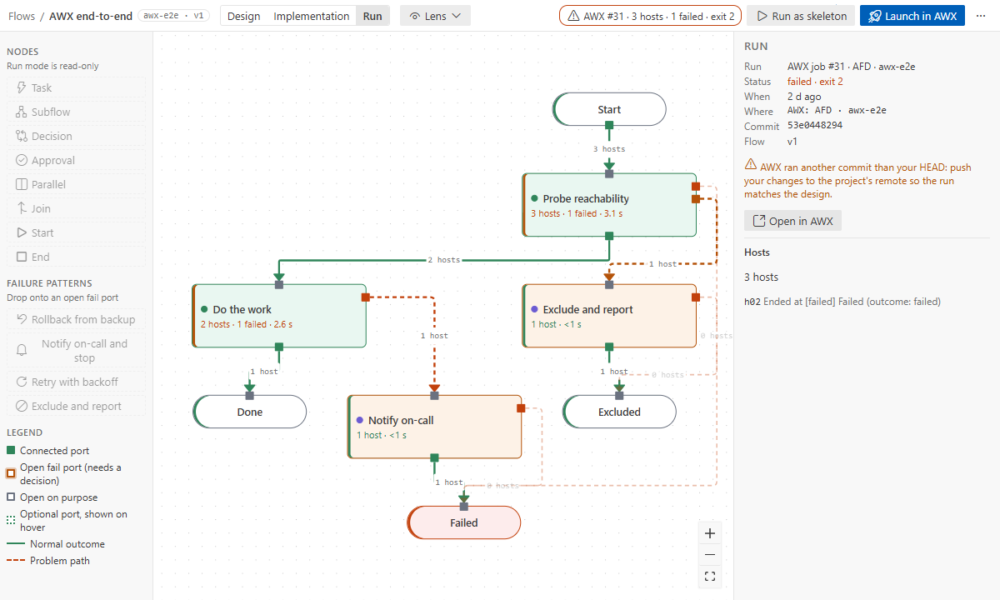
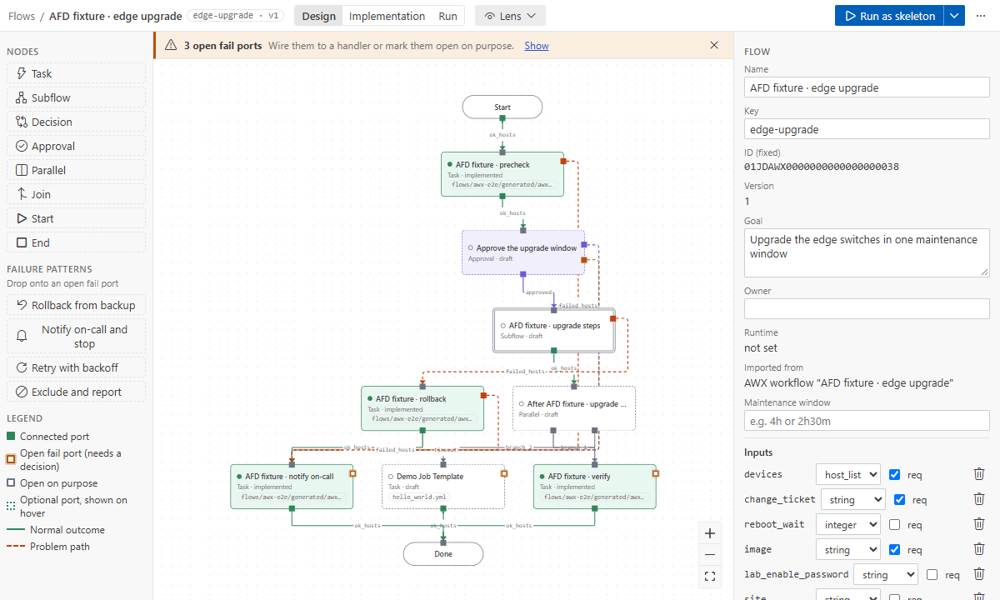

# Tutorial 3: AWX end to end

**Goal:** run a flow in AWX (or Ansible Automation Platform's controller) and follow it on the
canvas. Its approval becomes a real AWX approval node. After a passing run you mark the nodes
tested, and finally you import an existing AWX workflow as a new flow.

**Time:** 30 minutes. **You need:**
- an AWX you can create job templates in;
- an AWX **project** that checks out this repository from its Git remote;
- an **inventory** with your hosts, and an **execution environment** with ansible-core 2.19+;
- the firewall sample from [Tutorial 2](02-design-to-production.md), or any flow of yours.

## 1. Connect

1. Settings → `afd.awx.url` = your AWX, e.g. `https://awx.example.net`. Turn off
   `afd.awx.verifyTls` only for a lab with a self-signed certificate.
2. Command Palette → **Ansible Flow: Set AWX Token**. Paste a personal access token (Users →
   Tokens in AWX). It is checked against AWX, then kept in VS Code's SecretStorage, never in a file
   or setting.

## 2. Push what AWX will run

AWX runs the commit its project checks out, not your working copy. Save the flow (that writes
`generated/`), then commit and push the flow file and the `generated/` folder.

## 3. Set up the template

Open the flow and run **Ansible Flow: Set Up AWX Template**. Pick the AWX project, the inventory,
the execution environment and the credentials (machine, vault, …).

- A flow **without** top-level approvals gets one job template, `AFD · <flow key>`, for
  `generated/<key>.yml`.
- The firewall flow **has** a top-level approval, so it becomes an AWX **workflow**
  `AFD · firewall-upgrade`. It has one job template per segment (`generated/firewall-upgrade.seg_*.yml`,
  written on save), an approval node at the gate (timeout from the approval's `settings.timeout`),
  and a finish path for when nobody reaches the gate.

The name goes into the flow (`flow.runtime`). If AWX does not find the generated playbooks in the
project, the setup stops and names them: push first, and sync the project in AWX.

## 4. Launch and follow the run

Run **Launch in AWX**: from the top bar in Implementation or Run mode, or the Command Palette.

1. Enter the flow inputs (remembered per flow).
2. The confirmation names the targets and the commit AWX will run. If that is not your HEAD
   (unpushed or uncommitted changes), you get a warning.
3. The extension launches the template with the inputs as extra vars and follows the job's events.

Switch the top bar to **Run**. Nodes fill in as the job goes ("3 hosts · 1 failed · 2.1 s"), and
wires show how many hosts took them. Select a node to see each host and the port it left by; select
a wire to list its hosts.

When the workflow reaches the approval, the node shows **waiting**, with a link to decide it in
AWX. Approve it there: the workflow continues with the hosts that waited. Denying it, or letting it
time out, sends them down the approval's `rejected` port. See [approvals](../how-to/approvals.md).

## 5. Mark the nodes tested

After a **passing** real run of the current flow version (exit 0, every failure routed, no failed
end), the run panel offers **Mark N nodes tested** for the implemented nodes that ran. It is one
edit; save it. A tested node whose design changes later goes back to implemented, with a message
naming it.

## 6. Import an existing AWX workflow

Command Palette → **Ansible Flow: Import AWX Workflow…**

1. Choose **From AWX** (uses your URL and token), or **From an export file…** (made with
   `awx export --workflow_job_templates --job_templates > awx-export.json`).
2. Pick the workflow and the new flow's key.

The new flow opens, laid out top-down at every level. The flow description says where it came
from; **Show notes** lists what did not map one to one.

- Job template nodes become tasks bound to the template's playbook: **implemented** when the
  playbook is in this repository, else **draft**.
- Nested workflows become subflows, and approvals stay approvals. Survey questions and extra vars
  become flow inputs. Passwords and secret-looking values are imported **by name only**.
- AWX's `always` edges are wired from both `ok_hosts` and `failed_hosts`. Failures AWX does not
  handle stay open, so the banner shows what AWX would fail on.

The import is a one-time copy: AWX is only read.

## What you learned

- The token lives in SecretStorage; AWX runs what is pushed.
- Top-level approvals turn a flow into an AWX workflow with real approval nodes.
- Run mode follows AWX jobs on the canvas, and passing runs mark nodes tested.
- Existing AWX workflows can be imported as flows.

**Next:** [Tutorial 4: with an AI assistant](04-ai-assistant.md). Reference:
[AWX](../how-to/awx.md), [import](../how-to/import-awx.md).
