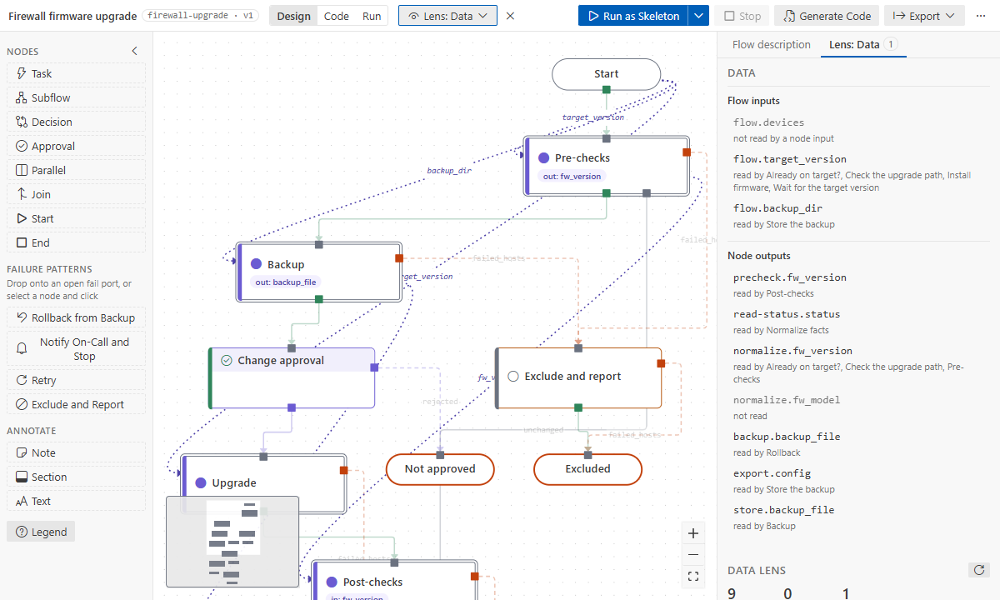

# Tutorial 4: build a flow with an AI assistant

**Goal:** let an AI assistant build a multi-level flow from a description, review what it did, and
have it fix the problems that are left. The tools work the same in Copilot and in terminal agents
(Claude Code, Codex, Gemini CLI, OpenCode, …).

**Time:** 20 minutes. **You need:** GitHub Copilot in VS Code, or one of the agents listed in
[AI assistants](../how-to/ai-assistants.md), and a folder open (Git recommended: your undo for
terminal agents).

## 1. Get the assistant ready

**Copilot** needs nothing: switch the chat to **Agent** mode. The `ansible-flow` skill and ten
tools come with the extension (`#flowList`, `#flowDescribe`, `#flowValidate`, `#flowReference`,
`#flowEdit`, `#flowNew`, `#flowCompleteIds`, `#flowExport`, `#sourceOutline`, `#flowImport`).

**Other agents** need the skill and the flow tools once. When VS Code starts, the extension looks for
the agents on your machine and offers **Set Up** in one notice. You can also run
**Ansible Flow: Set Up AI Assistants…** at any time:

1. Pick the agents (each is marked found, and why, or "config only").
2. Choose where the skill goes: **This repository** (commit it to share with your team) or
   **Just me**.
3. Check the preview, apply, and restart agents that are already running.

## 2. Ask for a flow

Describe the outcome, the phases and the failure handling. For example:

> Create an Ansible flow `flows/fw-upgrade/fw-upgrade.flow.yaml` for a firewall firmware upgrade:
> pre-checks, a configuration backup, a change approval, the upgrade, post-checks. Put the details
> of each phase in a subflow on its own level. Hosts already on the target version skip the
> upgrade. Failed hosts in the upgrade or the post-checks roll back from the backup; if the rollback
> fails, notify on-call. Hosts that fail the pre-checks or the backup are excluded and reported.

What happens:
- the agent reads the skill, creates the flow with `flow_new`, and builds it with `flow_edit`
  batches of key-based ops. Each batch applies all or nothing;
- it never writes IDs; it names nodes by key (`precheck/read-status`);
- each answer lists the nodes created, the problems added or solved, and what else it did (an end
  node a pattern reused, an output it lifted into a subflow).

With Copilot, each edit asks for confirmation and is **one undo step** on the canvas. Terminal
agents write the file like a save: `flow.version` moves once per commit and `generated/` is
refreshed.

## 3. Review it like a colleague's change

- **The canvas** shows the result at once. Open each subflow; check that every fail port goes
  somewhere sensible. A rejected approval should end at _Not approved_, not at _Rolled back_.
- **The Data lens** shows how values travel. Every input should come from somewhere, and steps
  should read inputs, not variables some other step happened to set.
- **Git diff** of the flow file shows exactly what changed.

## 4. Have it fix what is left

Run **Validate design** (top bar "…" menu) and ask:

> Fix the warnings in this flow with the flow tools, without changing what it does.

Each problem names its fix ([problem codes](../reference/problems.md)), so this usually takes one
batch. A typical cleanup for a multi-level flow:
- an inner step reads its subflow's input: `from: rollback.backup_file`;
- a step uses a value from a step inside another subflow: the agent gives the path
  `precheck/normalize.fw_version`, and the tool adds the output to `precheck`;
- conditions and `assert` checks read results that were never declared as outputs: the agent adds
  the outputs and inputs.

## 5. Ask for the parts that need your knowledge

Some changes need facts about your devices that the agent does not have. Ask for them explicitly,
with the details:

> The step "Wait for the target version" should poll `https://{{ inventory_hostname }}/api/v2/status`
> every 15 seconds, up to 10 minutes, until the answer is 200 and `json.version` equals
> `target_version`.

The agent binds the module and sets `retries`, `delay` and `until`
([retries and polling](../how-to/polling-and-retries.md)).

## 6. Start from playbooks you already have

Ask for a flow from your playbooks, or let the import command write the request for you:
right-click a playbook → **Import Ansible Playbooks…** → **With an AI assistant**. The agent reads
the playbooks with `source_outline`, which gives the exact module, parameters and keywords of every
task. It groups them by purpose, keeps failure handling where the playbooks have it, and reports
what it changed. [Tutorial 5](05-import-playbooks.md) does this with a sample repository.

## Tips

- Keep the flow open in the designer while the agent works: you see each edit land.
- Ask for one phase at a time on large flows.
- If the agent draws a PlantUML or Mermaid picture instead, say "an Ansible Flow Designer flow
  (`*.flow.yaml`)". With the skill installed, "Ansible flow" is enough.
- Without the tools, an agent can still write the YAML by key; **Complete IDs** turns it into a
  normal flow ([hand-written YAML](../how-to/hand-written-yaml.md)).

## What you learned

- Copilot works with no setup; other agents need one setup.
- Agents build flows with all-or-nothing edits by key, and say what they changed.
- You review on the canvas, with the Data lens and in Git, and agents fix problems from the codes.
- Agents redesign existing playbooks by intent, keeping their modules and parameters.
