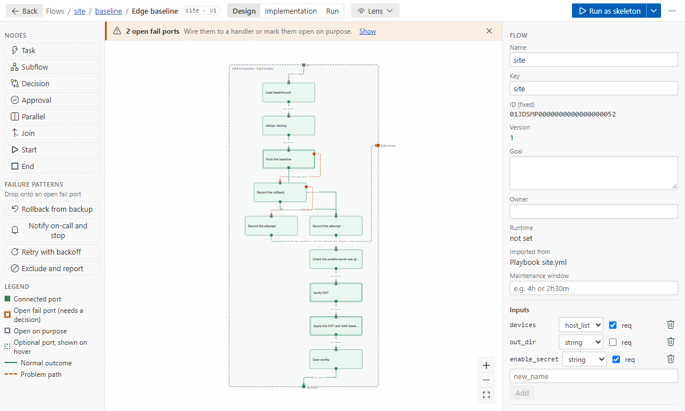
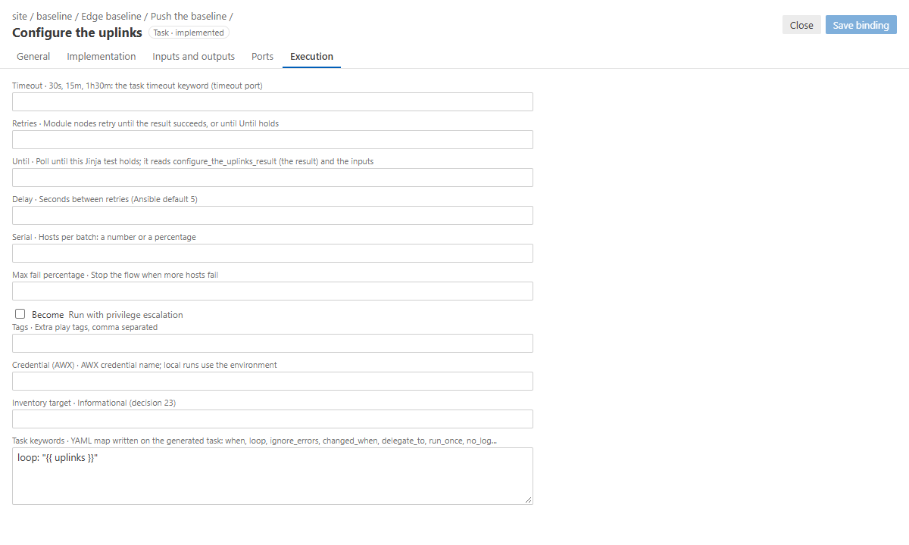

# Tutorial 5: bring existing playbooks into flows

**Goal:** turn a small playbook repository into flows, two ways. First as an exact copy that you can
run at once, then redesigned by intent with an AI assistant. On the way you see how blocks, roles,
handlers, task keywords and variables show up on the canvas.

**Time:** 25 minutes. **You need:**
- an empty folder open in VS Code (**File → Open Folder…**): the sample brings its own `ansible.cfg`
  and inventory;
- for step 6, an Ansible environment, as in [Tutorial 2](02-design-to-production.md) (Docker is
  enough);
- for step 7, an AI assistant: Copilot, or one set up with **Ansible Flow: Set Up AI Assistants…**
  ([AI assistants](../how-to/ai-assistants.md)).

## 1. Get the sample playbooks

Command Palette → **Ansible Flow: Open Sample Flow…** → under _Playbooks to import_, pick
**Playbooks to import: edge-baseline**. The files are copied into your folder, and `site.yml` opens.

| File                                         | What it is                                                                 |
| -------------------------------------------- | -------------------------------------------------------------------------- |
| `site.yml`                                   | imports `prechecks.yml`, then `baseline.yml`                               |
| `prechecks.yml`                              | one play: create a report folder, read the version, check it, record it    |
| `baseline.yml`                               | two plays: the baseline on the edge switches, then a report on `localhost` |
| `tasks/verify.yml`                           | the NTP check, included by `baseline.yml`                                  |
| `roles/netops_backup`, `roles/push_baseline` | a role, and a role split into two task files (`ntp.yml`, `aaa.yml`)        |
| `vars/baseline.yml`, `templates/motd.j2`     | variables and a template the plays use                                     |
| `ansible.cfg`, `inventory.ini`               | four fictional edge switches, simulated with the `local` connection        |

Runs write small files under `/tmp/edge-baseline` instead of configuring devices. Open
`baseline.yml` and look for the parts this tutorial follows:
- a `block` with `rescue` and `always`, in which the canary switch (`sw-edge-04`) fails on purpose;
- a `loop`, a `when`, and two tasks that notify the handler _Save config_ (one by its `listen` topic);
- a `vars_prompt` for the enable secret.

## 2. Import it as is

Right-click `site.yml` in the Explorer → **Import Ansible Playbooks…**
1. Choose **As is**.
2. Keep the key `site`.

The new flow `flows/site/site.flow.yaml` opens in the designer. The message counts **20 steps, 20
implemented**. **Show notes** says one thing: `enable_secret` is imported by name only (it was a
prompt), so you give it when you run.

> Right-click a folder instead (or run the command from the Command Palette) and the import lists
> the folder's playbooks. The top-level ones (`site.yml`, `rollback.yml`) are selected; each one you
> keep becomes its own flow.

The import is a one-time copy: your playbooks are not changed, and the flow is yours to change.

## 3. Find your playbook on the canvas

The top level reads like `site.yml`: **Start → Pre-checks → baseline → Done**. Each imported
playbook is a subflow. Double-click **baseline**: it has a subflow per play, **Edge baseline** and
**Report**. Report shows _Inventory target_ `local` in its properties, because its play runs on
`localhost`, not on the switches.

Double-click **Edge baseline**:

- **Load baseline.yml** is the play's `vars_files`. The variables it loads (`uplinks`,
  `ntp_servers`, `canary_switch`) are its outputs, and the steps that read them have inputs.
- **netops_backup** is the role, as one step bound to it.
- **Push the baseline** is the block, as a subflow. Its `failed_hosts` lead to **Record the
  rollback** (the rescue). Hosts that finish the block or the rescue meet at **Record the attempt**
  (the always). A host that fails in the rescue runs a copy of _Record the attempt_ and then fails,
  as Ansible would.
- **Verify NTP** is the included task file, and **Apply the NTP and AAA baseline** is the split
  role: a subflow bound to the role, with one step per task file.
- **Save config** is the handler. It runs once, after the tasks, on hosts where a step that notified
  it changed something.

The banner counts **2 open fail ports**. These are failures the playbooks do not handle, so Ansible
stops those hosts there too. The import leaves them for you to decide: apply a failure pattern later,
or leave them open on purpose ([ports and failure patterns](../how-to/ports-and-failure-patterns.md)).

## 4. Look at a step's details

Double-click **Push the baseline**, select **Configure the uplinks**, and open its properties (the
gear).

- **Implementation:** the module `ansible.builtin.copy` with the task's parameters, unchanged.
- **Inputs and outputs:** `uplinks` comes from `load-baseline-yml.uplinks`, the step that loaded it.
- **Execution:** **Task keywords** holds `loop: "{{ uplinks }}"`: the task keywords the flow has no
  field for, written on the generated task as they are.

**Refuse the change on the canary switch** keeps its `when`; **Read the software version** keeps
`changed_when` and `check_mode`. Register, tags, become, timeout and retries go to their own fields
([task keywords](../how-to/binding-and-catalog.md#task-keywords)).

## 5. Check and generate

Choose **Validate design** in the **…** menu: no errors, two warnings (the open fail ports). Then run
**Ansible Flow: Generate Playbook**. `flows/site/generated/` gets one playbook per level, one play
per step, as for any flow ([generated code](../how-to/code-generation.md)).

## 6. Run it

Click **Run as skeleton**. For `devices`, keep `edge`. For `enable_secret`, type anything: secret
inputs are typed hidden and never remembered.

The skeleton is `--check`, so nothing is written, except where a task says `check_mode: false`: the
report folder and the version read. Switch to **Run** in the top bar:
- every switch passes the pre-checks and the baseline;
- the canary switch `sw-edge-04` takes **Push the baseline**'s `failed_hosts` to **Record the
  rollback**, and then goes on with the others;
- Save config runs where something changed.

**Run for real** (under the run button's chevron) writes the files under `/tmp/edge-baseline` in
your environment. These are the same files, with the same contents, as
`ansible-playbook site.yml` writes. The extension's tests check exactly that in Ansible 2.19, 2.20
and 2.21.

## 7. Let an AI assistant redesign it

An exact copy keeps every task as a step. An assistant can group the work by purpose and keep what
the playbooks do.

1. Right-click `site.yml` → **Import Ansible Playbooks…** → **With an AI assistant**.
2. Key: `site-by-intent`.
3. **Copilot Chat** opens in agent mode with the prompt filled in: read it, then send it. With
   another assistant, choose **Another AI assistant** and paste the prompt (it is on the clipboard).

The assistant reads the playbooks with `source_outline`, plans subflows by purpose, builds the flow
with the same modules and parameters, and finishes with `flow_validate`. Then it reports how it
grouped the tasks, what it changed and what it left out. A typical result:
- Pre-checks, a step that loads the settings, a backup step, and **Push the baseline**, with its
  rescue and always;
- Verify, the NTP and AAA role, Save config, and Report.

Review it as you would a colleague's change:
- **Open both flows side by side.** The intent-based one has fewer levels. Its steps are named by
  what they do, and each is still bound to the playbook's module or role.
- **Run both as skeletons.** The canary switch should take the rescue path in both.
- **Ask for changes** in the same chat. For example: "move the enable secret check before the
  change", or "add a notify-stop pattern to the backup's failures".
- **For an exact copy instead,** ask the assistant to "import site.yml as is": it uses `flow_import`.

## What you learned

- **Import Ansible Playbooks…** turns a playbook, or a folder's playbooks, into flows. **As is** is
  a faithful copy, one step per task. **With an AI assistant** gives a design by intent.
- **Each part of a playbook has its place:**
  - plays and imported playbooks become subflows;
  - a block with rescue/always becomes a subflow with its failure path;
  - roles become steps (a split role, a subflow);
  - handlers become steps that run when something changed;
  - variables travel through inputs and outputs.
- **Task keywords** (`when`, `loop`, `check_mode`, …) stay on the step, on the Execution tab.
- **Unhandled failures stay open** on the banner, and secrets come in by name only.

Next: [import playbooks and AWX templates](../how-to/import.md) for every mapping and for AWX, and
[AI assistants](../how-to/ai-assistants.md) for the tools the assistant used.
