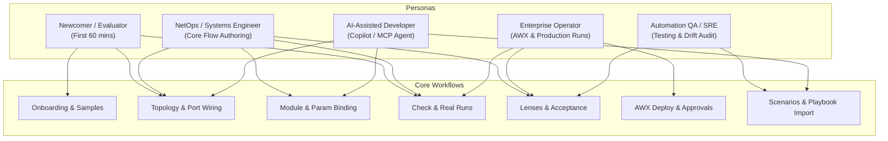
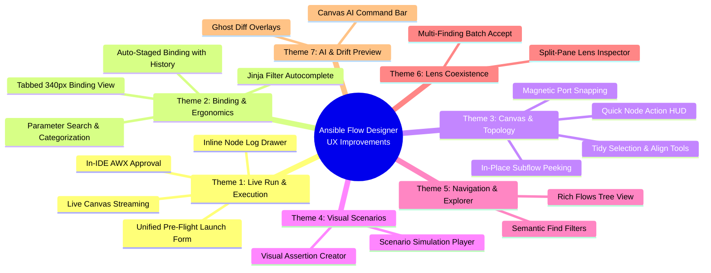

# Comprehensive UX & Usage Pattern Proposals for Ansible Flow Designer

**Target Codebase:** `c:\HOME\1.SCRIPTS\123.Ansible_Studio_VSCODE`  
**Current Version Evaluated:** `0.50.0` (Post-Wave 7 Contextual Disclosure & Guided First Use)  
**Date:** November 2026  
**Document Status:** Proposal & Strategic UX Roadmap (No codebase modifications applied)

---

## 1. Executive Summary & Context

Ansible Flow Designer (AFD) enables engineers to visually design Ansible automation as typed, directed graphs (`*.flow.yaml`), automatically generate idiomatic, clean Ansible playbooks (`generated/<key>.yml`), detect drift between design and code, and run or audit automation locally or inside AWX.

Across Waves 1–7 (documented in `docs/ux/`), the team achieved remarkable architectural and visual milestones:
1. **Model & Layout Performance:** One model build per snapshot, byte-preserving YAML edits with single-writer safety (ADR-0001, ADR-0002).
2. **Visual Ergonomics:** Minimum 11px font sizes at opening zoom, a 73% reduction in wire labels at rest, and elimination of label/node overlaps (Wave 3).
3. **Calmer First Screen (Wave 7, ADR-0029/ADR-0030):** Reduced visible controls on an empty flow from 46 to 35 using native `<details>` folds, contextual disclosure of failure patterns/lenses, and a guided "Your first flow" checklist.

### Why Further UX Improvements Are Needed

While the **initial 10 minutes** of a flow are now well-calibrated, intermediate and advanced workflows—such as module catalog binding, complex Jinja data piping, multi-stage local/AWX execution, scenario testing, drift reconciliation, and multi-flow navigation—experience noticeable ergonomic friction and disjointed context switches.

This document identifies **10 core friction areas** across 5 user personas and proposes **concrete, actionable UX improvements** categorized into 7 thematic areas with implementation considerations and measurable targets.

---

## 2. Target User Personas & Usage Patterns



### Primary Usage Patterns:

1. **The Green-Field Flow Creation Loop:**
   - Open empty folder $\rightarrow$ Activity Bar `Ansible Flows` $\rightarrow$ `New Flow` $\rightarrow$ Add Tasks with `N` $\rightarrow$ Wire Failure Ports $\rightarrow$ Bind modules/roles in Details panel $\rightarrow$ Run Skeleton $\rightarrow$ Review generated playbook.
2. **The NetOps Maintenance / Rollback Loop:**
   - Open complex flow (e.g. `firewall-upgrade.flow.yaml`) $\rightarrow$ Inspect multi-level subflows $\rightarrow$ Set `inventory_target` or rolling batching $\rightarrow$ Test failure routing $\rightarrow$ Generate draw.io or SVG diagrams for change advisory boards.
3. **The Playbook Import & Modernization Loop:**
   - Right-click legacy playbooks $\rightarrow$ `Import Ansible Playbooks...` $\rightarrow$ Review converted tasks and notes $\rightarrow$ Reconcile drift in Code Mode $\rightarrow$ Re-import source changes.
4. **The Scenario Verification & Validation Loop:**
   - Author `<key>.scenarios.yaml` $\rightarrow$ Run scenarios against mock host outcomes $\rightarrow$ Verify host routing to `failed`, `stopped`, or `done` $\rightarrow$ Commit scenario runner for CI.
5. **The AWX Execution & Approval Loop:**
   - Push to Git $\rightarrow$ `Set Up AWX Template` $\rightarrow$ `Launch in AWX` $\rightarrow$ Monitor workflow execution $\rightarrow$ Handle approval gates.

---

## 3. Analysis of Critical UX Friction Points

### Friction 1: Disruptive Terminal Hijacking & "Black-Box" Local Runs

- **Current Pattern:** When a user clicks _Run as Skeleton_ or _Run for Real_, VS Code immediately opens the dedicated terminal panel (`TaskRevealKind.Always`). This physically displaces or shrinks the webview canvas. While the playbook executes, the canvas shows only a static spinning icon in the top bar (`TopBar.tsx`). The extension only parses `events.jsonl` and updates node states _after_ the terminal process fully terminates (`src/extension/run/runner.ts`).
- **User Impact:** The user must stare at raw terminal text instead of watching their flow diagram work. For multi-minute playbooks, the designer loses its primary visual value proposition.

### Friction 2: Modal Input Prompt Barrage on Launch

- **Current Pattern:** `collectInputs()` (`src/extension/run/inputs.ts`) prompts the user via sequential `vscode.window.showInputBox` calls for each required input, followed by a separate prompt for Vault password (if auto/always), followed by a modal confirmation dialog (`showWarningMessage`) for real runs.
- **User Impact:** If a flow has 3–5 inputs, the user is subjected to 5 consecutive modal popups at the top of VS Code. There is no unified pre-flight sheet or launch confirmation form where inputs can be reviewed, edited, and launched together.

### Friction 3: 340px Vertical Cramping in the Binding / Implementation Panel

- **Current Pattern:** The docked Details panel defaults to 340px width (`src/webview/details/Details.tsx`). In `Implementation.tsx`, three large sections are rendered:
  1. _Find_ (search input, autocomplete hits, suggestions);
  2. _Understand_ (full module documentation, synopsis, parameter tables, returns, examples);
  3. _Configure_ (form fields, YamlField, input chips, checklist, generated task preview).
     Only when expanded past 900px does a container query split them into 3 columns.
- **User Impact:** At default width, the user must vertically scroll through hundreds of lines of parameter documentation just to reach the form fields. Clicking _Expand_ (`min(1100px, 80vw)`) fixes the columns but completely eclipses the canvas diagram, forcing users to toggle back and forth.

### Friction 4: "All-or-Nothing" ELK Layout (Tidy Up)

- **Current Pattern:** `Tidy Up` (`Shift+Alt+F`) runs ELK auto-layout over the _entire level_.
- **User Impact:** When an engineer has carefully positioned 15 nodes and sections, then adds 2 new nodes, triggering `Tidy Up` recomputes the entire graph, destroying their spatial hierarchy and annotation placements. There are no partial layout tools (e.g., align selected, distribute evenly, tidy selection only).

### Friction 5: Flat, Minimalist "Ansible Flows" Activity Bar View

- **Current Pattern:** `src/extension/flowsView.ts` provides a flat list of `**/*.flow.yaml` files with generic `type-hierarchy` icons.
- **User Impact:** In repositories with multiple flows and subdirectories (e.g. `flows/network/`, `flows/security/`), there is no folder hierarchy, no health status (error/warning indicators), no badge showing whether `generated/` is up-to-date or drifted, and no inline quick-actions (such as "Run Skeleton" or "Peek Playbook").

### Friction 6: Disconnected Scenario Testing UX

- **Current Pattern:** Scenarios (`*.scenarios.yaml`) provide high-value offline verification. However, scenarios have **zero representation on the canvas**. Clicking _Run Scenarios_ runs in the background and surfaces only a VS Code notification toast (`Scenarios: 1 of 2 failed`) with a link to raw log text.
- **User Impact:** The user cannot visualize which path a scenario tested, which wire failed, or where hosts diverged on the diagram. Scenarios feel like an auxiliary CLI tool rather than an integrated designer feature.

### Friction 7: Lens Context Loss on Node Selection

- **Current Pattern:** In `App.tsx`, when a Lens is active (e.g., _Access_ or _Inventory_), the side panel shows the Lens Findings tab. However, clicking any node on the canvas to inspect its details immediately switches the panel to `Details`, dismissing the Lens Findings.
- **User Impact:** An engineer fixing 5 security/credential findings must repeatedly click back and forth between the node and the "Lens: Access" tab, losing their scroll position in the findings list.

### Friction 8: AWX Approval Gate Context Switching

- **Current Pattern:** When an AWX workflow encounters an approval node, `RunPanel.tsx` and `TopBar.tsx` display "waiting for approval" with an external URL link that opens the default web browser.
- **User Impact:** Operators must leave VS Code, sign into AWX in Chrome/Edge, click Approve, and switch back to VS Code to watch the flow continue.

### Friction 9: Jinja Autocomplete (`@`) Limitations in Input Chips

- **Current Pattern:** Typing `@` inside `ChipField.tsx` lists upstream outputs and flow inputs.
- **User Impact:** Real-world Ansible variables frequently require filters (e.g., `{{ host | ipaddr }}`, `{{ config | default({}) }}`, `{{ intf.name }}`). Currently, entering anything beyond a raw variable name breaks the chip into an unassisted string, with no filter suggestions or Jinja syntax aid.

### Friction 10: Find Bar (`Ctrl+F`) Lacks Semantic Filtering

- **Current Pattern:** `src/core/view/find.ts` filters strictly by textual substring in `title`, `key`, `ref`, and annotation text.
- **User Impact:** On large flows with 40+ nodes across nested subflows, users cannot search for `@status:draft`, `@type:decision`, `@unhandled`, `@tag:security`, or `@failed`.

---

## 4. Proposals for UX Improvements



---

### Theme 1: Seamless Execution & Live Canvas Feedback (The "Zero-Terminal" Experience)

#### Proposal 1.1: Live Run Streaming & Visual Progress on Canvas

- **Concept:** Rather than waiting for the terminal process to end before parsing `events.jsonl`, the extension host should tail `events.jsonl` (or use an IPC socket from `afd_events`) during execution.
- **UX Behavior:**
  - When _Run as Skeleton_ is clicked, the designer transitions automatically to **Run Mode (Live)**.
  - Nodes actively executing display an animated blue/accent border pulse (`running`).
  - As tasks complete, wires animate host transit, and nodes update in real-time to green (`ok`), amber (`rescued/warn`), or red (`failed`).
  - Terminal presentation is set to `reveal: vscode.TaskRevealKind.Silent` by default (with a single-click "Show Terminal" toggle in the top bar), keeping the canvas in full view.
- **Metric Impact:** Reduces perceived wait time; eliminates the jarring terminal pop-up.

#### Proposal 1.2: Unified Pre-Flight Launch Form / Modal

- **Concept:** Replace the sequential `showInputBox` and confirmation modal barrage with a single, responsive launch dialog directly over the canvas or as a unified webview modal.
- **UX Mockup Layout:**

  ```text
  +-------------------------------------------------------------+
  |  Launch Flow: Firewall Upgrade (v2)                         |
  +-------------------------------------------------------------+
  |  Mode: [ (•) Check Mode (Skeleton)  ( ) Real Run (Live) ]   |
  |                                                             |
  |  Target Devices: [ edge_switches, core_spines             ] |
  |  Inventory:      [ lab/hosts.yml (24 hosts detected)      ] |
  |                                                             |
  |  Flow Inputs:                                               |
  |    - target_version:  [ 7.4.2                            ]  |
  |    - maintenance_window: [ 120m                          ]  |
  |    - admin_password:  [ ••••••••••••                     ]  |
  |                                                             |
  |  [✓] Ask for Vault password before run                      |
  |  [✓] Show detailed pre-flight safety audit                  |
  +-------------------------------------------------------------+
  |  [ Cancel ]                                  [ Launch Run ] |
  +-------------------------------------------------------------+
  ```
- **UX Behavior:** All inputs are validated simultaneously. Missing required inputs are highlighted inline. Clicking _Launch Run_ executes the run with zero subsequent modal interruptions.

#### Proposal 1.3: Inline Node Log Drawer / Task Trace

- **Concept:** When inspecting a failed or completed node in Run Mode, users currently see only a host summary. Provide an "Inspect Task Output" drawer or expandable card.
- **UX Behavior:**
  - Selecting a node in Run Mode adds a "Task Output" tab or quick link in the Run panel.
  - Displays the formatted stdout, stderr, and raw module return JSON for each host without opening the global terminal.
  - Includes a "Copy Failed Task Command" for rapid reproduction in terminal.

#### Proposal 1.4: In-IDE AWX Approval Quick-Action

- **Concept:** When an AWX workflow encounters an approval node, allow the user to approve or deny directly inside VS Code.
- **UX Behavior:**
  - The node on the canvas pulses with an attention banner: `[ Approve ] [ Reject ] [ Open in AWX ]`.
  - Clicking _Approve_ prompts for an optional comment and dispatches the approval via the AWX API token stored in VS Code SecretStorage, continuing workflow execution without switching windows.

---

### Theme 2: Streamlined Binding & Module Configuration (The "340px Ergonomics" Overhaul)

#### Proposal 2.1: Tabbed Sub-Flow for 340px Docked Panel

- **Problem:** Stacking Find, Understand (Docs), and Configure in a 340px sidebar causes endless scrolling.
- **Solution:** Introduce a sub-tab bar inside the Binding tab when the panel is narrower than 900px:

  ```text
  [ Details: Ping Task ]
  [ General ] [ Binding* ] [ I/O ] [ Ports ] [ Execution ]
  ---------------------------------------------------------
  Binding: ansible.builtin.ping
  Sub-tabs: (•) Configure  ( ) Module Docs  ( ) Change Module
  ```

  - **Configure View:** Shows only the module name, essential required parameters, configured parameters, and a prominent "+ Add Optional Parameter" search bar.
  - **Module Docs View:** Full documentation, parameter synopsis, and examples formatted for clean mobile/compact reading.
  - **Change Module View:** Search catalog and switch implementation.
- **Result:** Keeps the panel clean, eliminating 80% of vertical scrolling while preserving the full-canvas diagram view.

#### Proposal 2.2: Parameter Search & Smart Categorization in Configure

- **Concept:** Complex modules (like `cisco.ios.ios_l2_interfaces` or `ansible.builtin.user`) have dozens of parameters.
- **UX Behavior:**
  - Parameters in Configure are divided into three collapsible sections:
    1. **Required Parameters** (Always open, highlighted if unset);
    2. **Active / Configured Parameters** (Clean compact list);
    3. **Add Parameter (`/` shortcut)**: Search box that filters parameters by name and one-line summary in real time. Clicking adds the parameter immediately.

#### Proposal 2.3: Enhanced Jinja Smart Completion (`@` + Filters)

- **Concept:** Expand `ChipField.tsx` autocomplete.
- **UX Behavior:**
  - When `@` is typed, upstream outputs and flow inputs appear as today.
  - Once a variable is picked, typing `|` activates an intelligent Jinja filter picker:
    - Common filters: `default(...)`, `int`, `bool`, `ipaddr`, `to_json`, `split`, `length`.
    - Includes documentation tooltips explaining each filter.
  - For dictionary outputs, typing `.` shows suggested sub-keys inferred from the upstream module's documented return schema.

#### Proposal 2.4: Auto-Staged Binding with Granular History

- **Problem:** Currently, leaving an unsaved binding triggers an intrusive modal: _"Keep Editing / Discard / Save Binding"_.
- **Solution:**
  - Auto-stage changes into the local working draft as the user types.
  - Display a subtle header indicator: `Draft auto-staged · [Revert] [Save Binding]`.
  - Switching nodes or closing the panel automatically persists the staged draft to the node without interrupting modal guards, with standard VS Code Undo (`Ctrl+Z`) reverting the step.

---

### Theme 3: Canvas Ergonomics, Micro-Interactions & Topology Layout

#### Proposal 3.1: Selective Layout Tools ("Tidy Selection", "Align", "Distribute")

- **Concept:** Replace the global, all-or-nothing `Tidy Up` with precision layout options.
- **UX Behavior:**
  - When 2 or more nodes are selected, a floating layout toolbar appears above the selection:
    - **Align Horizontal** (aligns node centers horizontally);
    - **Align Vertical** (aligns node centers vertically);
    - **Distribute Evenly** (equalizes gaps between nodes);
    - **Tidy Selection** (runs ELK layout exclusively on the selected sub-graph, anchoring unselected nodes in place).
  - Context menu and shortcuts: `Alt+H` (align horizontal), `Alt+V` (align vertical).

#### Proposal 3.2: Magnetic Wire Snapping & Smart Port Hover

- **Concept:** Reduce mouse precision required to draw wires between ports.
- **UX Behavior:**
  - When dragging a wire from an output port, target ports on nearby nodes show an expanded magnetic snap target zone (20px radius).
  - Compatible ports illuminate in green; incompatible ports (e.g. duplicate control wires or circular self-connections) dim.
  - Releasing near the port automatically snaps and creates the edge.

#### Proposal 3.3: In-Place Subflow Peeking / Inline Expansion

- **Concept:** Avoid completely leaving the parent canvas when inspecting a subflow.
- **UX Behavior:**
  - Double-clicking a subflow enters it as today.
  - Adding an "Expand In-Place" icon (`codicon-screen-full`) expands the subflow node on the parent canvas into an expandable nested bounding frame, displaying its inner steps inline while keeping parent context visible.

#### Proposal 3.4: Quick Node Action HUD (Floating Pill)

- **Concept:** Fast-track common operations on node selection.
- **UX Behavior:**
  - On selecting a node, a small non-intrusive 3-button pill floats above it:
    `[ + Next Step ]  [ </> Peek Play ]  [ ⚠ Port Actions ]`
  - Allows power users to rapidly extend chains without moving the mouse to the side panel or right-clicking.

---

### Theme 4: Visual Scenario Testing & Verification

#### Proposal 4.1: Scenario Simulation Mode in Webview

- **Concept:** Turn `.scenarios.yaml` into a first-class visual testing tool.
- **UX Behavior:**
  - In the TopBar, add a **Scenario** selector when `<flow>.scenarios.yaml` exists:
    `Scenario: [ Happy Path ▾ ] [ ▶ Run Scenario ]`
  - Selecting a scenario colors the canvas to show the simulated path:
    - Passing nodes highlighted in green;
    - Simulated failed nodes highlighted in red with an indicator: _"Simulated failure: SSH timeout"_;
    - Wires glow along the path hosts are expected to take;
    - End nodes display expected vs actual host arrivals.

#### Proposal 4.2: Visual Scenario Assertion Builder

- **Concept:** Author scenario tests visually rather than writing raw YAML.
- **UX Behavior:**
  - In Scenario Mode, right-clicking any node gives: `Fail this step in Scenario...`.
  - Right-clicking an End node gives: `Assert hosts arrive here...`.
  - Automatically writes or updates `<flow>.scenarios.yaml` with zero syntax errors.

---

### Theme 5: Activity Bar & Workspace Navigation Power

#### Proposal 5.1: Rich Tree View with Status & Health Badges

- **Concept:** Upgrade `src/extension/flowsView.ts` from a flat URI list into a rich workspace explorer.
- **UX Behavior:**

  ```text
  ANSIBLE FLOWS
  ▾ networks/
    ▾ core-upgrade.flow.yaml    [v2] [✓ 0 errors] [Tested]
    ▾ border-leaf.flow.yaml     [v1] [⚠ 1 open fail] [Drift]
  ▾ security/
    ▾ zero-trust-sync.flow.yaml [v3] [✓ Passing]
  ```

  - **Inline Action Icons on Hover:**
    - `▶` Run as Skeleton;
    - `</>` Peek Code;
    - `...` Export / Re-import.
  - **Badges:** Shows validation health (errors/warnings), format version (`v1`/`v2`), and test status (`tested`/`draft`).

#### Proposal 5.2: Semantic Query Filtering in Find Bar (`Ctrl+F`)

- **Concept:** Enhance `src/core/view/find.ts` with prefix tokens for rapid enterprise auditing.
- **Supported Tokens:**
  - `@status:draft` / `@status:tested` / `@status:implemented`
  - `@type:decision` / `@type:approval` / `@type:subflow`
  - `@has:problems` / `@open:fail`
  - `@tag:<tagname>` / `@target:<hostgroup>`
- **UX Behavior:** Typing `@` in the Find bar surfaces a completion popup of available filters.

---

### Theme 6: Lens Coexistence & Batch Decisions

#### Proposal 6.1: Split / Persistent Lens Inspector

- **Problem:** Selecting a node currently dismisses the Lens findings panel.
- **Solution:**
  - With a Lens active, the right panel maintains a split view:
    - **Top 45%:** Lens Findings Browser (scrollable list of findings with filter by severity);
    - **Bottom 55%:** Selected Node Details.
  - Selecting a node highlights that node's related findings in the top list without dismissing the findings view.

#### Proposal 6.2: Multi-Finding Batch Accept

- **Concept:** In enterprise flows, an unhandled environmental variable or shared credential can trigger 10+ identical findings across nodes.
- **UX Behavior:**
  - Provide checkboxes next to findings in `LensPanel.tsx`.
  - Selecting multiple findings surfaces: `Accept 6 Findings with Reason...`.
  - Records a single cohesive rationale in the flow's `accepted` decisions block, saving repetitive typing.

---

### Theme 7: AI Collaboration & Diff Visualization

#### Proposal 7.1: Visual "AI Proposed Changes" Ghost Overlay

- **Concept:** When Copilot or an external agent (Claude Code, OpenCode) modifies a flow via the MCP server or language model tools, users currently see files reload without a visual change trace.
- **UX Behavior:**
  - Nodes added or edited by AI during the current session are highlighted with a glowing dashed accent border (`afd-ai-pending`).
  - An inline banner at top of canvas appears:
    `AI Assistant updated 3 nodes and added 1 rollback handler · [ Accept All ] [ Discard ] [ View Diff ]`.
  - Users can visually review the changes before saving or running code generation.

#### Proposal 7.2: Natural Language Canvas Command Bar (`Ctrl+K`)

- **Concept:** Bring inline agent intelligence directly onto the canvas.
- **UX Behavior:**
  - Pressing `Ctrl+K` opens a quick-prompt bar over the canvas:
    `Ask AI to edit flow (e.g., "Add retry 3 times with 5s delay on Check NTP", "Wire all fail ports to Rollback")`.
  - Executes tool ops via `#flowEdit`, showing immediate visual preview.

---

## 5. Prioritized Implementation Roadmap

| Priority Wave                             | Proposals Included                                                                                                                                                               | Target Benefits                                                                                                                         | Est. Complexity |
| :---------------------------------------- | :------------------------------------------------------------------------------------------------------------------------------------------------------------------------------- | :-------------------------------------------------------------------------------------------------------------------------------------- | :-------------- |
| **Wave 8: Run & Launch Ergonomics**       | **1.1** (Live Run Streaming)<br/>**1.2** (Unified Pre-Flight Launch Form)<br/>**1.3** (Inline Task Output Drawer)<br/>**1.4** (In-IDE AWX Approval)                              | Eliminates terminal disruption; transforms execution into an engaging, visual real-time feedback loop; eliminates 5-step modal prompts. | Medium          |
| **Wave 9: Binding & 340px Overhaul**      | **2.1** (Sub-Tabbed 340px Binding View)<br/>**2.2** (Parameter Search in Configure)<br/>**2.3** (Jinja Filter Autocomplete)<br/>**2.4** (Auto-Staged Binding with History)       | Solves the #1 layout complaint: vertical scroll fatigue at default panel width. Eliminates intrusive modal exit guards.                 | Medium          |
| **Wave 10: Canvas Layout & Navigation**   | **3.1** (Selection Alignment / Tidy)<br/>**3.2** (Magnetic Wire Snapping)<br/>**3.4** (Quick Node Action HUD)<br/>**5.1** (Rich Flows Tree View)<br/>**5.2** (Semantic Find Bar) | Drastically speeds up daily topology drawing, prevents layout scrambling, and organizes multi-flow workspaces.                          | Medium-Low      |
| **Wave 11: Scenarios & Lens Coexistence** | **4.1** (Visual Scenario Simulation)<br/>**4.2** (Visual Assertion Builder)<br/>**6.1** (Split Lens/Details View)<br/>**6.2** (Batch Finding Accept)                             | Turns Scenario testing from an opaque CLI tool into a core visual asset; stops Lens panel context loss.                                 | Medium-High     |
| **Wave 12: AI Experience & Diffing**      | **7.1** (AI Ghost Diff Overlay)<br/>**7.2** (Canvas `Ctrl+K` Command Bar)                                                                                                        | Gives users confidence in AI edits; makes agent-driven flow generation transparent and reversible.                                      | Medium          |

---

## 6. Verification & Usability Testing Strategy

To ensure these proposals preserve and elevate the established metrics in `docs/ux/`:
1. **Automated Baseline Verification:** Run `just ux-baseline wave8` to guarantee title readability ($\ge 11\text{px}$), zero overlap, and 1 model build per snapshot.
2. **First-Hour Learnability Gate:** Verify that a newcomer on an empty flow still sees $\le 35$ controls on first launch, ensuring new power tools stay folded until contextual relevance.
3. **Keyboard Accessibility (a11y) Gate:** Ensure every new feature (Unified Launch Dialog, Sub-tabs, Selection Alignment, Live Log Drawer) adheres to `docs/ux/a11y-checklist.md`:
   - Full Tab/arrow traversal;
   - ARIA roles (`role="dialog"`, `role="tablist"`, `aria-live="polite"`);
   - Windows High Contrast and reduced-motion compatibility.
4. **Task Step Count Reductions:**
   - _Launch Skeleton Run:_ Reduce from 3 modal prompts to 1 click + Enter on unified dialog.
   - _Bind Module & Set 2 Params:_ Reduce vertical scrolling distance by 75% via tabbed sub-views.
   - _Align 3 Nodes:_ Reduce from manual pixel dragging to 1 shortcut (`Alt+H`).

---

_End of Proposals Document._
